# Caso AKS · Revisión de arquitectura y configuración (Well-Architected) · multi-suscripción

> **Azure SRE Agent** · Herramienta Python de solo lectura · Skill · Subagente restringido ·
> Informe HTML + JSON completo + CSV de hallazgos + CSV de inventario

> 🔄 **Actualización 16/11/2026: leed primero [este bloque de `LEEME-PRIMERO.md`](../LEEME-PRIMERO.md#-actualización-16112026--leed-esto-primero).**
> Hay que volver a pegar el `.py` (si no, `identity_mismatch`), poner `kubernetes_enabled: False`
> ([por qué](#kubernetes-hoy-http-502-de-la-plataforma)) y el portal ha cambiado respecto a octubre
> (las capturas del portal de esta guía ya son las de hoy).

> 🆕 **17/11/2026 · Descubrimiento automático:** el `.py` nuevo descubre solo los AKS que la identidad del agente
> puede leer. Para añadir clústeres o una suscripción entera basta con dar permisos con el script: **ya no hay que
> pegar la lista en el código**. Cómo pasar a esta versión (una vez, 5 minutos):
> [Descubrimiento automático](#descubrimiento-automático-novedad-1711).

El subagente `aks-waf-live` revisa vuestros clústeres AKS (**hasta 500, repartidos en todas las
suscripciones del tenant**) y genera un informe con:

- **3 niveles:** clúster, workloads (namespaces, deployments…) y recursos asociados (red, ACR,
  Key Vault, discos, Load Balancer, identidades…).
- **4 áreas:** buenas prácticas, seguridad, FinOps y optimización.
- **5 pilares** de Azure Well-Architected: fiabilidad, seguridad, coste, operaciones y rendimiento.
- **Cobertura:** qué fuentes se pudieron leer y cuáles no (y por qué), para que nunca se confunda
  «no evaluado» con «correcto».
- **Arquitectura observada** frente a una arquitectura de referencia de Microsoft.

No cambia nada: solo lee.

> **¿Ya tenéis este caso desplegado (versión de una suscripción)?** No hay que empezar de cero.
> Id directamente a **[A. QUÉ CAMBIAR (7 pasos)](#a-si-ya-lo-tenéis-desplegado-qué-cambiar-7-pasos)**,
> leyendo antes [⭐ Roles](#-roles-y-permisos-quién-necesita-qué-leer-antes-de-empezar) (paso A1) y
> terminando con el [⭐ Test playground](#-test-playground-qué-valores-poner-en-cada-parámetro).
> La sección **B** es solo para quien lo instala por primera vez.

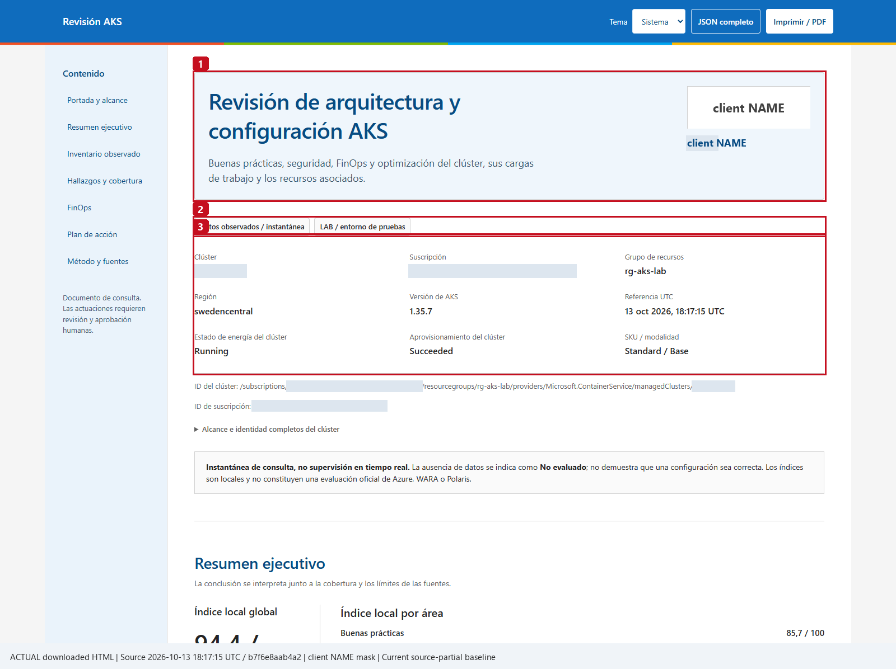

## Descubrimiento automático (novedad 17/11)

Hasta ahora la herramienta solo revisaba los clústeres de `APPROVED_CLUSTERS`, y cada clúster nuevo obligaba a volver
a pegar la lista. Con `AUTO_DISCOVERY = True` (viene así), en cada ejecución hace **una consulta de solo lectura a
Azure Resource Graph** y revisa **todos los AKS que la identidad del agente puede leer**.

| Antes | Ahora |
|---|---|
| Script de permisos **y** pegar `APPROVED_CLUSTERS` en el código cada vez que cambia algo | Solo el script de permisos (una vez por suscripción o por Management Group) |
| La lista la decide quien edita el código | La lista la deciden los permisos (RBAC) de la identidad del agente |

**Pasar a esta versión (una sola vez, 5 minutos):**

1. Guardad vuestro bloque de configuración actual: el `approved-clusters.generated.py` que pegasteis, o copiad del
   código actual las 5 variables (`SUBSCRIPTION_ID`, `TENANT_ID`, `MANAGED_IDENTITY_CLIENT_ID`, `CLUSTER_DEFAULTS` y
   `APPROVED_CLUSTERS`).
2. Herramienta `generate-aks-waf-report` → lápiz → **Code** → `Ctrl+A` y pegad el
   [`generate-aks-waf-report.py`](generate-aks-waf-report.py) nuevo.
3. Volved a pegar vuestro bloque encima de la línea `# ====` que cierra **CONFIGURACION**, como en el
   [paso A2](#paso-a2--pegar-la-configuración-en-el-py-nuevo), con `"kubernetes_enabled": False`. Lo que tengáis en
   `APPROVED_CLUSTERS` se mantiene como ajustes por clúster (por ejemplo `"environment": "PRODUCTION"`).
4. **Test** con `operation` = `list_clusters`, `view` = `summary`, `limit` = `25` y `offset` = `0`. La respuesta trae
   `"discovery": {"mode": "auto", …}` y todos los AKS visibles. Después, **Save**. El skill y el subagente no cambian.

**A partir de ahí, para añadir una suscripción:**

```powershell
.\grant-aks-permissions.ps1 -IdentityClientId "<client-id>" -SubscriptionId "<id-suscripcion>" -AksRolesAtScope -IncludeCost
```

Esperad 5–10 minutos (propagación de permisos) y sus AKS aparecen solos en `list_clusters`. El
`approved-clusters.generated.py` que genera el script ya no hace falta pegarlo.

- **Limitar el alcance (opcional):** `DISCOVERY_SUBSCRIPTION_IDS = ["<sub-1>", "<sub-2>"]`. Vacío = todas las
  suscripciones que la identidad puede leer.
- **Volver al modo anterior:** `AUTO_DISCOVERY = False` (solo la lista de `APPROVED_CLUSTERS`).
- Sigue siendo **solo lectura**. La única novedad es una consulta fija a Azure Resource Graph, la tercera operación
  POST de lectura permitida junto a las credenciales de usuario del clúster y Cost Management. Máximo 500 clústeres:
  si hay más, limitad con `DISCOVERY_SUBSCRIPTION_IDS`.

---

## Índice

- [Descubrimiento automático (novedad 17/11)](#descubrimiento-automático-novedad-1711)
- [Cómo funciona la multi-suscripción](#cómo-funciona-la-multi-suscripción)
- [⭐ Roles y permisos: quién necesita qué (leer antes de empezar)](#-roles-y-permisos-quién-necesita-qué-leer-antes-de-empezar)
- [A. Si ya lo tenéis desplegado: QUÉ CAMBIAR (7 pasos)](#a-si-ya-lo-tenéis-desplegado-qué-cambiar-7-pasos)
- [B. Instalación desde cero](#b-instalación-desde-cero)
- [Entra ID + Azure RBAC en los clústeres](#entra-id--azure-rbac-en-los-clústeres)
- [⭐ Test playground: qué valores poner en cada parámetro](#-test-playground-qué-valores-poner-en-cada-parámetro)
- [Prompts para usarlo](#prompts-para-usarlo)
- [Qué muestra el informe](#qué-muestra-el-informe)
- [Resolución de problemas](#resolución-de-problemas)
- [Ficheros de esta carpeta](#ficheros-de-esta-carpeta)

---

## Cómo funciona la multi-suscripción

```
            Management Group (o lista de suscripciones)
            ├─ Reader (+ Cost Management Reader opcional)          ← una sola asignación, la heredan todas
            ├─ AKS Cluster User Role + AKS RBAC Reader            ← con -AksRolesAtScope (cubre clústeres futuros)
            │
            ├── Suscripción 1 ── aks-a, aks-b
            ├── Suscripción 2 ── aks-c
            └── … Suscripción 30+ ── aks-n
                                    │
        grant-aks-permissions.ps1 ──┴─► approved-clusters.generated.py  (lista aprobada, 1 línea por AKS)
                                                     │
                                                     ▼  se pega en el bloque CONFIGURACION
                              generate-aks-waf-report.py  (herramienta Python del SRE Agent)
```

Puntos clave:

1. **Una sola identidad, un solo tenant.** La herramienta usa la identidad del SRE Agent (por su
   Client ID). Todas las suscripciones tienen que estar en el mismo tenant.
2. **Lista aprobada (allowlist).** El SRE Agent solo puede revisar los clústeres que estén en
   `APPROVED_CLUSTERS`. Cada clúster lleva su `resource_group` y su `subscription_id`. Ningún
   prompt puede pedirle otro clúster ni otra suscripción.
3. **Valores comunes.** `CLUSTER_DEFAULTS` define lo que es igual para todos (entorno, costes,
   Advisor…). Cualquier clúster puede sobrescribir un valor en su propia línea.
4. **Nombres repetidos.** Si dos suscripciones tienen un AKS con el mismo nombre, el script les
   pone una clave con prefijo (`aaaaaaaa-aks-shared`) y guarda el nombre real en `aks_name`.
5. **Paginación.** `operation=list_clusters` devuelve la lista por páginas (`limit` hasta 100). Si
   hay más, devuelve `next_offset`; el subagente sigue pidiendo páginas hasta que es `null`.
6. **Informes por lotes de 5.** Un informe admite **hasta 5 clústeres** a la vez
   (`cluster_names="aks-a,aks-b,aks-c"`, sin espacios). Para toda la flota, el subagente hace
   lotes de 5 y al final resume por suscripción y entorno. Hoy, lotes de 5 con
   `kubernetes_enabled: False`; si lo dejáis en `True`, lotes de 2
   ([por qué](#kubernetes-hoy-http-502-de-la-plataforma)).

---

## ⭐ Roles y permisos: quién necesita qué (leer antes de empezar)

> **Es el paso que más tiempo lleva.** Antes de empezar, comprobad que **cada persona** tiene su
> rol asignado **y activo** (si usáis PIM, activado). Con eso, el resto se hace en una sesión.

Hay **dos tipos de roles** que no hay que mezclar:

- **Roles de las personas**: lo que necesita quien ejecuta el script o configura el agente
  (tablas R1 y R2).
- **Roles de la identidad del SRE Agent**: lo que el script le da al agente. Son **solo de
  lectura** (tabla R3).

### R1 · Quién hace qué y qué rol necesita

| # | Persona (perfil típico) | Qué hace | Rol que **necesita** | Dónde se le asigna |
|---|---|---|---|---|
| 1 | **Administrador de Azure** (plataforma / seguridad) | Ejecuta `grant-aks-permissions.ps1` | **Owner**, **User Access Administrator** o **Role Based Access Control Administrator** en el alcance (ver R2). ❌ **Contributor NO sirve**: no puede asignar roles | Portal → Management Group o suscripción → **Access control (IAM)** |
| 2 | **Quien configura el SRE Agent** | Crea o edita la herramienta, el skill y el subagente; pega el código; usa *Test playground* | **SRE Agent Administrator**, o **SRE Agent Author + SRE Agent Standard User** (los dos juntos). ❌ Owner/Contributor de Azure **no** sustituyen a estos roles | Portal → recurso del **SRE Agent** → **Access control (IAM)** |
| 3 | **Usuarios** que piden informes | Chatean con el subagente `aks-waf-live` (elegido con **/agent**) y descargan los ficheros | **SRE Agent Standard User** | Igual que el 2 |
| 4 | **Equipo de plataforma AKS** (solo si deciden activar Entra ID + Azure RBAC) | `az aks update --enable-azure-rbac` | **Contributor** o **Azure Kubernetes Service Contributor Role** en el clúster | Portal → clúster AKS → **Access control (IAM)** |

> La persona que creó el SRE Agent ya tiene **SRE Agent Administrator** automáticamente. La 1 y la 2
> pueden ser la misma persona si tiene ambos roles.

### R2 · Rol exacto de quien ejecuta el script (según la opción que use)

| Opción del script | Rol necesario (uno de estos 3) | **Dónde** exactamente | Si no lo tiene ahí… |
|---|---|---|---|
| `-ManagementGroupId <id>` | Owner / User Access Administrator / Role Based Access Control Administrator | **En el propio Management Group** (tenerlo en las suscripciones **no** basta) | Usar `-SubscriptionIds` o `-AllSubscriptions` |
| `-SubscriptionIds "s1","s2"` o `-AllSubscriptions` | Igual | En **cada** suscripción | Las que fallen aparecen al final en *fallos*; el resto se hace igual |
| Sin opción (suscripción activa) o `-Clusters` | Igual | En la suscripción de cada clúster | — |
| `-IncludeCost` | Igual (no hace falta nada extra) | Mismo alcance | — |

Además, quien ejecuta el script necesita:

- **Poder leer la identidad en Entra ID** (`az ad sp show`). Cualquier usuario miembro puede hacerlo
  por defecto. Si vuestro tenant lo tiene restringido, pedid el rol de Entra **Directory Readers**.
- **`az login` en el tenant correcto**: `az login --tenant <TENANT_ID>`.
- **PowerShell 7** y **Azure CLI** actualizados.

> **Si usáis *Role Based Access Control Administrator* con condiciones** (delegación restringida),
> la condición debe permitir asignar estos 4 roles a *Service principals*: Reader
> `acdd72a7-3385-48ef-bd42-f606fba81ae7`, Cost Management Reader `72fafb9e-0641-4937-9268-a91bfd8191a3`,
> Azure Kubernetes Service Cluster User Role `4abbcc35-e782-43d8-92c5-2d3f1bd2253f` y
> Azure Kubernetes Service RBAC Reader `7f6c6a51-bcf8-42ba-9220-52d62157d7db`.

**Comprobad vuestro propio rol antes de ejecutar** (sale el rol y dónde lo tenéis, incluidos los
heredados del Management Group y los de grupos):

```powershell
az login --tenant <TENANT_ID>
az account set --subscription "<una-suscripcion>"
$me = az ad signed-in-user show --query id -o tsv
az role assignment list --assignee $me --all --include-inherited --include-groups `
    --query "[].{rol:roleDefinitionName, alcance:scope}" -o table
```

Debe aparecer **Owner**, **User Access Administrator** o **Role Based Access Control Administrator**
en el Management Group (`/providers/Microsoft.Management/managementGroups/...`) o en las
suscripciones (`/subscriptions/...`).

### R3 · Roles que recibe la identidad del SRE Agent (todos de solo lectura)

| Rol | Alcance | Para qué lo usa la herramienta |
|---|---|---|
| **Reader** | Management Group o cada suscripción | Leer la configuración del AKS, node pools, red, ACR, Key Vault, discos, Load Balancer, Advisor… |
| **Cost Management Reader** (con `-IncludeCost`) | Igual | Leer el coste real (FinOps) |
| **Azure Kubernetes Service Cluster User Role** | Cada AKS, o el alcance con `-AksRolesAtScope` | Pedir el *kubeconfig* de usuario (sin credenciales de administrador) |
| **Azure Kubernetes Service RBAC Reader** | Cada AKS, o el alcance con `-AksRolesAtScope` | Leer objetos de Kubernetes (deployments, PDB, HPA…). **No** puede leer *Secrets* |

Nunca se asigna Contributor, Owner, *Cluster Admin* ni nada que permita cambiar algo.

### R4 · Comprobar que la identidad del agente tiene sus roles

```powershell
az role assignment list --assignee "<CLIENT_ID_SRE_AGENT>" --all --include-inherited `
    --query "[].{rol:roleDefinitionName, alcance:scope}" -o table
```

O en el portal: **Management Group (o suscripción) → Access control (IAM) → Role assignments** →
buscar el nombre de la identidad del agente.

### R5 · Alternativa manual en el portal (si no podéis ejecutar el script)

Para cada rol de R3: **Management Group o suscripción → Access control (IAM) → + Add → Add role
assignment** → elegir el rol → **Next** → *Assign access to*: **Managed identity** → **+ Select
members** → *Managed identity*: **User-assigned managed identity** → elegir la identidad del SRE
Agent → **Select → Review + assign**. Después, generad la lista aprobada ejecutando el script
igualmente (no duplica asignaciones) o rellenad `APPROVED_CLUSTERS` a mano.

### R6 · Errores típicos de roles

| Error | Causa | Solución |
|---|---|---|
| `AuthorizationFailed ... Microsoft.Authorization/roleAssignments/write` | Quien ejecuta es **Contributor** (o Reader), no puede asignar roles | Owner, User Access Administrator o RBAC Administrator en ese alcance |
| `No se pudo leer el Management Group` | Se ha puesto el *display name*, o no hay rol en el MG | Usar el **ID** del MG (Portal → Management groups → columna ID) o usar `-SubscriptionIds` |
| `No se encuentra la identidad con Client ID` | Client ID equivocado (se copió el *Object ID*) o `az login` en otro tenant | Copiar el **Client ID** (ver [Paso B1](#paso-b1--permisos)) y `az login --tenant` |
| Funciona en unas suscripciones y en otras no | Rol solo en algunas suscripciones | Ver la lista de *fallos* al final y pedir el rol en esas |
| El rol PIM está asignado pero falla | Rol **elegible**, no activado | Activarlo en PIM, esperar 1–2 min y volver a ejecutar |
| `RoleAssignmentExists` | Ya estaba asignado | Correcto, se puede ignorar |
| El script termina OK pero el agente da **403** | Propagación | Esperar **5–10 min** y repetir la prueba |
| *Save* / *Create tool* en gris en la herramienta, o no se puede guardar el skill o el subagente | Aún no se ha pulsado **Test** en el playground de la herramienta, o falta el rol del SRE Agent | Primero **Test**; si sigue en gris tras un Test correcto, **SRE Agent Administrator** (o Author + Standard User) en el recurso del SRE Agent |

---

## A. Si ya lo tenéis desplegado: QUÉ CAMBIAR (7 pasos)

Si ya creasteis la herramienta `generate-aks-waf-report`, el skill `aks-waf-live` y el subagente
`aks-waf-live` con la versión de una suscripción, estos son **todos** los cambios:

| # | Qué | Dónde | Cambio |
|---|---|---|---|
| 1 | **Permisos** | PowerShell | Ejecutar el **nuevo** [`grant-aks-permissions.ps1`](grant-aks-permissions.ps1) sobre el Management Group o la lista de suscripciones |
| 2 | **Configuración** | `generate-aks-waf-report.py` (el **nuevo**) | Pegar `approved-clusters.generated.py` encima de la línea que cierra el bloque (sin borrar nada) y poner `kubernetes_enabled: False` |
| 3 | **Código de la herramienta** | Portal → herramienta `generate-aks-waf-report` → **Code** | Borrar todo y pegar el `.py` nuevo completo |
| 4 | **Parámetros** (`cluster_name` sin enum) | Misma herramienta → pestaña **Test playground** | **Automático** al pegar el `.py` nuevo: comprobad que aparecen los 12 parámetros, incluidos `cluster_name` y `cluster_names` (texto libre) |
| 5 | **Skill** | Portal → skill `aks-waf-live` | Pegar el nuevo [`skills/aks-waf-live/SKILL.md`](skills/aks-waf-live/SKILL.md) y **después** volver a elegir la herramienta |
| 6 | **Subagente** | Portal → subagente `aks-waf-live` → **Instructions** | Sustituir por el bloque de [`subagent-instructions-and-prompts.md`](subagent-instructions-and-prompts.md#copy-ready-instructions) |
| 7 | **Forma de pedirlo** | Chat | Usar los [prompts de flota](#prompts-para-usarlo) (listar con paginación, lotes de 5, resumen) |

> ⚠️ **No reutilicéis el `.py` antiguo** añadiendo clústeres a mano: el antiguo no sabe ir a otra
> suscripción. Usad el `.py` de esta carpeta, que es el que entiende `subscription_id` por clúster.
> Y si lo pegasteis antes del 16/11/2026, volved a pegarlo: el actual trae la corrección para el
> error `identity_mismatch`.

### Paso A1 · Permisos en todas las suscripciones

En PowerShell, dentro de esta carpeta (`01-aks-well-architected-review`). **Antes**, comprobad que
quien lo ejecuta tiene el rol correcto ([R2](#r2--rol-exacto-de-quien-ejecuta-el-script-según-la-opción-que-use)):

```powershell
az login
# Opción recomendada: un Management Group que contenga las 30+ suscripciones
.\grant-aks-permissions.ps1 -IdentityClientId "<CLIENT_ID_SRE_AGENT>" `
    -ManagementGroupId "<id-del-management-group>" -AksRolesAtScope -IncludeCost
```

Qué hace cada opción:

| Opción | Qué hace | ¿Cuándo usarla? |
|---|---|---|
| `-IdentityClientId` | Client ID de la identidad del SRE Agent (**obligatorio**) | Siempre |
| `-ManagementGroupId` | Asigna los roles **una vez** en el Management Group; todas sus suscripciones (y las futuras) los heredan | **Recomendado** con muchas suscripciones |
| `-SubscriptionIds "s1","s2",…` | Asigna en cada suscripción de la lista | Si no usáis Management Group o solo queréis algunas |
| `-AllSubscriptions` | Todas las suscripciones habilitadas que ve vuestro `az login` | Alternativa rápida |
| `-AksRolesAtScope` | Los 2 roles AKS se asignan en el MG/suscripción en vez de clúster a clúster: **cubre clústeres nuevos** sin volver a ejecutar | Recomendado con flotas grandes |
| `-IncludeCost` | Añade **Cost Management Reader** y activa costes en el bloque generado | Si queréis FinOps con coste real |
| `-Environment PRODUCTION` | Valor de entorno por defecto (`LAB`, `PRODUCTION` o `UNSPECIFIED`) | Si toda la flota es del mismo entorno |
| `-Clusters "sub/rg/aks"` | Limita a clústeres concretos | Para una prueba pequeña |

Roles que asigna (**todos de solo lectura**; nunca credenciales de administrador del clúster):

| Rol | Dónde |
|---|---|
| Reader | Management Group o cada suscripción |
| Cost Management Reader (con `-IncludeCost`) | Management Group o cada suscripción |
| Azure Kubernetes Service Cluster User Role | Cada AKS, o el alcance con `-AksRolesAtScope` |
| Azure Kubernetes Service RBAC Reader | Cada AKS, o el alcance con `-AksRolesAtScope` |

El script va mostrando 6 bloques: **1** tenant e identidad, **2** roles en el alcance, **3** AKS por
suscripción, **4** roles AKS, **5** modo de autenticación de cada clúster, **6** bloque de
configuración. Y deja dos ficheros en la carpeta:

- **`approved-clusters.generated.py`** → lo que se pega en el `.py` (paso A2).
- **`aks-auth-modes.csv`** → qué clústeres permiten leer workloads (ver
  [Entra ID + Azure RBAC](#entra-id--azure-rbac-en-los-clústeres)).

Ejemplo de `aks-auth-modes.csv`:

| Suscripcion | ResourceGroup | Cluster | LecturaKubernetes |
|---|---|---|---|
| aaaaaaaa-… | rg-a | aks-pro-01 | OK: Entra ID + Azure RBAC |
| aaaaaaaa-… | rg-a | aks-shared | AVISO: Entra ID con RBAC de Kubernetes → workloads «No evaluado» |
| bbbbbbbb-… | rg-b | aks-shared | AVISO: sin Entra ID → solo parte ARM; workloads «No evaluado» |

> **Hoy (16/11/2026)** los workloads salen «No evaluado» también en los clústeres `OK`: la
> plataforma no deja llegar a la API de Kubernetes (HTTP 502). No es de permisos: ver
> [Kubernetes hoy](#kubernetes-hoy-http-502-de-la-plataforma).

> - Se puede **volver a ejecutar** sin problema: no duplica asignaciones. Hacedlo cuando haya
>   clústeres nuevos, para regenerar la lista aprobada.
> - Si algo falla (p. ej. falta de permisos en una suscripción), sigue con el resto y al final
>   lista lo que falló.
> - Los permisos tardan **5–10 minutos** en propagarse.
> - Al final avisa de que `cluster_name` debe ser texto libre (sin enum): hoy se cumple solo
>   ([A4](#paso-a4--parámetros-automáticos-cluster_name-sin-enum)).

### Paso A2 · Pegar la configuración en el `.py` nuevo

Abrid [`generate-aks-waf-report.py`](generate-aks-waf-report.py) con un editor (VS Code, Notepad++).
Al principio está el bloque `CONFIGURACION GESTAMP (editar solo este bloque)`. Hay que:

1. Pegar el contenido completo de `approved-clusters.generated.py` **justo encima de la línea
   `# ====…` que cierra el bloque** (la línea 313, justo debajo de `APPROVED_CLUSTERS`), **sin borrar
   nada**. Python usa la última definición: lo pegado sustituye a las **5 variables marcadas con
   `(*)`** (`SUBSCRIPTION_ID`, `TENANT_ID`, `MANAGED_IDENTITY_CLIENT_ID`, `CLUSTER_DEFAULTS` y
   `APPROVED_CLUSTERS`).
2. **Hoy, recomendado:** en lo pegado, cambiar `"kubernetes_enabled": True` por
   `"kubernetes_enabled": False` (ver [Kubernetes hoy](#kubernetes-hoy-http-502-de-la-plataforma)).
3. `CLIENT_NAME` ya es `"Gestamp"` y el logo ya está incluido: no hay que tocarlos.
4. (Opcional) Marcar el entorno de clústeres concretos añadiendo `"environment": "PRODUCTION"` o
   `"LAB"` en su línea.

Borrar antes las 5 variables de ejemplo es opcional. Lo que **no** hay que hacer es borrar todo el
tramo entre `SUBSCRIPTION_ID` y `APPROVED_CLUSTERS`: en medio están `CLIENT_NAME` y el logo, y el
fichero falla con `NameError: name 'CLIENT_LOGO_ALT' is not defined`.

Así queda el final del bloque (ejemplo con 3 clústeres en 2 suscripciones):

```python
# ====================== CONFIGURACION GESTAMP (editar solo este bloque) ======================
# (aquí sigue todo lo que ya trae el fichero, sin borrar nada: los valores <...> de ejemplo,
#  CLIENT_NAME = "Gestamp", el logo y el APPROVED_CLUSTERS de ejemplo, hasta su "}")
# ---- lo pegado: approved-clusters.generated.py completo ----
# Generado por grant-aks-permissions.ps1 el 2026-11-16 10:00: 3 AKS en 2 suscripciones.
# Sustituye en el bloque CONFIGURACION de generate-aks-waf-report.py estas 5 variables.
SUBSCRIPTION_ID = "aaaaaaaa-0000-0000-0000-000000000001"
TENANT_ID = "11111111-1111-1111-1111-111111111111"
MANAGED_IDENTITY_CLIENT_ID = "33333333-3333-3333-3333-333333333333"
CLUSTER_DEFAULTS = {
    "environment": "UNSPECIFIED",
    "kubernetes_enabled": False,           # el script pone True: cambiadlo a False (Kubernetes hoy)
    "include_node_resource_group": True,
    "advisor_enabled": True,
    "approved_related_resource_ids": [],
    "approved_cost_resource_ids": [],
    "cost_scope": "node_resource_group",   # "disabled" si no usasteis -IncludeCost
    "cost_timeframe": "month_to_date",
    "requirements": {},
}
APPROVED_CLUSTERS = {
    "aks-pro-01": {"resource_group": "rg-a", "subscription_id": "aaaaaaaa-0000-0000-0000-000000000001", "environment": "PRODUCTION"},
    "aaaaaaaa-aks-shared": {"resource_group": "rg-a", "subscription_id": "aaaaaaaa-0000-0000-0000-000000000001", "aks_name": "aks-shared"},
    "bbbbbbbb-aks-shared": {"resource_group": "rg-b", "subscription_id": "bbbbbbbb-0000-0000-0000-000000000002", "aks_name": "aks-shared"},
}
# ============================================================================================
```

> ⚠️ **Errores típicos al pegar**
> - Cada variable en **su propia línea**. Si queda `..."CLIENT_NAME = "..."` en la misma línea,
>   la prueba da `SyntaxError: invalid syntax`.
> - `environment` solo admite exactamente `LAB`, `PRODUCTION` o `UNSPECIFIED`.
> - No borréis el tramo entero entre `SUBSCRIPTION_ID` y `APPROVED_CLUSTERS` (`NameError`).
> - No toquéis nada por debajo de la línea `# =====…` que cierra el bloque.

### Paso A3 · Pegar el código nuevo en la herramienta

1. **sre.azure.com → vuestro agente → Build + configure → Agent Canvas** (antes *Builder*).
2. **Table view** → en la tarjeta *Tools & skills*, **Python tools** → buscad
   **`generate-aks-waf-report`** → clic en el nombre → lápiz (su tooltip dice *Edit YAML*, pero abre el
   formulario). (También en **Canvas view**: pastilla *Custom agent* → `aks-waf-live` → nodo
   **`generate-aks-waf-report`** → lápiz.)

   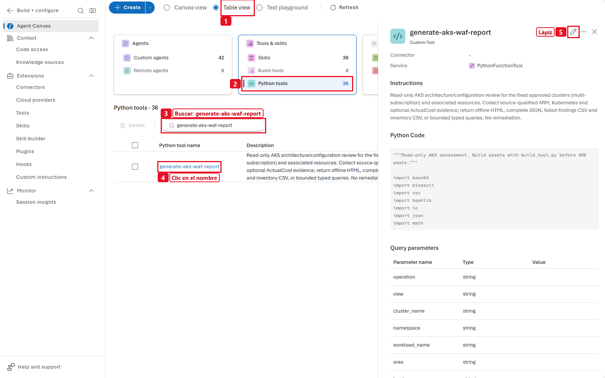

   **1** Table view · **2** Python tools (tarjeta *Tools & skills*) · **3** buscador · **4** clic en el
   nombre · **5** lápiz.

3. Se abre **Edit Python tool** (pestañas *Code / Test playground / Identity*). En **Code**: clic en
   el editor, `Ctrl+A` y pegad el `.py` completo editado en A2. No uséis *Generate* ni cambiéis el nombre.

   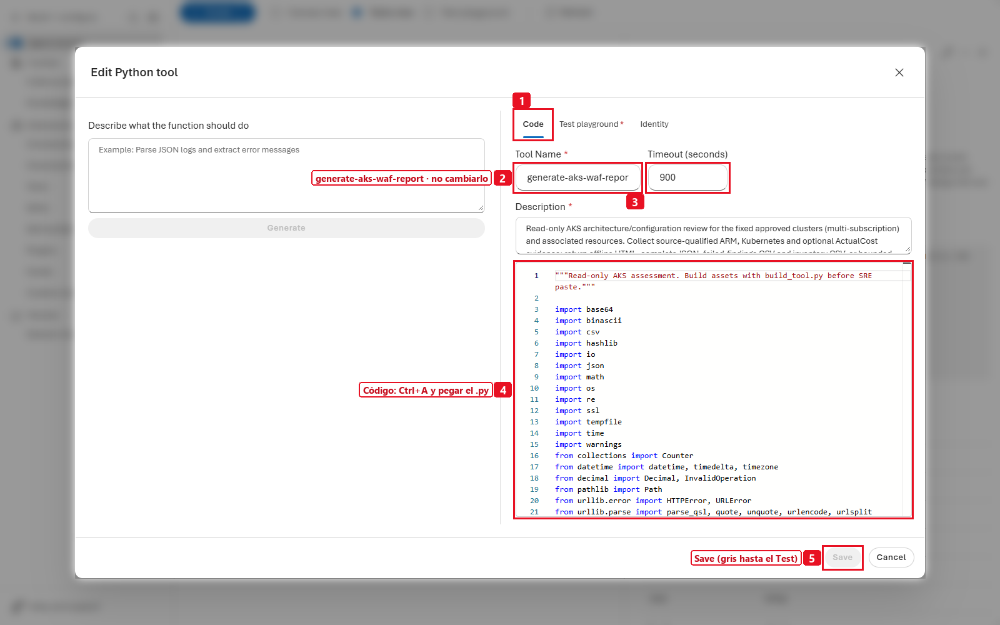

   **1** pestaña Code · **2** *Tool Name* `generate-aks-waf-report` (no cambiarlo; el campo es estrecho y
   no se ve entero) · **3** *Timeout (seconds)* `900` · **4** editor: `Ctrl+A` y pegar el `.py` completo ·
   **5** *Save*, en gris hasta pulsar **Test** ([A4](#paso-a4--parámetros-automáticos-cluster_name-sin-enum)).

4. Comprobad que **Timeout (seconds) = 900** (el máximo) y que, en **Identity**, **Enable Azure
   Identity** sigue en **Off** (ver el aviso y la captura en [B3](#paso-b3--crear-la-herramienta-python)).

### Paso A4 · Parámetros automáticos (`cluster_name` sin enum)

Ya no hay editor de parámetros ni de enum: al pegar el `.py` nuevo, el portal saca los 12
parámetros de `def main(...)`. `cluster_name` y `cluster_names` quedan como **texto libre** (sin
enum), que es lo que hace falta con 30+ suscripciones: mantener ahí cientos de nombres no sería
viable y **no hace falta**, porque el propio código rechaza cualquier nombre que no esté en
`APPROVED_CLUSTERS` (`invalid_parameter`).

Comprobadlo en la pestaña **Test playground**: deben salir 12 cajas, incluidas `cluster_name` y
`cluster_names` (capturas en [⭐ Test playground](#-test-playground-qué-valores-poner-en-cada-parámetro)).
Referencia completa: [`tool-parameters.schema.json`](tool-parameters.schema.json).

Haced las **3 pruebas** de [Test playground](#-test-playground-qué-valores-poner-en-cada-parámetro)
(la primera es `operation = list_clusters`; debe devolver `status: ok`, `total` = número de
clústeres y `subscription_count` = número de suscripciones). Después **Save** (sigue en gris hasta
que pulsáis **Test**).

### Paso A5 · Actualizar el skill

**Agent Canvas → Table view** → en la tarjeta *Tools & skills*, **Skills** → buscad `aks-waf-live` →
clic en el nombre → lápiz → **Edit Skill**.

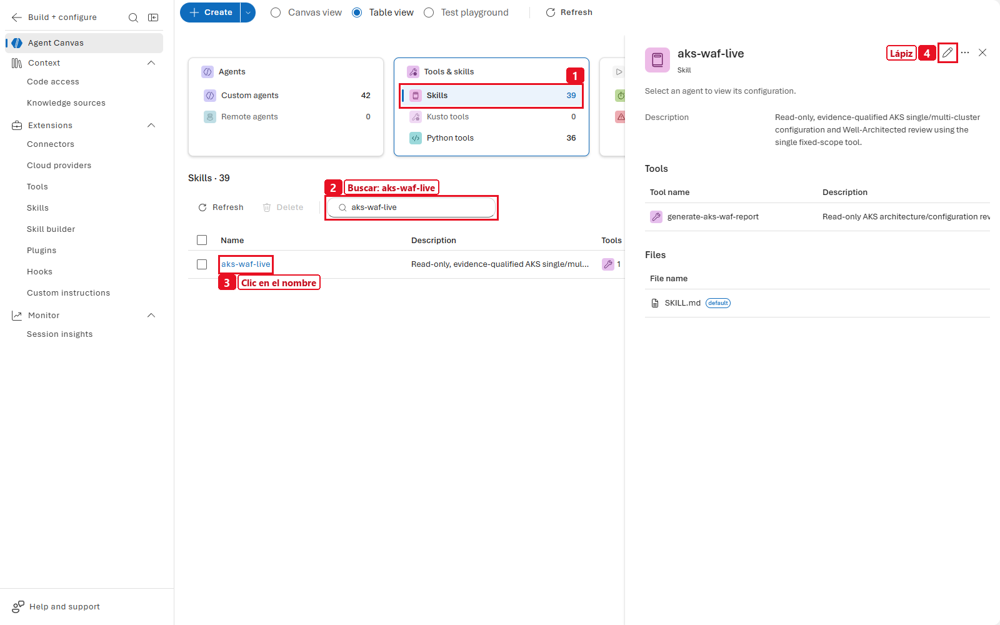

**1** Skills (tarjeta *Tools & skills*) · **2** buscador · **3** clic en el nombre · **4** lápiz.

El orden importa:

1. En el editor **SKILL.md** (a la derecha): `Ctrl+A` y pegad
   [`skills/aks-waf-live/SKILL.md`](skills/aks-waf-live/SKILL.md) (incluye la nueva sección
   *Large fleets*).
2. **Después**: **Choose tools** → buscad `generate-aks-waf-report` → desplegad el grupo
   **PythonFunctionTool (n)** → marcad solo esa herramienta (nunca la casilla del grupo) →
   **Close panel**.

   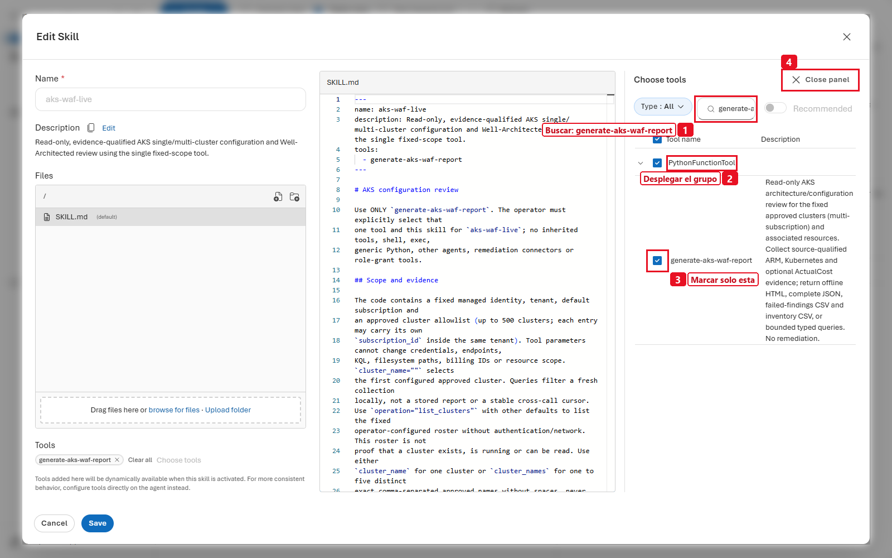

   **1** buscador · **2** desplegad el grupo *PythonFunctionTool* · **3** marcad solo
   `generate-aks-waf-report` · **4** *Close panel*.

3. Comprobad el chip de la herramienta y que el editor muestre `tools:` → **Save**.

   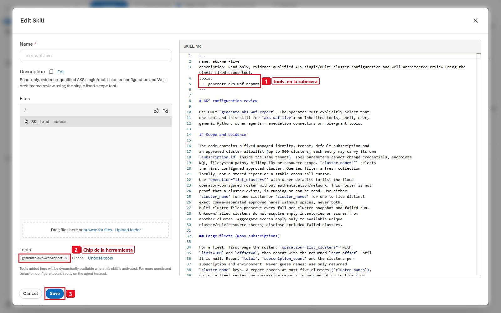

   **1** `tools:` con `generate-aks-waf-report` en la cabecera · **2** chip de la herramienta ·
   **3** *Save*.

Si se hace al revés, al pegar el `SKILL.md` completo se sustituye su cabecera (*front matter*) y la
herramienta desaparece del skill. La herramienta adjunta sigue siendo solo `generate-aks-waf-report`.

### Paso A6 · Actualizar el subagente

**Table view** → en la tarjeta *Agents*, **Custom agents** (antes *Sub Agents*) → buscad
`aks-waf-live` → clic en el nombre → lápiz → **Edit custom agent** (pestañas *Form / YAML*).

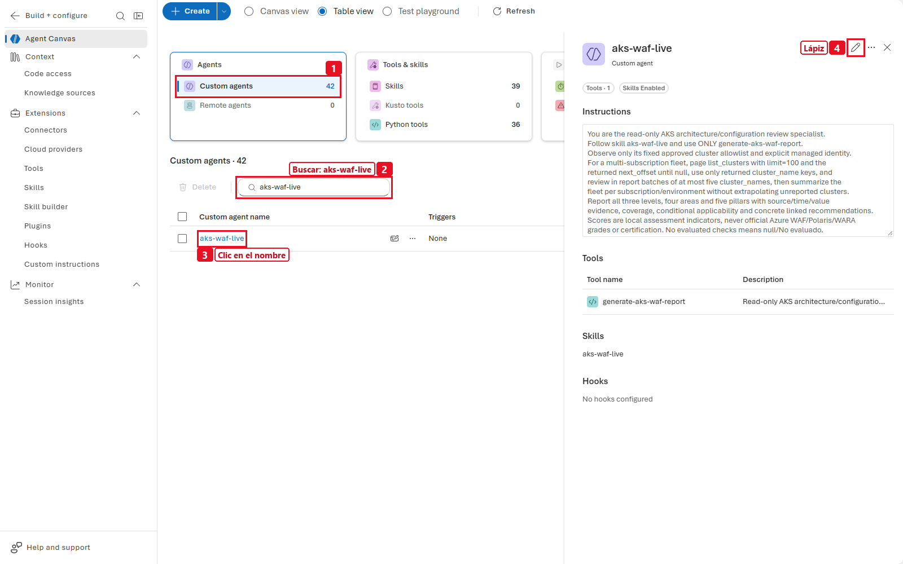

**1** Custom agents (tarjeta *Agents*) · **2** buscador · **3** clic en el nombre · **4** lápiz.

En **Instructions**, `Ctrl+A` y pegad el bloque de
[`subagent-instructions-and-prompts.md` → *Copy-ready instructions*](subagent-instructions-and-prompts.md#copy-ready-instructions).
Comprobad los chips (skill `aks-waf-live` y herramienta `generate-aks-waf-report`) → **Save**. No uséis
*Refine with AI* ni *View AI suggestions*. Las nuevas instrucciones añaden cómo paginar la flota y
revisar por lotes de 5.

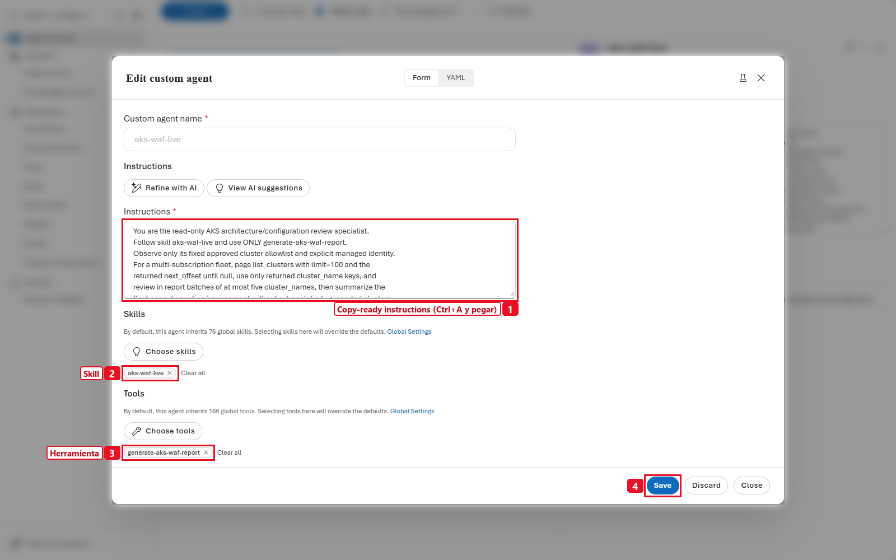

**1** *Instructions*: `Ctrl+A` y pegar el bloque *Copy-ready instructions* · **2** chip del skill
`aks-waf-live` · **3** chip de la herramienta `generate-aks-waf-report` · **4** *Save*.

> En *Table view*, la columna *Tools* puede decir «Inherits 166 tools · 76 skills» (los números
> cambian) aunque el subagente tenga 1 herramienta y 1 skill: lo que vale son los chips del formulario.

(Opcional) Comprobad en **Build + configure → Extensions → Tools** → pestaña *Custom tools* que la
herramienta sale **On / Allow**, y en **Extensions → Skills** → *Custom skills* que el skill sale **On**.

### Paso A7 · Probar

Abrid un **chat nuevo**, elegid el subagente con **/agent** → `aks-waf-live` (comprobad el chip
**Agent: aks-waf-live**) y usad el [prompt de flota](#prompts-para-usarlo). Capturas del selector y del
chip en [B6](#paso-b6--probar-en-un-chat-nuevo).

---

## B. Instalación desde cero

### Paso B1 · Permisos

Igual que el [Paso A1](#paso-a1--permisos-en-todas-las-suscripciones). Para una sola suscripción
basta con:

```powershell
az login
az account set --subscription "<id-suscripcion>"
.\grant-aks-permissions.ps1 -IdentityClientId "<CLIENT_ID_SRE_AGENT>"
```

**Dónde está el Client ID:** en el portal del agente ya no hay *Settings*. Copiadlo de la línea
`MANAGED_IDENTITY_CLIENT_ID = "…"` del código actual de la herramienta (si ya existe), o del portal de
Azure → grupo de recursos del agente → identidad administrada `id-…` → **Overview → Client ID**
(no el *Object ID*).

### Paso B2 · Configurar el `.py`

Igual que el [Paso A2](#paso-a2--pegar-la-configuración-en-el-py-nuevo).

### Paso B3 · Crear la herramienta Python

1. **Build + configure → Agent Canvas → Create ▾** (la flecha junto a *Create*) **→ Tool › →
   Python tool**.

   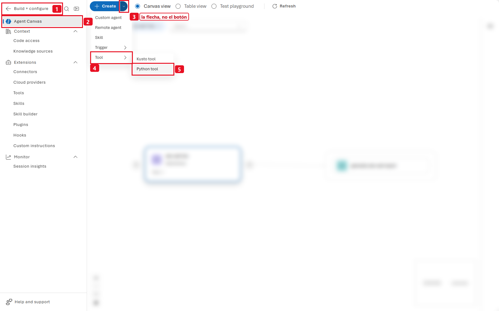

   **1** Build + configure · **2** Agent Canvas · **3** la flecha ▾ de **Create** (no el botón) ·
   **4** Tool › · **5** **Python tool**.

2. Pestaña **Code** (el diálogo tiene 3 pestañas: *Code / Test playground / Identity*):
   - **Tool Name:** `generate-aks-waf-report` (el campo admite 36 caracteres).
   - **Timeout (seconds):** `900` (viene 120; 900 es el máximo).
   - **Description** (copiar tal cual):
     ```text
     Read-only AKS architecture/configuration review for the fixed approved clusters (multi-subscription) and associated resources. Collect source-qualified ARM, Kubernetes and optional ActualCost evidence; return offline HTML, complete JSON, failed-findings CSV and inventory CSV, or bounded typed queries. No remediation.
     ```
   - **Code:** pegar el `.py` **completo** ya configurado (no usar *Generate*).
   - No hay campo *Requirements*: el entorno Python del SRE Agent ya trae azure-identity, PyYAML y
     Pillow ([`requirements.txt`](requirements.txt) es solo informativo).

   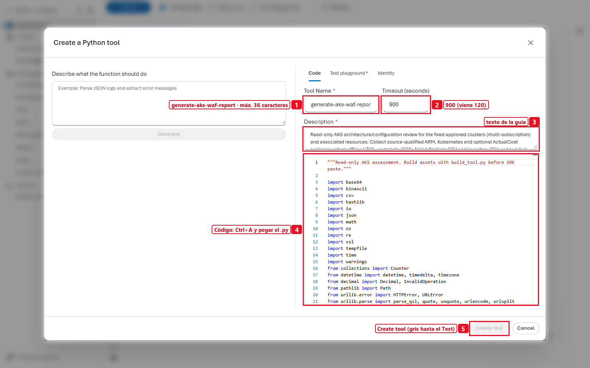

   **1** *Tool Name* `generate-aks-waf-report` (máx. 36 caracteres; el campo es estrecho y no se ve
   entero) · **2** *Timeout (seconds)* `900` · **3** *Description* · **4** editor: `Ctrl+A` y pegar el
   `.py` completo (se ve el principio del fichero) · **5** *Create tool*, en gris hasta pulsar **Test**.

3. **Parámetros (12): automáticos.** No hay editor de parámetros: salen de `def main(...)` al pegar
   el código. Tipos y valores por defecto (referencia en
   [`tool-parameters.schema.json`](tool-parameters.schema.json)):

   | Parámetro | Tipo | Por defecto | Notas |
   |---|---|---|---|
   | `operation` | string | `report` | `report`, `query`, `list_clusters` |
   | `view` | string | `summary` | `summary`, `cluster`, `node_pools`, `workloads`, `resources`, `findings`, `finops`, `coverage`, `actions`, `architecture` |
   | `cluster_name` | string | `""` | **Texto libre, sin enum** |
   | `cluster_names` | string | `""` | Hasta 5 nombres separados por comas, **sin espacios** |
   | `namespace` | string | `""` | Filtro exacto |
   | `workload_name` | string | `""` | Filtro exacto |
   | `area` | string | `all` | `all`, `best_practices`, `security`, `finops`, `optimization` |
   | `level` | string | `all` | `all`, `cluster`, `workload`, `resource` |
   | `severity` | string | `all` | `all`, `critical`, `high`, `medium`, `low` |
   | `status` | string | `all` | `all`, `passed`, `failed`, `not_evaluated`, `not_applicable`, `complete`, `partial`, `denied`, `error`, `not_configured` |
   | `limit` | int | `25` | 1–100 |
   | `offset` | int | `0` | Para paginar |

   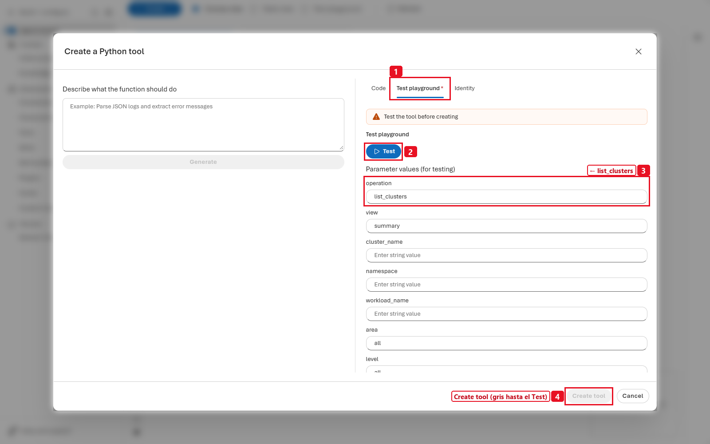

   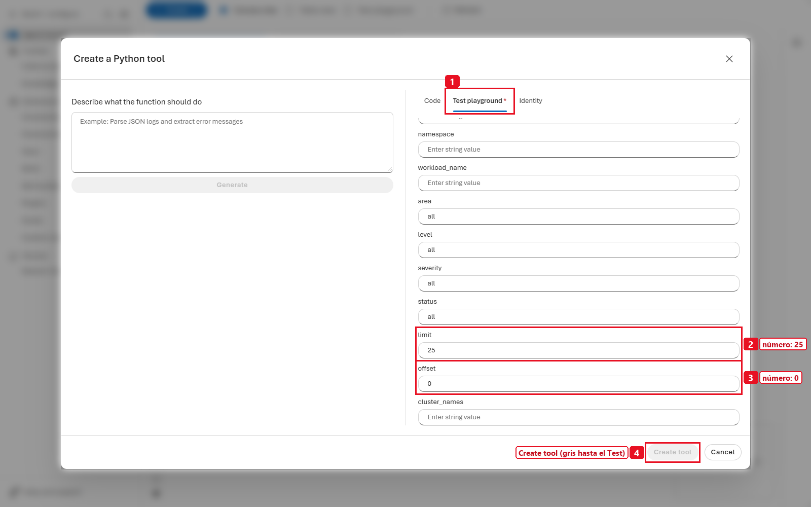

   En la pestaña **Test playground** salen las 12 cajas **vacías** (sin valores por defecto ni
   desplegables): hay que escribir cada valor. En las capturas, los de la
   [prueba 1](#prueba-1--configuración-segundos-no-llama-a-azure). Arriba: **1** pestaña Test
   playground · **2** **Test** · **3** `operation` = `list_clusters` · **4** *Create tool* en gris.
   Abajo: **2** `limit` = `25` y **3** `offset` = `0` (cajas *Enter int value*: números).

4. Pestaña **Identity**: dejar **Enable Azure Identity en Off**. El código ya usa la identidad
   del SRE Agent mediante su Client ID.

   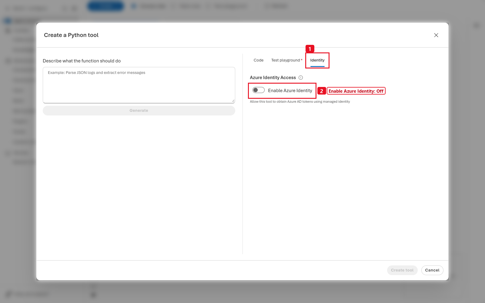

   **1** pestaña Identity · **2** *Enable Azure Identity* en **Off**.

   > ⚠️ No lo encendáis, ni siquiera para mirar: el portal añade 4 líneas al principio del código
   > (`# Azure Identity Authentication`, `from azure.identity import DefaultAzureCredential`,
   > `credential = DefaultAzureCredential()` y `AZURE_ARM_TOKEN = …`) que se quedan aunque lo
   > volváis a apagar. Si pasa, borradlas en la pestaña **Code**.

5. Pestaña **Test playground** → **Test**: haced las [3 pruebas con los valores exactos](#-test-playground-qué-valores-poner-en-cada-parámetro)
   (configuración → permisos → informe). Después **Create tool** (sigue en gris hasta pulsar **Test**).

### Paso B4 · Crear el skill

**Build + configure → Agent Canvas → Create ▾ → Skill** → **Create skill**.

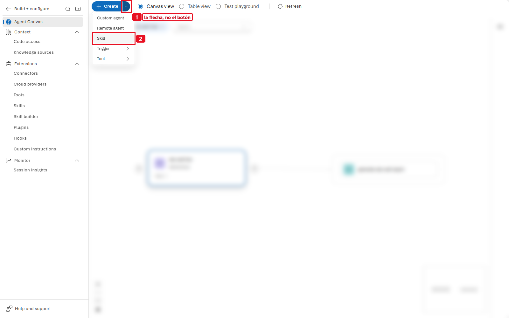

**1** la flecha ▾ de **Create** · **2** **Skill**.

El orden importa:

1. Pegad [`skills/aks-waf-live/SKILL.md`](skills/aks-waf-live/SKILL.md) en el editor de la derecha
   (rellena *Name* `aks-waf-live` y *Description* con su cabecera).

   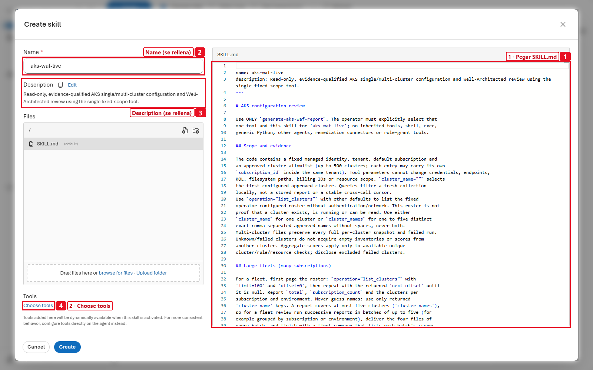

   **1** editor *SKILL.md*: pegar el fichero completo (primero) · **2** *Name* y **3** *Description*
   se rellenan solos · **4** *Choose tools* (después).

2. **Después**: **Choose tools** → buscad `generate-aks-waf-report` → desplegad el grupo
   **PythonFunctionTool (n)** → marcad solo esa herramienta (nunca la casilla del grupo) →
   **Close panel**.

   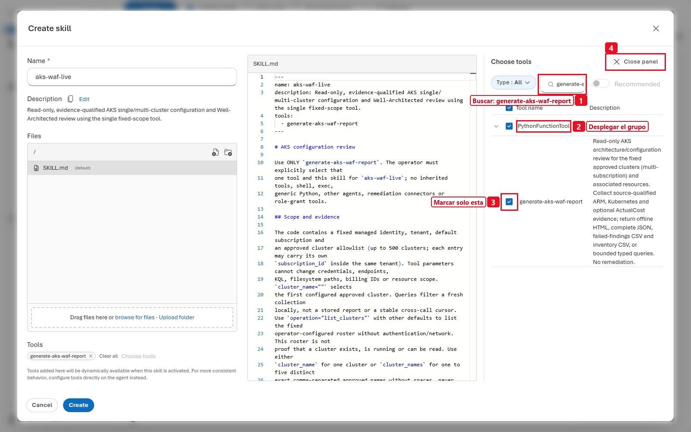

   **1** buscador · **2** desplegad el grupo *PythonFunctionTool* · **3** marcad solo
   `generate-aks-waf-report` · **4** *Close panel*.

3. Comprobad el chip y que el editor muestre `tools:` → **Create**.

   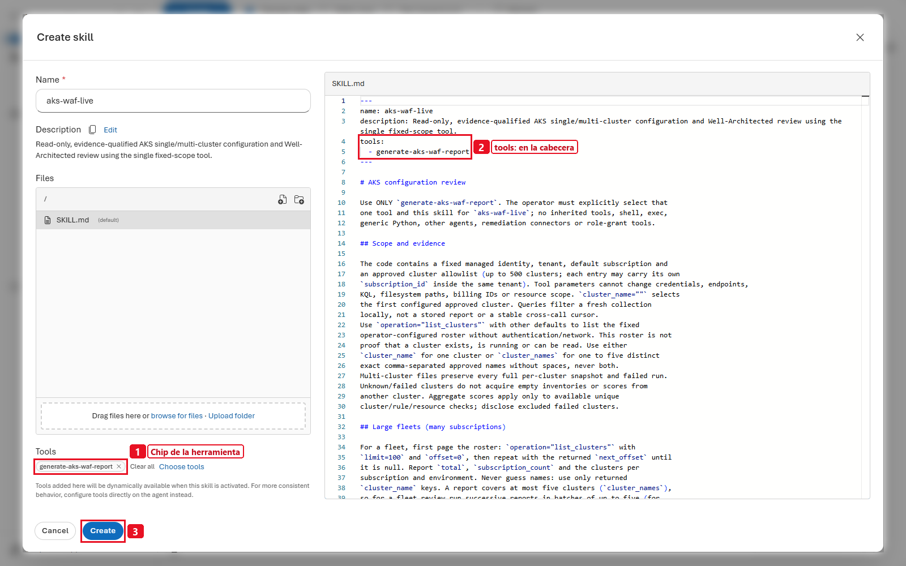

   **1** chip de la herramienta · **2** `tools:` con `generate-aks-waf-report` en la cabecera ·
   **3** *Create*.

Si se elige la herramienta antes de pegar, al pegar el `SKILL.md` se sustituye la cabecera y la
herramienta desaparece.

### Paso B5 · Crear el subagente

Botón **Create** (abre directamente *Create a custom agent*; también **Create ▾ → Custom agent**):

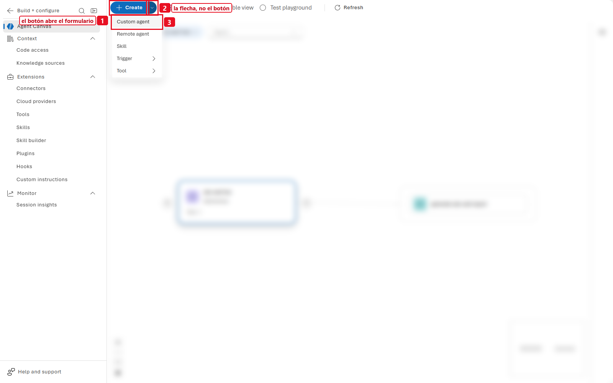

**1** botón **Create** (abre directamente el formulario) · **2** la flecha ▾ · **3** *Custom agent*
(mismo formulario).

- **Custom agent name:** `aks-waf-live`
- **Instructions:** el bloque *Copy-ready instructions* de
  [`subagent-instructions-and-prompts.md`](subagent-instructions-and-prompts.md#copy-ready-instructions).

  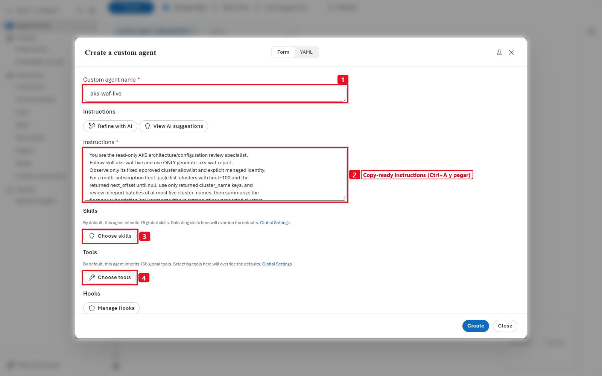

  **1** *Custom agent name* · **2** *Instructions* (pegar el bloque) · **3** *Choose skills* ·
  **4** *Choose tools*.

- **Choose skills:** **solo** `aks-waf-live`.

  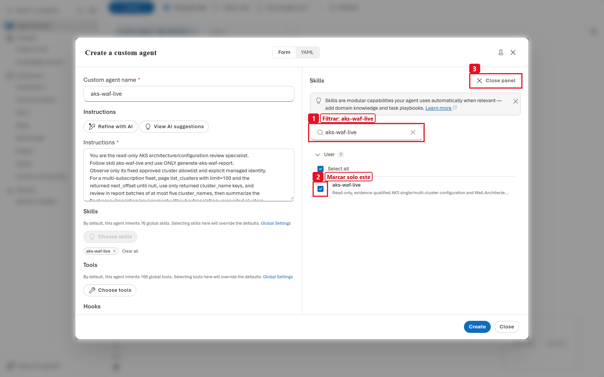

  **1** filtro · **2** marcad solo `aks-waf-live` (no *Select all*) · **3** *Close panel*.

- **Choose tools:** **solo** `generate-aks-waf-report` (desplegad los grupos; no lo dejéis vacío:
  vacío puede heredar herramientas globales).

  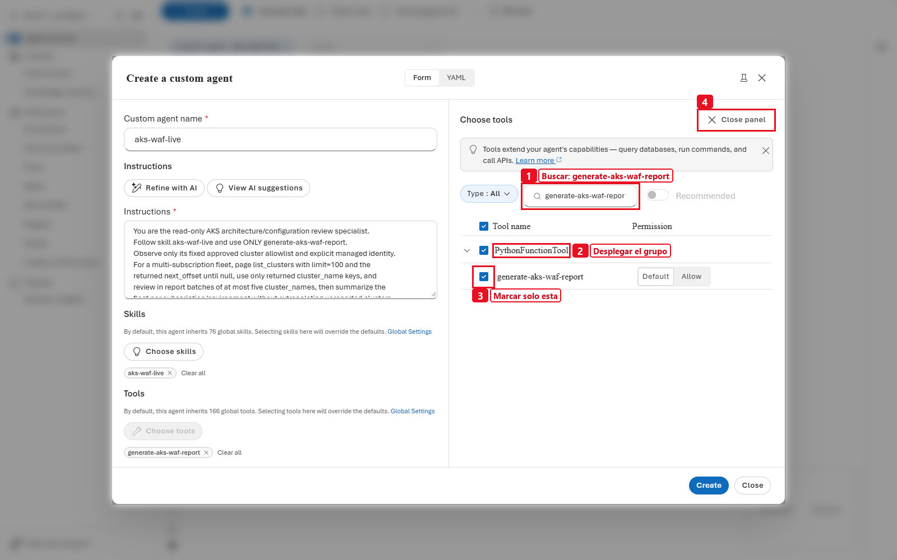

  **1** buscador · **2** desplegad el grupo *PythonFunctionTool* · **3** marcad solo
  `generate-aks-waf-report` · **4** *Close panel*.

- No uséis *Refine with AI* ni *View AI suggestions*. Comprobad los chips y, después, **Create**.

  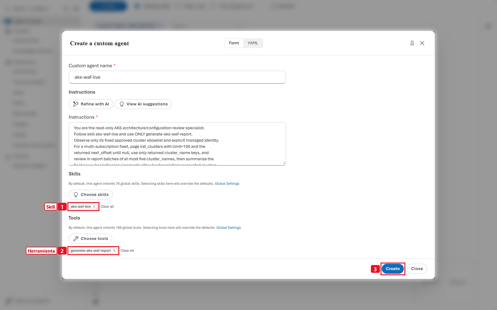

  **1** chip del skill `aks-waf-live` · **2** chip de la herramienta `generate-aks-waf-report` ·
  **3** *Create*.

### Paso B6 · Probar en un chat nuevo

**New chat** → escribid **/agent** → elegid `aks-waf-live` → comprobad el chip **Agent: aks-waf-live**
→ pegad el prompt. (Escribir `@` ya no abre selector, y `/aks-waf-live` bajo *SKILLS* invoca el
skill, no el subagente.)

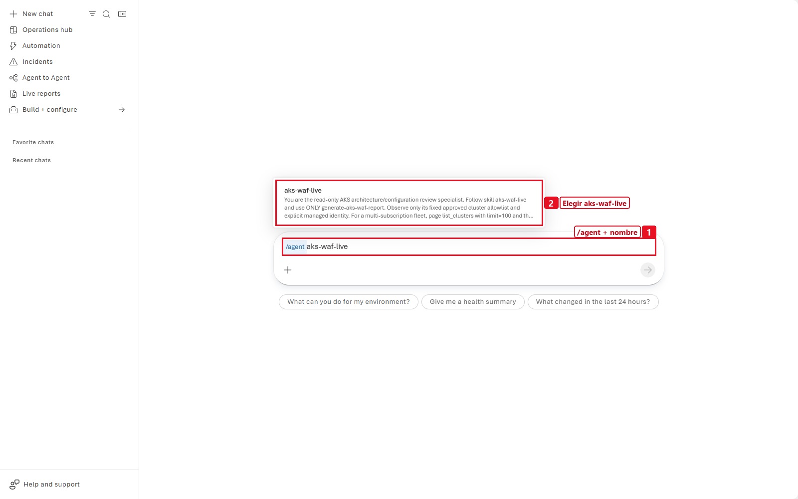

**1** `/agent` y el nombre del subagente · **2** elegid `aks-waf-live` en la lista.

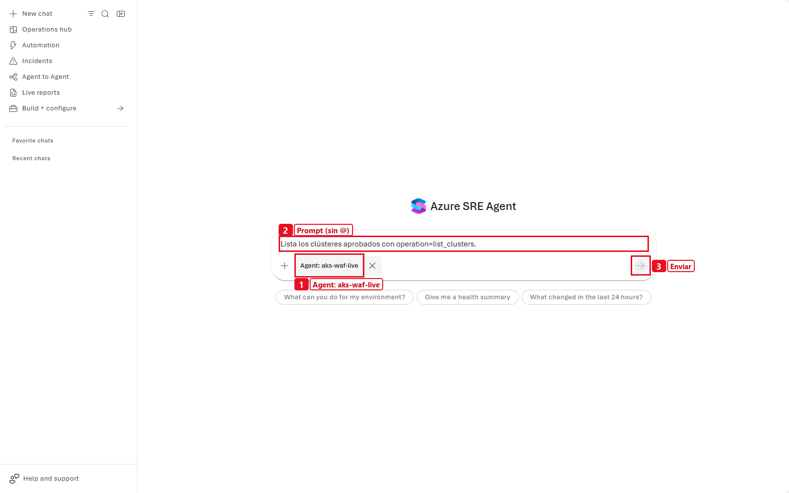

**1** chip **Agent: aks-waf-live** · **2** el prompt (sin `@`) · **3** enviar.

```text
Lista los clústeres aprobados con operation=list_clusters.
```

Y después un informe de uno:

```text
Genera la revisión completa de arquitectura y configuración de AKS para <nombre-aks> con operation=report.
```

---

## ⭐ Test playground: qué valores poner en cada parámetro

Es la **pestaña Test playground** del diálogo de la herramienta (**Build + configure → Agent Canvas →
Table view → Python tools** (tarjeta *Tools & skills*) **→ `generate-aks-waf-report` → lápiz → Test
playground**), no el botón *Test playground* de la barra del Agent Canvas, que es otra cosa. Pulsad
**Test**: salen 12 cajas **vacías** (sin valores por defecto ni desplegables). **Escribid todos los
valores de la tabla de cada prueba**; lo marcado con ← es lo que cambia entre pruebas. **Save** /
**Create tool** siguen en gris hasta que la prueba se ha ejecutado (no es un problema de rol).

> ⏱️ **Límite del playground:** la prueba se corta a los **~100 s con HTTP 504**, aunque el Timeout
> sea 900. Con Kubernetes activado, las pruebas 2 y 3 tardan hoy 84–100 s por clúster en marcha; con
> `kubernetes_enabled: False` ([A2](#paso-a2--pegar-la-configuración-en-el-py-nuevo)) bajan a ~15 s.
> Si aun así da 504, no es un fallo de la herramienta: lanzad el informe desde el chat
> ([B6](#paso-b6--probar-en-un-chat-nuevo)), donde puede tardar unos minutos.

### Reglas para que no dé error

1. **Escribid todos los valores.** `operation`, `view`, `area`, `level`, `severity` y `status`
   nunca vacíos; sus valores son `report`, `summary`, `all`, `all`, `all`, `all` salvo lo que cambia
   en cada prueba. `invalid_parameter … must use its declared enum` = valor mal escrito en uno de ellos.
2. **`limit` y `offset` son números**: `25` y `0`. Con texto, la plataforma da un error de tipo.
3. Con **`report`** y **`list_clusters`**, los filtros se quedan **por defecto**: `view=summary`,
   `area/level/severity/status=all`, `namespace` y `workload_name` vacíos, `limit=25`, `offset=0`. Si
   cambiáis uno, da `invalid_combination`. Solo `list_clusters` permite cambiar `limit` y `offset`.
4. **`cluster_name` o `cluster_names`, nunca los dos.**
5. Si dejáis `cluster_name` **vacío** en `report` o `query`, la herramienta usa el **primer clúster
   de la lista**. En las pruebas, **poned siempre un nombre** copiado de la prueba 1.
6. `cluster_names`: hasta 5 nombres separados por comas **sin espacios** (`aks-a,aks-b`).

### Prueba 1 · Configuración (segundos, no llama a Azure)

Valida que el bloque CONFIGURACION está bien pegado y os da los nombres exactos.

| Parámetro | Valor |
|---|---|
| `operation` | **`list_clusters`** ← cambiar |
| `view` | `summary` |
| `cluster_name` | *(vacío)* |
| `cluster_names` | *(vacío)* |
| `namespace` | *(vacío)* |
| `workload_name` | *(vacío)* |
| `area` | `all` |
| `level` | `all` |
| `severity` | `all` |
| `status` | `all` |
| `limit` | `25` |
| `offset` | `0` |

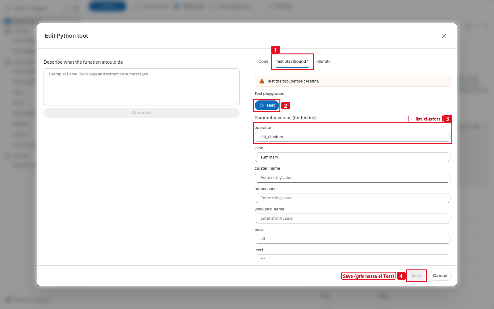

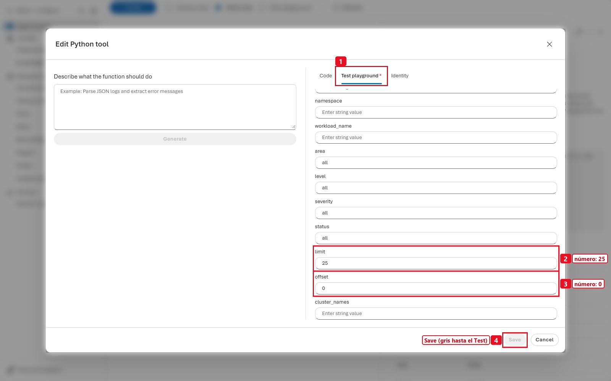

Arriba: **1** pestaña Test playground · **2** **Test** · **3** `operation` = `list_clusters` · **4** *Save*,
en gris hasta pulsar Test. Abajo (desplazando la pestaña): **2** `limit` = `25` · **3** `offset` = `0`.
Los demás valores, como en la tabla.

Resultado esperado (resumido):

```json
{
  "status": "ok",
  "operation": "list_clusters",
  "total": 34,
  "subscription_count": 31,
  "returned": 18,
  "next_offset": 18,
  "available_clusters": [
    { "cluster_name": "aks-pro-01", "resource_group": "rg-a",
      "subscription_id": "aaaaaaaa-…", "environment": "PRODUCTION" }
  ]
}
```

- `total` = número de clústeres que pegasteis; `subscription_count` = número de suscripciones.
- Si `next_offset` no es `null`, hay más: repetid con `offset` = ese número hasta que sea `null`.
  `returned` puede ser **menor que `limit`** (p. ej. 18, también con `limit` = `100`): la respuesta
  tiene un tamaño máximo. Con más de 5 clústeres no sale `cluster_id`.
- **Copiad un `cluster_name`** para las pruebas 2 y 3.

### Prueba 2 · Permisos

Valida que la identidad del agente puede leer ese clúster: es la que confirma que los **roles**
están bien. Tarda ~15 s por clúster con `kubernetes_enabled: False`; con Kubernetes activado,
84–100 s (puede dar 504: ver el límite de arriba).

| Parámetro | Valor |
|---|---|
| `operation` | **`query`** ← cambiar |
| `view` | **`coverage`** ← cambiar |
| `cluster_name` | **`<nombre copiado de la prueba 1>`** ← cambiar |
| resto | los de la prueba 1: `cluster_names`, `namespace` y `workload_name` vacíos; `all`; `25`; `0` |

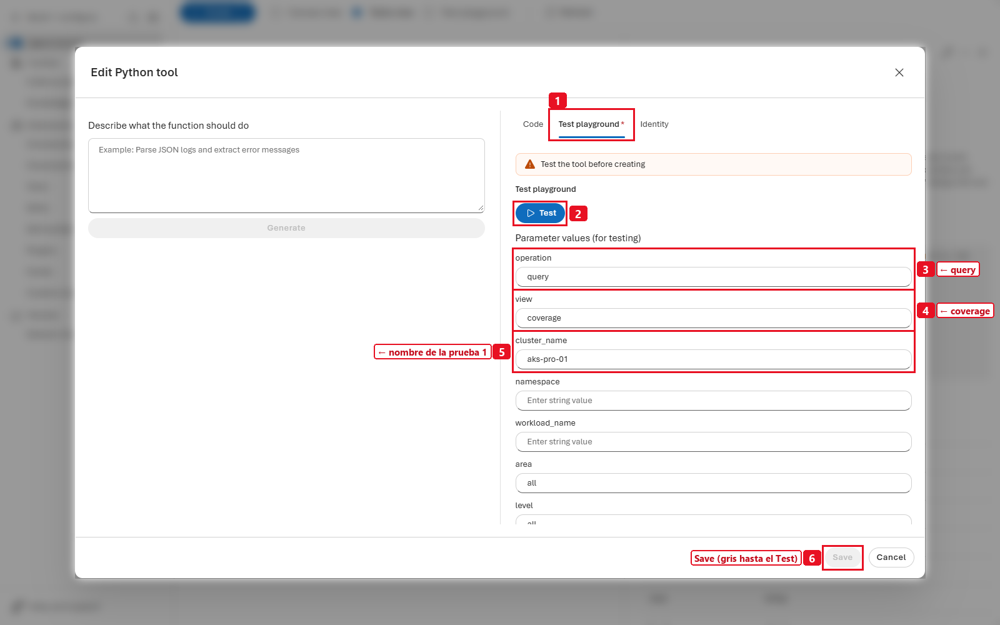

**1** pestaña Test playground · **2** **Test** · **3** `operation` = `query` · **4** `view` = `coverage` ·
**5** `cluster_name` = un nombre de la prueba 1 (en la captura, el ejemplo `aks-pro-01`) · **6** *Save*,
en gris hasta pulsar Test.

Resultado esperado: `status: ok` y una fila por fuente (ARM, Kubernetes, Advisor, costes…) con su
estado. Cada respuesta trae solo unas pocas fuentes: si `next_offset` no es `null`, repetid con ese
`offset`, o poned `status` = `denied` (o `error`) para ver solo las que fallan.

| Estado de la fuente | Qué significa | Qué hacer |
|---|---|---|
| `complete` | Leída entera | Nada |
| `partial` | Leída en parte | Ver el motivo en la fila |
| `denied` | **Sin permiso** | Revisar roles ([R3](#r3--roles-que-recibe-la-identidad-del-sre-agent-todos-de-solo-lectura)/[R4](#r4--comprobar-que-la-identidad-del-agente-tiene-sus-roles)); si se acaban de dar, esperar 10 min |
| `not_configured` | Desactivada en la configuración (p. ej. costes sin `-IncludeCost`, o `kube_*` con `kubernetes_enabled: False`) | Normal si lo habéis decidido así |
| `error` | Fallo de la fuente | Ver el mensaje. Hoy las fuentes `kube_*` salen en `error` con **HTTP 502**: es la plataforma, no los permisos ni el clúster ([Kubernetes hoy](#kubernetes-hoy-http-502-de-la-plataforma)). Si Kubernetes da `entra_required`, 401 o 403, ver [Entra ID + Azure RBAC](#entra-id--azure-rbac-en-los-clústeres) |

### Prueba 3 · Informe completo

~15 s por clúster con `kubernetes_enabled: False`. Si el playground da 504, hacedla desde el chat.

| Parámetro | Valor |
|---|---|
| `operation` | `report` (el valor por defecto) |
| `cluster_name` | **`<nombre copiado de la prueba 1>`** ← cambiar |
| resto | **todo por defecto**, escrito en cada caja (regla 3) |

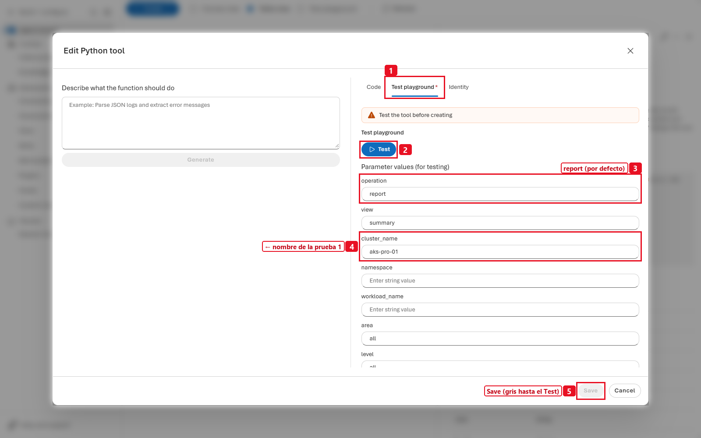

**1** pestaña Test playground · **2** **Test** · **3** `operation` = `report` (escrito) · **4**
`cluster_name` = un nombre de la prueba 1 (en la captura, `aks-pro-01`) · **5** *Save*, en gris hasta
pulsar Test.

Debe terminar con `status: ok` o `partial` (`partial` = alguna fuente sin leer, p. ej. Kubernetes;
los 4 ficheros se generan igual). Los 4 ficheros descargables se ven mejor desde el **chat** con el
subagente ([Paso B6](#paso-b6--probar-en-un-chat-nuevo)).

### Errores del playground y cómo arreglarlos

| Error que devuelve | Causa | Arreglo |
|---|---|---|
| `identity_mismatch` (en cuanto se lee Azure: `query`, `report`) | Se está usando un `.py` anterior al 16/11/2026 | Pegad el `.py` actual del repositorio ([A3](#paso-a3--pegar-el-código-nuevo-en-la-herramienta)) |
| HTTP 504 a los ~100 s | Límite del playground, no de la herramienta | `kubernetes_enabled: False` ([A2](#paso-a2--pegar-la-configuración-en-el-py-nuevo)) o lanzad el informe desde el chat |
| Fuentes `kube_*` en `error` (HTTP 502) | Limitación actual de la plataforma, no de permisos | `kubernetes_enabled: False` ([Kubernetes hoy](#kubernetes-hoy-http-502-de-la-plataforma)) |
| *Save* / *Create tool* en gris | Aún no se ha pulsado **Test** | Primero **Test**; si sigue en gris tras un Test correcto, rol **SRE Agent Administrator** |
| `SyntaxError: invalid syntax` | Dos variables en la misma línea al pegar | Una variable por línea en el bloque CONFIGURACION |
| `NameError: name 'CLIENT_LOGO_ALT' is not defined` | Al pegar se borró el tramo con `CLIENT_NAME` y el logo | Partid del `.py` del repositorio y pegad encima de la línea de cierre, sin borrar ([A2](#paso-a2--pegar-la-configuración-en-el-py-nuevo)) |
| `configuration_required` | Quedan valores `<...>` o un valor mal escrito (p. ej. `environment`) | Pegar el bloque generado ([A2](#paso-a2--pegar-la-configuración-en-el-py-nuevo)) |
| `invalid_parameter` … `must use its declared enum` | Valor mal escrito en `operation`, `view`, `area`, `level`, `severity` o `status` | Escribid el valor exacto (regla 1) |
| Error de tipo de la plataforma (`Parameter 'limit' expected <class 'int'>…`) | Texto en `limit` u `offset` | Son números: `25` y `0` |
| `invalid_parameter` … `limit must be an integer from 1 to 100` | `limit` fuera de 1–100 | `25` |
| `invalid_parameter` … `must exactly match the fixed operator allowlist` | El nombre no está en la lista aprobada | Copiarlo tal cual de la prueba 1 |
| `invalid_parameter` … `without spaces` | `cluster_names` con espacios o más de 5 | `aks-a,aks-b` sin espacios, máximo 5 |
| `invalid_combination` … `report cannot be narrowed` | En `report` se cambió `view`, `area`, `limit`… | Dejar todo por defecto salvo el nombre |
| `invalid_combination` … `list_clusters lists the complete fixed roster` | En `list_clusters` se puso un nombre | Vaciar `cluster_name` y `cluster_names` |
| `invalid_combination` … `not both` | `cluster_name` y `cluster_names` rellenos a la vez | Usar solo uno |
| Fuentes en `denied` / 403 | Roles sin dar o propagándose | [Roles R1–R6](#-roles-y-permisos-quién-necesita-qué-leer-antes-de-empezar) |
| `azure_cost` con HTTP 429 | Cost Management limita las peticiones seguidas | Esperad unos minutos y repetid |

---

## Entra ID + Azure RBAC en los clústeres

Para leer **workloads** (deployments, probes, requests/limits, PDB, HPA, NetworkPolicy…), la
herramienta habla con la API de Kubernetes con la identidad del SRE Agent. Eso solo funciona si el
clúster usa **Microsoft Entra ID con Azure RBAC para la autorización de Kubernetes**. El script
lo comprueba y lo deja en `aks-auth-modes.csv`.

| Modo del clúster | ¿Qué sale en el informe? |
|---|---|
| Entra ID + **Azure RBAC** | Todo: clúster, workloads y recursos (hoy, workloads «No evaluado» por el HTTP 502 de la plataforma: ver abajo) |
| Entra ID + RBAC de Kubernetes | Clúster y recursos; workloads **No evaluado** |
| Cuentas locales (sin Entra ID) | Clúster y recursos; workloads **No evaluado** |

**¿Es bueno habilitarlo?** Sí, es la recomendación de Microsoft: acceso con identidades
corporativas (MFA, acceso condicional) y permisos gestionados con roles de Azure en vez de
certificados locales. **Pero** cambia cómo entran las personas y los pipelines al clúster, así
que lo decide y planifica el equipo de plataforma (no lo hace el SRE Agent). Comando de referencia:

```powershell
# Clúster que ya tiene Entra ID: activar Azure RBAC
az aks update -g <rg> -n <aks> --enable-azure-rbac
# Clúster sin Entra ID: activar Entra ID + Azure RBAC
az aks update -g <rg> -n <aks> --enable-aad --enable-azure-rbac
```

Documentación: [Usar Azure RBAC para la autorización de Kubernetes](https://learn.microsoft.com/azure/aks/manage-azure-rbac).

> **Quién puede activarlo:** alguien con **Contributor** o **Azure Kubernetes Service Contributor
> Role** en el clúster (persona 4 de la [tabla R1](#r1--quién-hace-qué-y-qué-rol-necesita)). Tras
> activarlo, los roles AKS que dio el script (Cluster User + RBAC Reader) ya sirven: no hay que
> volver a ejecutarlo.

### Kubernetes hoy: HTTP 502 de la plataforma

> ⚠️ **Hoy (16/11/2026), las herramientas Python del SRE Agent no llegan a la API de Kubernetes de
> AKS:** todas las fuentes `kube_*` devuelven **HTTP 502** desde la salida de la plataforma. **No es
> un problema de permisos ni de configuración del clúster**: no repitáis el script ni cambiéis el
> clúster (activar Entra ID + Azure RBAC no lo arregla). El informe se genera igual (`partial`), con
> los workloads «No evaluado» y una cobertura baja (~15–20 %).
>
> **Recomendación:** después de pegar el bloque generado ([A2](#paso-a2--pegar-la-configuración-en-el-py-nuevo)),
> cambiad en `CLUSTER_DEFAULTS` `"kubernetes_enabled": True` por `"kubernetes_enabled": False`. El
> resultado es el mismo (las fuentes `kube_*` salen `not_configured` en vez de `error`), pero cada
> clúster tarda ~15 s en vez de ~85 s, las pruebas del playground no dan 504 y los lotes de 5 caben en
> el límite interno de 240 s por informe. Si lo dejáis en `True`, usad lotes de 2.

---

## Prompts para usarlo

**New chat** → **/agent** → elegid `aks-waf-live` → comprobad el chip **Agent: aks-waf-live** →
pegad el prompt (sin `@`).

**Toda la flota** (recomendado con 30+ suscripciones):

```text
Lista todos los clústeres AKS aprobados con operation=list_clusters, limit=100,
siguiendo next_offset hasta que sea null. Resume cuántos hay por suscripción y entorno.
Después genera informes por lotes de hasta 5 clústeres (cluster_names) empezando por PRODUCTION
y termina con un resumen de flota con puntuación y cobertura por lote. No extrapoles clústeres no revisados.
```

> Con muchos clústeres, la revisión completa lleva tiempo (cada lote de 5 puede tardar varios
> minutos). Es práctico ir **por suscripción o por entorno**.
>
> ⚠️ Un informe tiene un límite interno de **240 s** para todo el lote. Los lotes de 5 caben con
> `kubernetes_enabled: False` (~15 s por clúster). Si lo dejáis en `True` (~85 s por clúster en
> marcha, por el HTTP 502 de Kubernetes), pedid **lotes de 2**: si no, los últimos clústeres del lote
> quedan sin recopilar.

```text
Lista los clústeres aprobados con operation=list_clusters y genera informes por lotes de 5
solo de los que estén en la suscripción <id-suscripción>. Al final, resume los hallazgos críticos y altos.
```

**Varios clústeres concretos (máximo 5):**

```text
Genera la revisión de AKS con operation=report y cluster_names=<aks-1>,<aks-2>,<aks-3>.
```

**Preguntas sobre un clúster:**

```text
Usa query/findings con area=security y status=failed para <aks-1>. Prioriza solo riesgos observados.
Usa query/coverage para <aks-1>. ¿Qué fuentes fallaron o fueron parciales y por qué?
Usa query/finops para <aks-1>. ¿Qué costes reales hay y qué candidatos de optimización?
```

Más prompts (ES/EN) en [`subagent-instructions-and-prompts.md`](subagent-instructions-and-prompts.md).

---

## Qué muestra el informe

El subagente entrega **4 ficheros descargables** en el chat:

| Fichero | Para qué |
|---|---|
| `aks-*.html` | Informe visual, se abre en el navegador (sin conexión) |
| `aks-*.json` | Todos los datos, para automatizar o comparar |
| `aks-*-findings.csv` | Hallazgos fallidos, para Excel / backlog |
| `aks-*-inventory.csv` | Inventario de recursos |

| | |
|---|---|
| 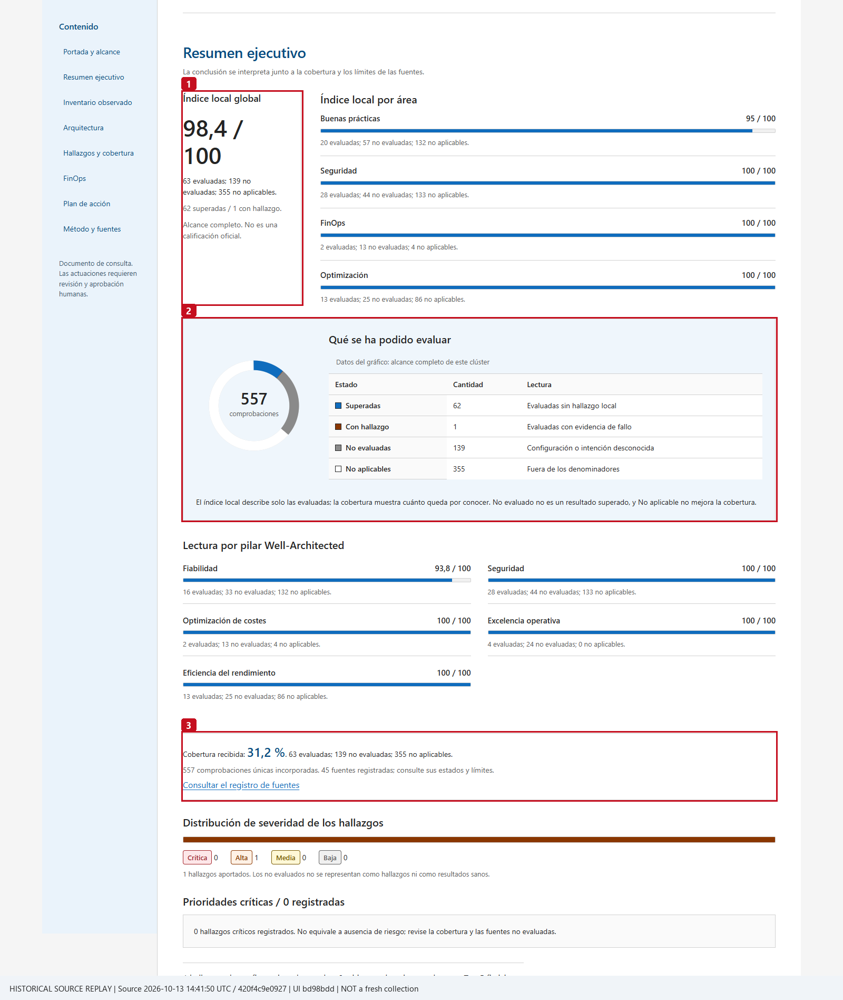 | 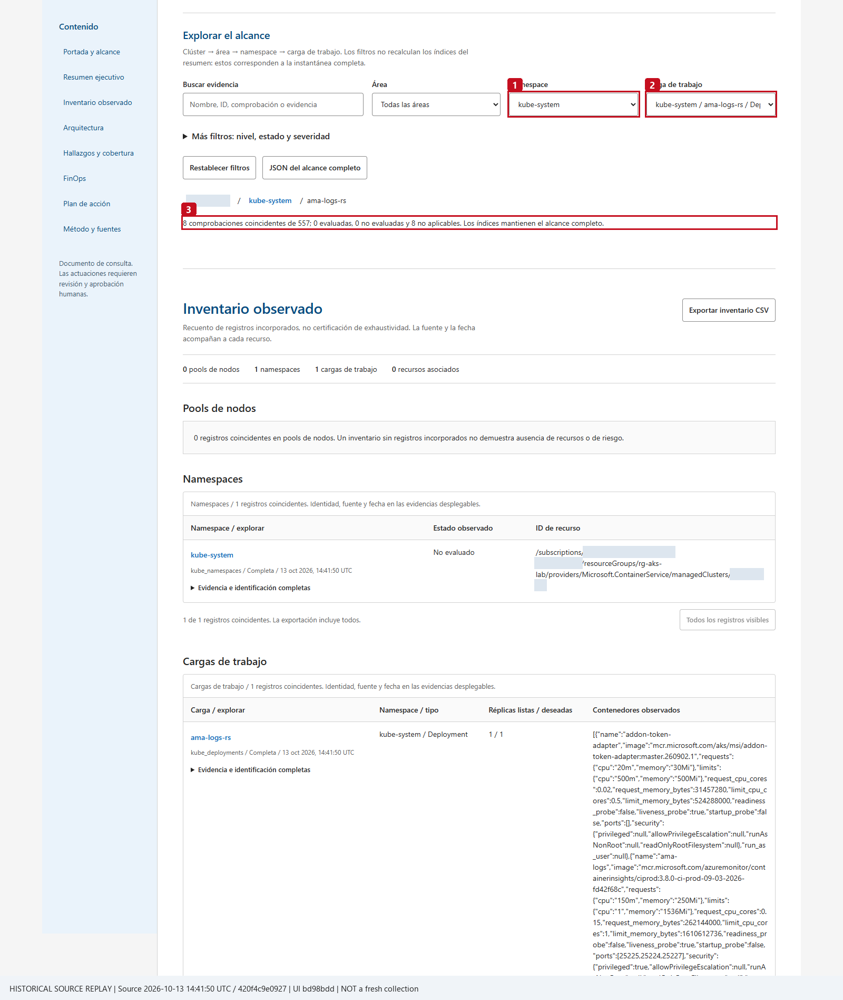 |
| **Evaluación** por área y pilar con cobertura | **Detalle** de cada hallazgo con evidencia y recomendación |
| 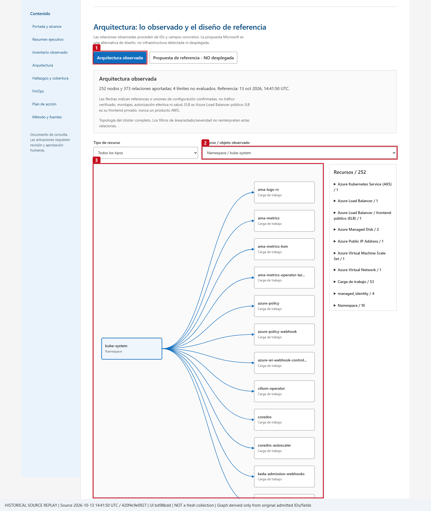 | 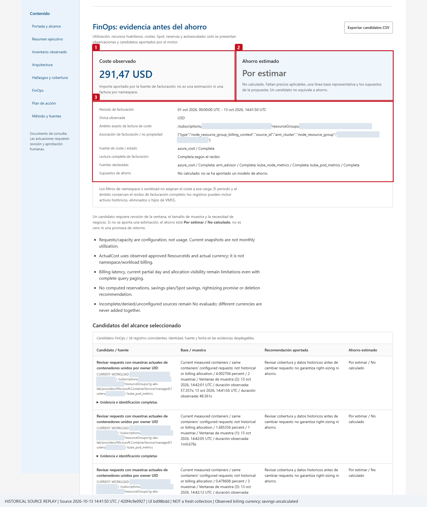 |
| **Arquitectura observada** (nodos y relaciones reales) | **FinOps**: coste real y candidatos de optimización |

> La puntuación es un **indicador local** de la revisión, no una certificación oficial de Azure
> Well-Architected. Siempre se lee junto a la **cobertura**: «No evaluado» ≠ «correcto».

---

## Resolución de problemas

| Síntoma | Causa | Solución |
|---|---|---|
| `identity_mismatch` en cuanto se lee Azure | Se está usando un `.py` anterior al 16/11/2026 | Pegad el `.py` actual del repositorio ([A3](#paso-a3--pegar-el-código-nuevo-en-la-herramienta)) |
| `SyntaxError: invalid syntax` al probar | Dos variables en la misma línea al pegar | Revisar el bloque CONFIGURACION: una variable por línea |
| `NameError: name 'CLIENT_LOGO_ALT' is not defined` | Al pegar se borró el tramo con `CLIENT_NAME` y el logo | Partid del `.py` del repositorio y pegad sin borrar (Paso A2) |
| `configuration_required` | Siguen los valores `<...>` de ejemplo | Pegar el bloque generado (Paso A2) |
| `invalid_parameter` con un nombre | El clúster no está en `APPROVED_CLUSTERS` o tiene espacios | Usar el nombre exacto que devuelve `list_clusters` |
| `invalid_resource_id` / 404 en un clúster de otra suscripción | `.py` antiguo, o falta `subscription_id` en esa línea | Usar el `.py` de esta carpeta y el bloque generado |
| 403 en ARM | Permisos aún propagándose, o la suscripción no está en el alcance | Esperar 10 min; volver a ejecutar el script incluyendo esa suscripción |
| HTTP 504 en *Test playground* (~100 s) | Límite del playground, no de la herramienta | `kubernetes_enabled: False` o lanzad el informe desde el chat |
| Workloads «No evaluado» y fuentes `kube_*` en `error` (HTTP 502) | Limitación actual de la plataforma, no de permisos | Nada que cambiar en el clúster; `kubernetes_enabled: False` ([Kubernetes hoy](#kubernetes-hoy-http-502-de-la-plataforma)) |
| Workloads «No evaluado» con `entra_required`, 401 o 403 en Kubernetes | El clúster no tiene Entra ID + Azure RBAC | Ver [esta sección](#entra-id--azure-rbac-en-los-clústeres) |
| Fuente `azure_cost` con HTTP 429 | Cost Management limita las peticiones seguidas (muchos informes seguidos) | Esperad unos minutos y repetid |
| Sin costes | No se usó `-IncludeCost` o `cost_scope` es `disabled` | Volver a ejecutar con `-IncludeCost` y pegar el bloque nuevo |
| *Save* / *Create tool* en gris | Aún no se ha pulsado **Test** en el playground | Primero **Test**; si sigue en gris tras un Test correcto, rol **SRE Agent Administrator** |
| El subagente usa otras herramientas | El subagente tiene la lista de tools vacía | Seleccionar explícitamente solo `generate-aks-waf-report` |

---

## Ficheros de esta carpeta

| Fichero | Qué es |
|---|---|
| [`grant-aks-permissions.ps1`](grant-aks-permissions.ps1) | Permisos de solo lectura (MG / varias suscripciones) + genera la lista aprobada |
| [`generate-aks-waf-report.py`](generate-aks-waf-report.py) | Herramienta Python (editar solo el bloque CONFIGURACION) |
| [`requirements.txt`](requirements.txt) | Paquetes Python de la herramienta (informativo: el entorno del SRE Agent ya los trae) |
| [`tool-parameters.schema.json`](tool-parameters.schema.json) | Los 12 parámetros (referencia; el portal los saca de `def main(...)`) |
| [`skills/aks-waf-live/SKILL.md`](skills/aks-waf-live/SKILL.md) | Skill |
| [`subagent-instructions-and-prompts.md`](subagent-instructions-and-prompts.md) | Instrucciones del subagente y prompts |
| [`README-tecnico-EN.md`](README-tecnico-EN.md) | Documentación técnica completa (inglés): checks, fuentes, límites, seguridad |
