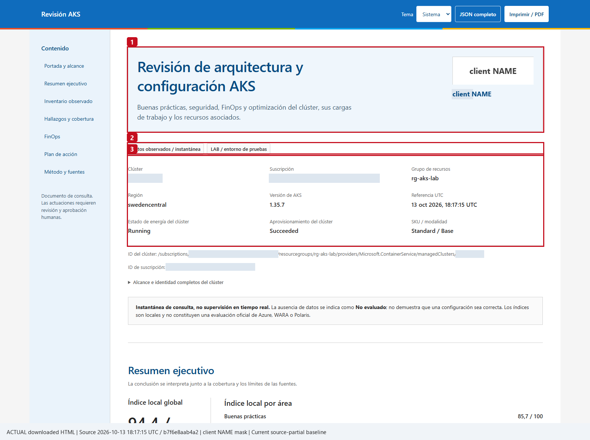
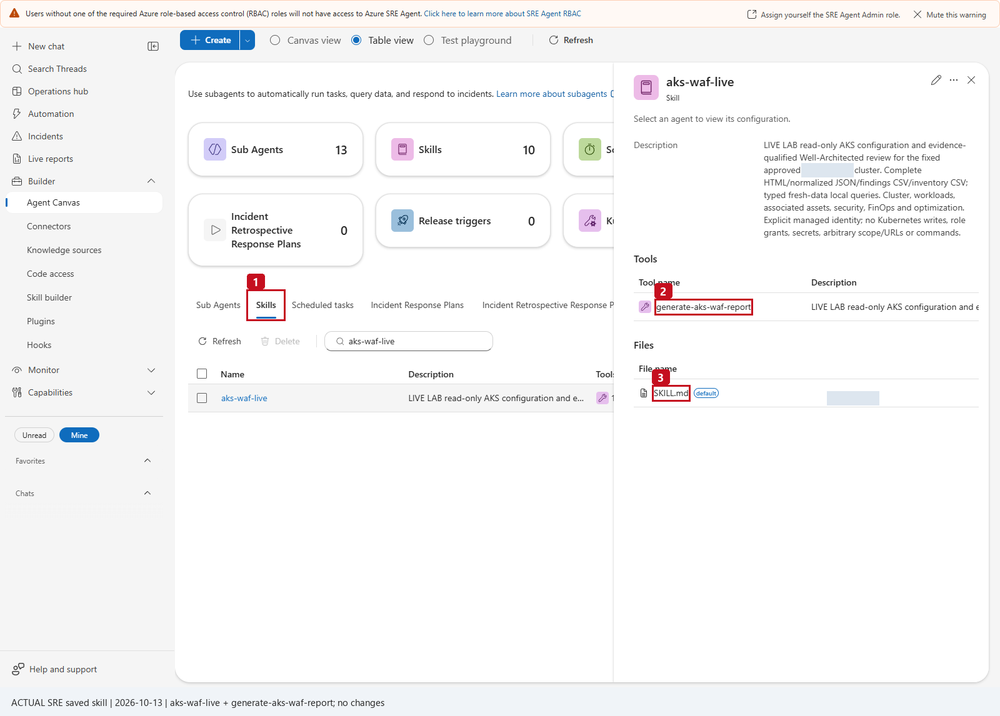
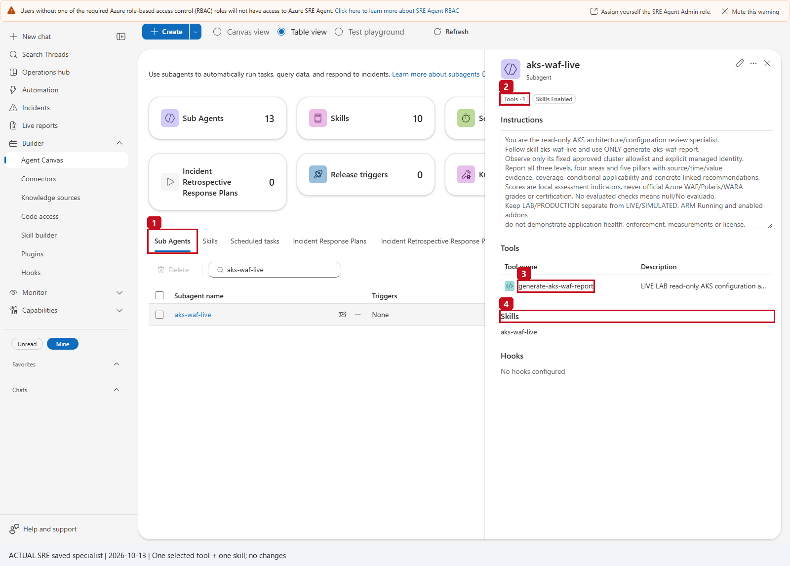
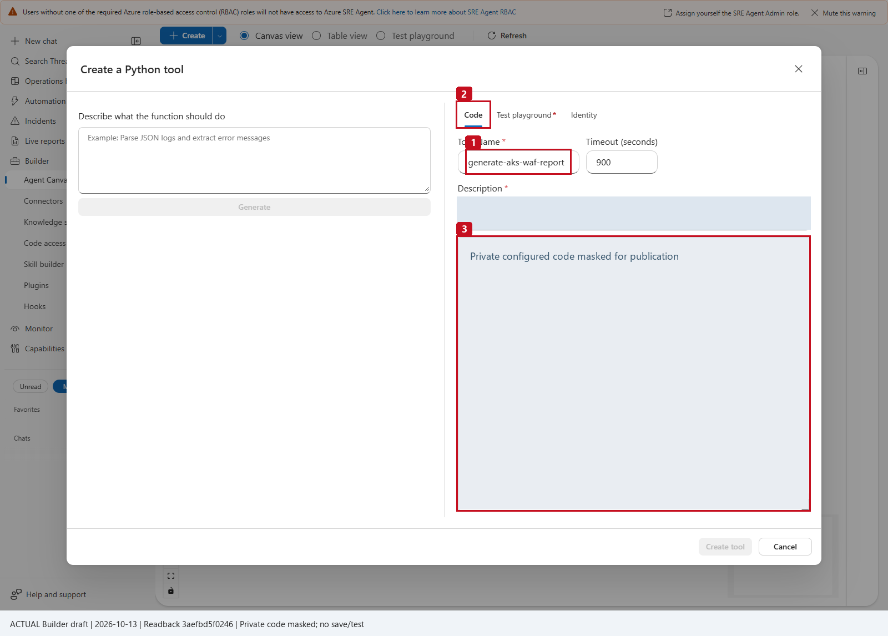
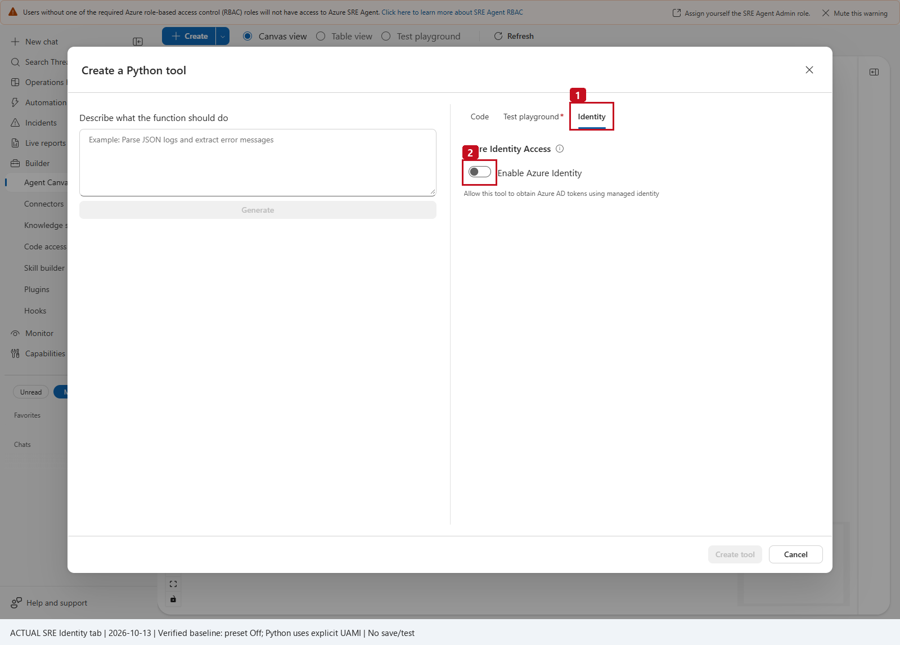
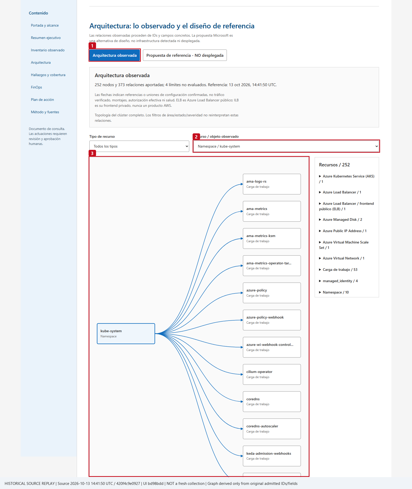

# Caso AKS · Revisión de arquitectura y configuración (Well-Architected) · multi-suscripción

> **Azure SRE Agent** · Herramienta Python de solo lectura · Skill · Subagente restringido ·
> Informe HTML + JSON completo + CSV de hallazgos + CSV de inventario

El subagente `aks-waf-live` revisa vuestros clústeres AKS (**hasta 500, repartidos en todas las
suscripciones del tenant**) y genera un informe con:

- **3 niveles:** clúster, workloads (namespaces, deployments…) y recursos asociados (red, ACR,
  Key Vault, discos, Load Balancer, identidades…).
- **4 áreas:** buenas prácticas, seguridad, FinOps y optimización.
- **5 pilares** de Azure Well-Architected: fiabilidad, seguridad, coste, operaciones y rendimiento.
- **Cobertura:** qué fuentes se pudieron leer y cuáles no (y por qué), para que nunca se confunda
  «no evaluado» con «correcto».
- **Arquitectura observada** frente a una arquitectura de referencia de Microsoft.

No cambia nada: solo lee.

> **¿Ya tenéis este caso desplegado (versión de una suscripción)?** No hay que empezar de cero.
> Id directamente a **[A. QUÉ CAMBIAR (7 pasos)](#a-si-ya-lo-tenéis-desplegado-qué-cambiar-7-pasos)**,
> leyendo antes [⭐ Roles](#-roles-y-permisos-quién-necesita-qué-leer-antes-de-empezar) (paso A1) y
> terminando con el [⭐ Test playground](#-test-playground-qué-valores-poner-en-cada-parámetro).
> La sección **B** es solo para quien lo instala por primera vez.



---

## Índice

- [Cómo funciona la multi-suscripción](#cómo-funciona-la-multi-suscripción)
- [⭐ Roles y permisos: quién necesita qué (leer antes de empezar)](#-roles-y-permisos-quién-necesita-qué-leer-antes-de-empezar)
- [A. Si ya lo tenéis desplegado: QUÉ CAMBIAR (7 pasos)](#a-si-ya-lo-tenéis-desplegado-qué-cambiar-7-pasos)
- [B. Instalación desde cero](#b-instalación-desde-cero)
- [Entra ID + Azure RBAC en los clústeres](#entra-id--azure-rbac-en-los-clústeres)
- [⭐ Test playground: qué valores poner en cada parámetro](#-test-playground-qué-valores-poner-en-cada-parámetro)
- [Prompts para usarlo](#prompts-para-usarlo)
- [Qué muestra el informe](#qué-muestra-el-informe)
- [Resolución de problemas](#resolución-de-problemas)
- [Ficheros de esta carpeta](#ficheros-de-esta-carpeta)

---

## Cómo funciona la multi-suscripción

```
            Management Group (o lista de suscripciones)
            ├─ Reader (+ Cost Management Reader opcional)          ← una sola asignación, la heredan todas
            ├─ AKS Cluster User Role + AKS RBAC Reader            ← con -AksRolesAtScope (cubre clústeres futuros)
            │
            ├── Suscripción 1 ── aks-a, aks-b
            ├── Suscripción 2 ── aks-c
            └── … Suscripción 30+ ── aks-n
                                    │
        grant-aks-permissions.ps1 ──┴─► approved-clusters.generated.py  (lista aprobada, 1 línea por AKS)
                                                     │
                                                     ▼  se pega en el bloque CONFIGURACION
                              generate-aks-waf-report.py  (herramienta Python del SRE Agent)
```

Puntos clave:

1. **Una sola identidad, un solo tenant.** La herramienta usa la identidad del SRE Agent (por su
   Client ID). Todas las suscripciones tienen que estar en el mismo tenant.
2. **Lista aprobada (allowlist).** El SRE Agent solo puede revisar los clústeres que estén en
   `APPROVED_CLUSTERS`. Cada clúster lleva su `resource_group` y su `subscription_id`. Ningún
   prompt puede pedirle otro clúster ni otra suscripción.
3. **Valores comunes.** `CLUSTER_DEFAULTS` define lo que es igual para todos (entorno, costes,
   Advisor…). Cualquier clúster puede sobrescribir un valor en su propia línea.
4. **Nombres repetidos.** Si dos suscripciones tienen un AKS con el mismo nombre, el script les
   pone una clave con prefijo (`aaaaaaaa-aks-shared`) y guarda el nombre real en `aks_name`.
5. **Paginación.** `operation=list_clusters` devuelve la lista por páginas (`limit` hasta 100). Si
   hay más, devuelve `next_offset`; el subagente sigue pidiendo páginas hasta que es `null`.
6. **Informes por lotes de 5.** Un informe admite **hasta 5 clústeres** a la vez
   (`cluster_names="aks-a,aks-b,aks-c"`, sin espacios). Para toda la flota, el subagente hace
   lotes de 5 y al final resume por suscripción y entorno.

---

## ⭐ Roles y permisos: quién necesita qué (leer antes de empezar)

> **Es el paso que más tiempo lleva.** Antes de empezar, comprobad que **cada persona** tiene su
> rol asignado **y activo** (si usáis PIM, activado). Con eso, el resto se hace en una sesión.

Hay **dos tipos de roles** que no hay que mezclar:

- **Roles de las personas**: lo que necesita quien ejecuta el script o configura el agente
  (tablas R1 y R2).
- **Roles de la identidad del SRE Agent**: lo que el script le da al agente. Son **solo de
  lectura** (tabla R3).

### R1 · Quién hace qué y qué rol necesita

| # | Persona (perfil típico) | Qué hace | Rol que **necesita** | Dónde se le asigna |
|---|---|---|---|---|
| 1 | **Administrador de Azure** (plataforma / seguridad) | Ejecuta `grant-aks-permissions.ps1` | **Owner**, **User Access Administrator** o **Role Based Access Control Administrator** en el alcance (ver R2). ❌ **Contributor NO sirve**: no puede asignar roles | Portal → Management Group o suscripción → **Access control (IAM)** |
| 2 | **Quien configura el SRE Agent** | Crea o edita la herramienta, el skill y el subagente; pega el código; usa *Test playground* | **SRE Agent Administrator**, o **SRE Agent Author + SRE Agent Standard User** (los dos juntos). ❌ Owner/Contributor de Azure **no** sustituyen a estos roles | Portal → recurso del **SRE Agent** → **Access control (IAM)** |
| 3 | **Usuarios** que piden informes | Chatean con `@aks-waf-live` y descargan los ficheros | **SRE Agent Standard User** | Igual que el 2 |
| 4 | **Equipo de plataforma AKS** (solo si deciden activar Entra ID + Azure RBAC) | `az aks update --enable-azure-rbac` | **Contributor** o **Azure Kubernetes Service Contributor Role** en el clúster | Portal → clúster AKS → **Access control (IAM)** |

> La persona que creó el SRE Agent ya tiene **SRE Agent Administrator** automáticamente. La 1 y la 2
> pueden ser la misma persona si tiene ambos roles.

### R2 · Rol exacto de quien ejecuta el script (según la opción que use)

| Opción del script | Rol necesario (uno de estos 3) | **Dónde** exactamente | Si no lo tiene ahí… |
|---|---|---|---|
| `-ManagementGroupId <id>` | Owner / User Access Administrator / Role Based Access Control Administrator | **En el propio Management Group** (tenerlo en las suscripciones **no** basta) | Usar `-SubscriptionIds` o `-AllSubscriptions` |
| `-SubscriptionIds "s1","s2"` o `-AllSubscriptions` | Igual | En **cada** suscripción | Las que fallen aparecen al final en *fallos*; el resto se hace igual |
| Sin opción (suscripción activa) o `-Clusters` | Igual | En la suscripción de cada clúster | — |
| `-IncludeCost` | Igual (no hace falta nada extra) | Mismo alcance | — |

Además, quien ejecuta el script necesita:

- **Poder leer la identidad en Entra ID** (`az ad sp show`). Cualquier usuario miembro puede hacerlo
  por defecto. Si vuestro tenant lo tiene restringido, pedid el rol de Entra **Directory Readers**.
- **`az login` en el tenant correcto**: `az login --tenant <TENANT_ID>`.
- **PowerShell 7** y **Azure CLI** actualizados.

> **Si usáis *Role Based Access Control Administrator* con condiciones** (delegación restringida),
> la condición debe permitir asignar estos 4 roles a *Service principals*: Reader
> `acdd72a7-3385-48ef-bd42-f606fba81ae7`, Cost Management Reader `72fafb9e-0641-4937-9268-a91bfd8191a3`,
> Azure Kubernetes Service Cluster User Role `4abbcc35-e782-43d8-92c5-2d3f1bd2253f` y
> Azure Kubernetes Service RBAC Reader `7f6c6a51-bcf8-42ba-9220-52d62157d7db`.

**Comprobad vuestro propio rol antes de ejecutar** (sale el rol y dónde lo tenéis, incluidos los
heredados del Management Group y los de grupos):

```powershell
az login --tenant <TENANT_ID>
az account set --subscription "<una-suscripcion>"
$me = az ad signed-in-user show --query id -o tsv
az role assignment list --assignee $me --all --include-inherited --include-groups `
    --query "[].{rol:roleDefinitionName, alcance:scope}" -o table
```

Debe aparecer **Owner**, **User Access Administrator** o **Role Based Access Control Administrator**
en el Management Group (`/providers/Microsoft.Management/managementGroups/...`) o en las
suscripciones (`/subscriptions/...`).

### R3 · Roles que recibe la identidad del SRE Agent (todos de solo lectura)

| Rol | Alcance | Para qué lo usa la herramienta |
|---|---|---|
| **Reader** | Management Group o cada suscripción | Leer la configuración del AKS, node pools, red, ACR, Key Vault, discos, Load Balancer, Advisor… |
| **Cost Management Reader** (con `-IncludeCost`) | Igual | Leer el coste real (FinOps) |
| **Azure Kubernetes Service Cluster User Role** | Cada AKS, o el alcance con `-AksRolesAtScope` | Pedir el *kubeconfig* de usuario (sin credenciales de administrador) |
| **Azure Kubernetes Service RBAC Reader** | Cada AKS, o el alcance con `-AksRolesAtScope` | Leer objetos de Kubernetes (deployments, PDB, HPA…). **No** puede leer *Secrets* |

Nunca se asigna Contributor, Owner, *Cluster Admin* ni nada que permita cambiar algo.

### R4 · Comprobar que la identidad del agente tiene sus roles

```powershell
az role assignment list --assignee "<CLIENT_ID_SRE_AGENT>" --all --include-inherited `
    --query "[].{rol:roleDefinitionName, alcance:scope}" -o table
```

O en el portal: **Management Group (o suscripción) → Access control (IAM) → Role assignments** →
buscar el nombre de la identidad del agente.

### R5 · Alternativa manual en el portal (si no podéis ejecutar el script)

Para cada rol de R3: **Management Group o suscripción → Access control (IAM) → + Add → Add role
assignment** → elegir el rol → **Next** → *Assign access to*: **Managed identity** → **+ Select
members** → *Managed identity*: **User-assigned managed identity** → elegir la identidad del SRE
Agent → **Select → Review + assign**. Después, generad la lista aprobada ejecutando el script
igualmente (no duplica asignaciones) o rellenad `APPROVED_CLUSTERS` a mano.

### R6 · Errores típicos de roles

| Error | Causa | Solución |
|---|---|---|
| `AuthorizationFailed ... Microsoft.Authorization/roleAssignments/write` | Quien ejecuta es **Contributor** (o Reader), no puede asignar roles | Owner, User Access Administrator o RBAC Administrator en ese alcance |
| `No se pudo leer el Management Group` | Se ha puesto el *display name*, o no hay rol en el MG | Usar el **ID** del MG (Portal → Management groups → columna ID) o usar `-SubscriptionIds` |
| `No se encuentra la identidad con Client ID` | Client ID equivocado (se copió el *Object ID*) o `az login` en otro tenant | Copiar el **Client ID** (ver [Paso B1](#paso-b1--permisos)) y `az login --tenant` |
| Funciona en unas suscripciones y en otras no | Rol solo en algunas suscripciones | Ver la lista de *fallos* al final y pedir el rol en esas |
| El rol PIM está asignado pero falla | Rol **elegible**, no activado | Activarlo en PIM, esperar 1–2 min y volver a ejecutar |
| `RoleAssignmentExists` | Ya estaba asignado | Correcto, se puede ignorar |
| El script termina OK pero el agente da **403** | Propagación | Esperar **5–10 min** y repetir la prueba |
| No se puede guardar la herramienta o el subagente en el Builder | Falta el rol del SRE Agent | **SRE Agent Administrator** (o Author + Standard User) en el recurso del SRE Agent |

---

## A. Si ya lo tenéis desplegado: QUÉ CAMBIAR (7 pasos)

Si ya creasteis la herramienta `generate-aks-waf-report`, el skill `aks-waf-live` y el subagente
`aks-waf-live` con la versión de una suscripción, estos son **todos** los cambios:

| # | Qué | Dónde | Cambio |
|---|---|---|---|
| 1 | **Permisos** | PowerShell | Ejecutar el **nuevo** [`grant-aks-permissions.ps1`](grant-aks-permissions.ps1) sobre el Management Group o la lista de suscripciones |
| 2 | **Configuración** | `generate-aks-waf-report.py` (el **nuevo**) | Sustituir las 5 variables marcadas con `(*)` por el contenido de `approved-clusters.generated.py` |
| 3 | **Código de la herramienta** | Portal → herramienta `generate-aks-waf-report` → **Code** | Borrar todo y pegar el `.py` nuevo completo |
| 4 | **Parámetro `cluster_name`** | Misma herramienta → parámetros | **Quitar el enum**: debe quedar como texto libre (`string`) |
| 5 | **Skill** | Portal → skill `aks-waf-live` | Sustituir el cuerpo por el nuevo [`skills/aks-waf-live/SKILL.md`](skills/aks-waf-live/SKILL.md) |
| 6 | **Subagente** | Portal → subagente `aks-waf-live` → **Instructions** | Sustituir por el bloque de [`subagent-instructions-and-prompts.md`](subagent-instructions-and-prompts.md#copy-ready-instructions) |
| 7 | **Forma de pedirlo** | Chat | Usar los [prompts de flota](#prompts-para-usarlo) (listar con paginación, lotes de 5, resumen) |

> ⚠️ **No reutilicéis el `.py` antiguo** añadiendo clústeres a mano: el antiguo no sabe ir a otra
> suscripción. Usad el `.py` de esta carpeta, que es el que entiende `subscription_id` por clúster.

### Paso A1 · Permisos en todas las suscripciones

En PowerShell, dentro de esta carpeta (`01-aks-well-architected-review`). **Antes**, comprobad que
quien lo ejecuta tiene el rol correcto ([R2](#r2--rol-exacto-de-quien-ejecuta-el-script-según-la-opción-que-use)):

```powershell
az login
# Opción recomendada: un Management Group que contenga las 30+ suscripciones
.\grant-aks-permissions.ps1 -IdentityClientId "<CLIENT_ID_SRE_AGENT>" `
    -ManagementGroupId "<id-del-management-group>" -AksRolesAtScope -IncludeCost
```

Qué hace cada opción:

| Opción | Qué hace | ¿Cuándo usarla? |
|---|---|---|
| `-IdentityClientId` | Client ID de la identidad del SRE Agent (**obligatorio**) | Siempre |
| `-ManagementGroupId` | Asigna los roles **una vez** en el Management Group; todas sus suscripciones (y las futuras) los heredan | **Recomendado** con muchas suscripciones |
| `-SubscriptionIds "s1","s2",…` | Asigna en cada suscripción de la lista | Si no usáis Management Group o solo queréis algunas |
| `-AllSubscriptions` | Todas las suscripciones habilitadas que ve vuestro `az login` | Alternativa rápida |
| `-AksRolesAtScope` | Los 2 roles AKS se asignan en el MG/suscripción en vez de clúster a clúster: **cubre clústeres nuevos** sin volver a ejecutar | Recomendado con flotas grandes |
| `-IncludeCost` | Añade **Cost Management Reader** y activa costes en el bloque generado | Si queréis FinOps con coste real |
| `-Environment PRODUCTION` | Valor de entorno por defecto (`LAB`, `PRODUCTION` o `UNSPECIFIED`) | Si toda la flota es del mismo entorno |
| `-Clusters "sub/rg/aks"` | Limita a clústeres concretos | Para una prueba pequeña |

Roles que asigna (**todos de solo lectura**; nunca credenciales de administrador del clúster):

| Rol | Dónde |
|---|---|
| Reader | Management Group o cada suscripción |
| Cost Management Reader (con `-IncludeCost`) | Management Group o cada suscripción |
| Azure Kubernetes Service Cluster User Role | Cada AKS, o el alcance con `-AksRolesAtScope` |
| Azure Kubernetes Service RBAC Reader | Cada AKS, o el alcance con `-AksRolesAtScope` |

El script va mostrando 6 bloques: **1** tenant e identidad, **2** roles en el alcance, **3** AKS por
suscripción, **4** roles AKS, **5** modo de autenticación de cada clúster, **6** bloque de
configuración. Y deja dos ficheros en la carpeta:

- **`approved-clusters.generated.py`** → lo que se pega en el `.py` (paso A2).
- **`aks-auth-modes.csv`** → qué clústeres permiten leer workloads (ver
  [Entra ID + Azure RBAC](#entra-id--azure-rbac-en-los-clústeres)).

Ejemplo de `aks-auth-modes.csv`:

| Suscripcion | ResourceGroup | Cluster | LecturaKubernetes |
|---|---|---|---|
| aaaaaaaa-… | rg-a | aks-pro-01 | OK: Entra ID + Azure RBAC |
| aaaaaaaa-… | rg-a | aks-shared | AVISO: Entra ID con RBAC de Kubernetes → workloads «No evaluado» |
| bbbbbbbb-… | rg-b | aks-shared | AVISO: sin Entra ID → solo parte ARM; workloads «No evaluado» |

> - Se puede **volver a ejecutar** sin problema: no duplica asignaciones. Hacedlo cuando haya
>   clústeres nuevos, para regenerar la lista aprobada.
> - Si algo falla (p. ej. falta de permisos en una suscripción), sigue con el resto y al final
>   lista lo que falló.
> - Los permisos tardan **5–10 minutos** en propagarse.

### Paso A2 · Pegar la configuración en el `.py` nuevo

Abrid [`generate-aks-waf-report.py`](generate-aks-waf-report.py) con un editor (VS Code, Notepad++).
Al principio está el bloque `CONFIGURACION (editar solo este bloque)`. Hay que:

1. Sustituir las **5 variables marcadas con `(*)`** (`SUBSCRIPTION_ID`, `TENANT_ID`,
   `MANAGED_IDENTITY_CLIENT_ID`, `CLUSTER_DEFAULTS` y `APPROVED_CLUSTERS`) por el contenido de
   `approved-clusters.generated.py`. Lo más fácil: borrar esas 5 variables enteras del `.py` y
   pegar en su lugar el fichero generado completo.
2. Poner vuestro nombre en `CLIENT_NAME` (aparece en el informe). El logo es opcional.
3. (Opcional) Marcar el entorno de clústeres concretos añadiendo `"environment": "PRODUCTION"` o
   `"LAB"` en su línea.

Así queda el bloque (ejemplo con 3 clústeres en 2 suscripciones):

```python
# ====================== CONFIGURACION (editar solo este bloque) ======================
SUBSCRIPTION_ID = "aaaaaaaa-0000-0000-0000-000000000001"         # (*) suscripción por defecto
TENANT_ID = "11111111-1111-1111-1111-111111111111"               # (*) tenant
MANAGED_IDENTITY_CLIENT_ID = "33333333-3333-3333-3333-333333333333"  # (*) Client ID del SRE Agent
CLIENT_NAME = "Mi empresa"
CLIENT_LOGO_DATA_URI = ""
CLIENT_LOGO_ALT = "Logotipo del cliente"
CLUSTER_DEFAULTS = {                                             # (*)
    "environment": "UNSPECIFIED",
    "kubernetes_enabled": True,
    "include_node_resource_group": True,
    "advisor_enabled": True,
    "approved_related_resource_ids": [],
    "approved_cost_resource_ids": [],
    "cost_scope": "node_resource_group",   # "disabled" si no usasteis -IncludeCost
    "cost_timeframe": "month_to_date",
    "requirements": {},
}
APPROVED_CLUSTERS = {                                            # (*)
    "aks-pro-01": {"resource_group": "rg-a", "subscription_id": "aaaaaaaa-0000-0000-0000-000000000001", "environment": "PRODUCTION"},
    "aaaaaaaa-aks-shared": {"resource_group": "rg-a", "subscription_id": "aaaaaaaa-0000-0000-0000-000000000001", "aks_name": "aks-shared"},
    "bbbbbbbb-aks-shared": {"resource_group": "rg-b", "subscription_id": "bbbbbbbb-0000-0000-0000-000000000002", "aks_name": "aks-shared"},
}
# ============================================================================================
```

> ⚠️ **Errores típicos al pegar**
> - Cada variable en **su propia línea**. Si queda `..."CLIENT_NAME = "..."` en la misma línea,
>   la prueba da `SyntaxError: invalid syntax`.
> - `environment` solo admite exactamente `LAB`, `PRODUCTION` o `UNSPECIFIED`.
> - No toquéis nada por debajo de la línea `# =====…` que cierra el bloque.

### Paso A3 · Pegar el código nuevo en la herramienta

1. **sre.azure.com → vuestro agente → Builder → Agent Canvas**.
2. En **Canvas view**, clic en el nodo **`generate-aks-waf-report`** (o en **Table view**, buscadla)
   y abridla para editar (icono de lápiz).
3. Pestaña **Code**: seleccionad todo (`Ctrl+A`), borrad y pegad el `.py` completo editado en A2.
4. Comprobad que **Timeout = 900** y que **Identity** sigue en **Off** (ver capturas en
   [B3](#paso-b3--crear-la-herramienta-python)).

### Paso A4 · Quitar el enum de `cluster_name`

En la misma herramienta, en la lista de parámetros, abrid `cluster_name`:

- Tipo: **string**.
- **Borrad los valores permitidos (enum)**. Con 30+ suscripciones, mantener ahí cientos de
  nombres no es viable y **no hace falta**: el propio código rechaza cualquier nombre que no esté
  en `APPROVED_CLUSTERS` (`invalid_parameter`).
- Valor por defecto: vacío.

Si existe el parámetro `cluster_names` (plural), dejadlo también como `string` sin enum. Si no
existe, añadidlo: `string`, por defecto vacío. Referencia completa:
[`tool-parameters.schema.json`](tool-parameters.schema.json).

Guardad y haced las **3 pruebas** de [Test playground](#-test-playground-qué-valores-poner-en-cada-parámetro)
(la primera es `operation = list_clusters`; debe devolver `status: ok`, `total` = número de
clústeres y `subscription_count` = número de suscripciones). Después **Save**.

### Paso A5 · Actualizar el skill

**Builder → Agent Canvas → Table view → pestaña Skills → `aks-waf-live` → lápiz (editar)**.
Sustituid el contenido de `SKILL.md` por el de [`skills/aks-waf-live/SKILL.md`](skills/aks-waf-live/SKILL.md)
(incluye la nueva sección *Large fleets*). La herramienta adjunta sigue siendo solo
`generate-aks-waf-report`.



**1** pestaña Skills · **2** única herramienta adjunta · **3** `SKILL.md` que hay que sustituir.

### Paso A6 · Actualizar el subagente

**Table view → pestaña Sub Agents → `aks-waf-live` → lápiz (editar)**. En **Instructions**, borrad
el texto y pegad el bloque de [`subagent-instructions-and-prompts.md` → *Copy-ready instructions*](subagent-instructions-and-prompts.md#copy-ready-instructions).
Las nuevas instrucciones añaden cómo paginar la flota y revisar por lotes de 5.



**1** pestaña Sub Agents · **2** solo 1 herramienta · **3** `generate-aks-waf-report` · **4** solo el
skill `aks-waf-live`.

### Paso A7 · Probar

Abrid un **chat nuevo** y usad el [prompt de flota](#prompts-para-usarlo).

---

## B. Instalación desde cero

### Paso B1 · Permisos

Igual que el [Paso A1](#paso-a1--permisos-en-todas-las-suscripciones). Para una sola suscripción
basta con:

```powershell
az login
az account set --subscription "<id-suscripcion>"
.\grant-aks-permissions.ps1 -IdentityClientId "<CLIENT_ID_SRE_AGENT>"
```

**Dónde está el Client ID:** sre.azure.com → vuestro agente → **Settings → Azure settings →
Managed Identity → Go to Identity → Overview → Client ID** (no el *Object ID*).

### Paso B2 · Configurar el `.py`

Igual que el [Paso A2](#paso-a2--pegar-la-configuración-en-el-py-nuevo).

### Paso B3 · Crear la herramienta Python

1. **Builder → Agent Canvas → flecha junto a Create → Tool → Python tool**.

   

   **1–2** Builder › Agent Canvas · **3** flecha de **Create** · **4** **Python tool**.

2. Pestaña **Code**:
   - **Name:** `generate-aks-waf-report`
   - **Description** (copiar tal cual):
     ```text
     Read-only AKS architecture/configuration review for the fixed approved clusters (multi-subscription) and associated resources. Collect source-qualified ARM, Kubernetes and optional ActualCost evidence; return offline HTML, complete JSON, failed-findings CSV and inventory CSV, or bounded typed queries. No remediation.
     ```
   - **Code:** pegar el `.py` **completo** ya configurado (no usar *Generate*).
   - **Requirements:** el contenido de [`requirements.txt`](requirements.txt).
   - **Timeout:** `900` segundos.

   

   **1** nombre · **2** pestaña Code · **3** editor donde se pega el fichero completo (en la captura
   el código está tapado a propósito).

3. **Parámetros** (12). Los tipos y valores por defecto están en
   [`tool-parameters.schema.json`](tool-parameters.schema.json):

   | Parámetro | Tipo | Por defecto | Notas |
   |---|---|---|---|
   | `operation` | string | `report` | `report`, `query`, `list_clusters` |
   | `view` | string | `summary` | `summary`, `cluster`, `node_pools`, `workloads`, `resources`, `findings`, `finops`, `coverage`, `actions`, `architecture` |
   | `cluster_name` | string | `""` | **Texto libre, sin enum** |
   | `cluster_names` | string | `""` | Hasta 5 nombres separados por comas, **sin espacios** |
   | `namespace` | string | `""` | Filtro exacto |
   | `workload_name` | string | `""` | Filtro exacto |
   | `area` | string | `all` | `all`, `best_practices`, `security`, `finops`, `optimization` |
   | `level` | string | `all` | `all`, `cluster`, `workload`, `resource` |
   | `severity` | string | `all` | `all`, `critical`, `high`, `medium`, `low` |
   | `status` | string | `all` | `all`, `passed`, `failed`, `not_evaluated`, `not_applicable`, `complete`, `partial`, `denied`, `error`, `not_configured` |
   | `limit` | int | `25` | 1–100 |
   | `offset` | int | `0` | Para paginar |

   

   En **Test playground** se ven los 12 parámetros; **1–3** `status`, `limit` y `offset` con sus
   valores por defecto (`all`, `25`, `0`).

4. Pestaña **Identity**: dejar **Enable Azure Identity en Off**. El código ya usa la identidad
   del SRE Agent mediante su Client ID.

   

   **1** pestaña Identity · **2** interruptor en **Off**.

5. **Test playground**: haced las [3 pruebas con los valores exactos](#-test-playground-qué-valores-poner-en-cada-parámetro)
   (configuración → permisos → informe). Después **Create tool**.

### Paso B4 · Crear el skill

**Create → Skill**:

- **Name:** `aks-waf-live`
- **Contenido:** pegar [`skills/aks-waf-live/SKILL.md`](skills/aks-waf-live/SKILL.md).
- **Tools:** solo `generate-aks-waf-report`.

### Paso B5 · Crear el subagente

**Create → Custom Agent**:

- **Name:** `aks-waf-live`
- **Instructions:** el bloque *Copy-ready instructions* de
  [`subagent-instructions-and-prompts.md`](subagent-instructions-and-prompts.md#copy-ready-instructions).
- **Tools:** **solo** `generate-aks-waf-report` (no dejarlo vacío: vacío puede heredar herramientas globales).
- **Skills:** **solo** `aks-waf-live`.

(Capturas de cómo queda: ver [A5](#paso-a5--actualizar-el-skill) y [A6](#paso-a6--actualizar-el-subagente).)

### Paso B6 · Probar en un chat nuevo

```text
@aks-waf-live Lista los clústeres aprobados con operation=list_clusters.
```

Y después un informe de uno:

```text
@aks-waf-live Genera la revisión completa de arquitectura y configuración de AKS para <nombre-aks> con operation=report.
```

---

## ⭐ Test playground: qué valores poner en cada parámetro

En la herramienta (**Builder → Agent Canvas → `generate-aks-waf-report` → Test playground**) se
ven los 12 parámetros con un valor ya escrito. **Ese valor es el correcto para casi todos.** Solo
hay que cambiar 1 o 2 campos según la prueba.

### Reglas para que no dé error

1. **Nunca dejéis vacíos** `operation`, `view`, `area`, `level`, `severity` ni `status`. Vacío da
   `invalid_parameter … must use its declared enum`. Sus valores son `report`, `summary`, `all`,
   `all`, `all`, `all`.
2. **`limit` y `offset` son números**: `25` y `0`. Vacíos o con texto dan error.
3. Con **`report`** y **`list_clusters`**, los filtros se quedan **por defecto**: `view=summary`,
   `area/level/severity/status=all`, `namespace` y `workload_name` vacíos, `limit=25`, `offset=0`. Si
   cambiáis uno, da `invalid_combination`. Solo `list_clusters` permite cambiar `limit` y `offset`.
4. **`cluster_name` o `cluster_names`, nunca los dos.**
5. Si dejáis `cluster_name` **vacío** en `report` o `query`, la herramienta usa el **primer clúster
   de la lista**. En las pruebas, **poned siempre un nombre** copiado de la prueba 1.
6. `cluster_names`: hasta 5 nombres separados por comas **sin espacios** (`aks-a,aks-b`).

### Prueba 1 · Configuración (segundos, no llama a Azure)

Valida que el bloque CONFIGURACION está bien pegado y os da los nombres exactos.

| Parámetro | Valor |
|---|---|
| `operation` | **`list_clusters`** ← cambiar |
| `view` | `summary` |
| `cluster_name` | *(vacío)* |
| `cluster_names` | *(vacío)* |
| `namespace` | *(vacío)* |
| `workload_name` | *(vacío)* |
| `area` | `all` |
| `level` | `all` |
| `severity` | `all` |
| `status` | `all` |
| `limit` | `25` (o `100` para ver más por página) |
| `offset` | `0` |

Resultado esperado (resumido):

```json
{
  "status": "ok",
  "operation": "list_clusters",
  "total": 34,
  "subscription_count": 31,
  "returned": 25,
  "next_offset": 25,
  "available_clusters": [
    { "cluster_name": "aks-pro-01", "resource_group": "rg-a",
      "subscription_id": "aaaaaaaa-…", "environment": "PRODUCTION", "cluster_id": "/subscriptions/…" }
  ]
}
```

- `total` = número de clústeres que pegasteis; `subscription_count` = número de suscripciones.
- Si `next_offset` no es `null`, hay más: repetid con `offset` = ese número.
- **Copiad un `cluster_name`** para las pruebas 2 y 3.

### Prueba 2 · Permisos (1–3 min)

Valida que la identidad del agente puede leer ese clúster: es la que confirma que los **roles**
están bien.

| Parámetro | Valor |
|---|---|
| `operation` | **`query`** ← cambiar |
| `view` | **`coverage`** ← cambiar |
| `cluster_name` | **`<nombre copiado de la prueba 1>`** ← cambiar |
| resto | por defecto (`cluster_names`, `namespace` y `workload_name` vacíos; `all`; `25`; `0`) |

Resultado esperado: `status: ok` y una fila por fuente (ARM, Kubernetes, Advisor, costes…) con su
estado:

| Estado de la fuente | Qué significa | Qué hacer |
|---|---|---|
| `complete` | Leída entera | Nada |
| `partial` | Leída en parte | Ver el motivo en la fila |
| `denied` | **Sin permiso** | Revisar roles ([R3](#r3--roles-que-recibe-la-identidad-del-sre-agent-todos-de-solo-lectura)/[R4](#r4--comprobar-que-la-identidad-del-agente-tiene-sus-roles)); si se acaban de dar, esperar 10 min |
| `not_configured` | Desactivada en la configuración (p. ej. costes sin `-IncludeCost`) | Normal si lo habéis decidido así |
| `error` | Fallo de la fuente | Ver el mensaje; si es Kubernetes, ver [Entra ID + Azure RBAC](#entra-id--azure-rbac-en-los-clústeres) |

### Prueba 3 · Informe completo (2–10 min)

| Parámetro | Valor |
|---|---|
| `operation` | `report` (el valor por defecto) |
| `cluster_name` | **`<nombre copiado de la prueba 1>`** ← cambiar |
| resto | **todo por defecto** (regla 3) |

Debe terminar con `status: ok`. Los 4 ficheros descargables se ven mejor desde el **chat** con el
subagente ([Paso B6](#paso-b6--probar-en-un-chat-nuevo)).

### Errores del playground y cómo arreglarlos

| Error que devuelve | Causa | Arreglo |
|---|---|---|
| `SyntaxError: invalid syntax` | Dos variables en la misma línea al pegar | Una variable por línea en el bloque CONFIGURACION |
| `configuration_required` | Quedan valores `<...>` o un valor mal escrito (p. ej. `environment`) | Pegar el bloque generado ([A2](#paso-a2--pegar-la-configuración-en-el-py-nuevo)) |
| `invalid_parameter` … `must use its declared enum` | Un campo vacío o con un valor no permitido | Poner su valor por defecto (regla 1) |
| `invalid_parameter` … `limit must be an integer` | `limit` vacío o con texto | `25` |
| `invalid_parameter` … `must exactly match the fixed operator allowlist` | El nombre no está en la lista aprobada | Copiarlo tal cual de la prueba 1 |
| `invalid_parameter` … `without spaces` | `cluster_names` con espacios o más de 5 | `aks-a,aks-b` sin espacios, máximo 5 |
| `invalid_combination` … `report cannot be narrowed` | En `report` se cambió `view`, `area`, `limit`… | Dejar todo por defecto salvo el nombre |
| `invalid_combination` … `list_clusters lists the complete fixed roster` | En `list_clusters` se puso un nombre | Vaciar `cluster_name` y `cluster_names` |
| `invalid_combination` … `not both` | `cluster_name` y `cluster_names` rellenos a la vez | Usar solo uno |
| Fuentes en `denied` / 403 | Roles sin dar o propagándose | [Roles R1–R6](#-roles-y-permisos-quién-necesita-qué-leer-antes-de-empezar) |

---

## Entra ID + Azure RBAC en los clústeres

Para leer **workloads** (deployments, probes, requests/limits, PDB, HPA, NetworkPolicy…), la
herramienta habla con la API de Kubernetes con la identidad del SRE Agent. Eso solo funciona si el
clúster usa **Microsoft Entra ID con Azure RBAC para la autorización de Kubernetes**. El script
lo comprueba y lo deja en `aks-auth-modes.csv`.

| Modo del clúster | ¿Qué sale en el informe? |
|---|---|
| Entra ID + **Azure RBAC** | Todo: clúster, workloads y recursos |
| Entra ID + RBAC de Kubernetes | Clúster y recursos; workloads **No evaluado** |
| Cuentas locales (sin Entra ID) | Clúster y recursos; workloads **No evaluado** |

**¿Es bueno habilitarlo?** Sí, es la recomendación de Microsoft: acceso con identidades
corporativas (MFA, acceso condicional) y permisos gestionados con roles de Azure en vez de
certificados locales. **Pero** cambia cómo entran las personas y los pipelines al clúster, así
que lo decide y planifica el equipo de plataforma (no lo hace el SRE Agent). Comando de referencia:

```powershell
# Clúster que ya tiene Entra ID: activar Azure RBAC
az aks update -g <rg> -n <aks> --enable-azure-rbac
# Clúster sin Entra ID: activar Entra ID + Azure RBAC
az aks update -g <rg> -n <aks> --enable-aad --enable-azure-rbac
```

Documentación: [Usar Azure RBAC para la autorización de Kubernetes](https://learn.microsoft.com/azure/aks/manage-azure-rbac).

> **Quién puede activarlo:** alguien con **Contributor** o **Azure Kubernetes Service Contributor
> Role** en el clúster (persona 4 de la [tabla R1](#r1--quién-hace-qué-y-qué-rol-necesita)). Tras
> activarlo, los roles AKS que dio el script (Cluster User + RBAC Reader) ya sirven: no hay que
> volver a ejecutarlo.

---

## Prompts para usarlo

**Toda la flota** (recomendado con 30+ suscripciones):

```text
@aks-waf-live Lista todos los clústeres AKS aprobados con operation=list_clusters, limit=100,
siguiendo next_offset hasta que sea null. Resume cuántos hay por suscripción y entorno.
Después genera informes por lotes de hasta 5 clústeres (cluster_names) empezando por PRODUCTION
y termina con un resumen de flota con puntuación y cobertura por lote. No extrapoles clústeres no revisados.
```

> Con muchos clústeres, la revisión completa lleva tiempo (cada lote de 5 puede tardar varios
> minutos). Es práctico ir **por suscripción o por entorno**:

```text
@aks-waf-live Lista los clústeres aprobados con operation=list_clusters y genera informes por lotes de 5
solo de los que estén en la suscripción <id-suscripción>. Al final, resume los hallazgos críticos y altos.
```

**Varios clústeres concretos (máximo 5):**

```text
@aks-waf-live Genera la revisión de AKS con operation=report y cluster_names=<aks-1>,<aks-2>,<aks-3>.
```

**Preguntas sobre un clúster:**

```text
@aks-waf-live Usa query/findings con area=security y status=failed para <aks-1>. Prioriza solo riesgos observados.
@aks-waf-live Usa query/coverage para <aks-1>. ¿Qué fuentes fallaron o fueron parciales y por qué?
@aks-waf-live Usa query/finops para <aks-1>. ¿Qué costes reales hay y qué candidatos de optimización?
```

Más prompts (ES/EN) en [`subagent-instructions-and-prompts.md`](subagent-instructions-and-prompts.md).

---

## Qué muestra el informe

El subagente entrega **4 ficheros descargables** en el chat:

| Fichero | Para qué |
|---|---|
| `aks-*.html` | Informe visual, se abre en el navegador (sin conexión) |
| `aks-*.json` | Todos los datos, para automatizar o comparar |
| `aks-*-findings.csv` | Hallazgos fallidos, para Excel / backlog |
| `aks-*-inventory.csv` | Inventario de recursos |

| | |
|---|---|
|  |  |
| **Evaluación** por área y pilar con cobertura | **Detalle** de cada hallazgo con evidencia y recomendación |
|  |  |
| **Arquitectura observada** (nodos y relaciones reales) | **FinOps**: coste real y candidatos de optimización |

> La puntuación es un **indicador local** de la revisión, no una certificación oficial de Azure
> Well-Architected. Siempre se lee junto a la **cobertura**: «No evaluado» ≠ «correcto».

---

## Resolución de problemas

| Síntoma | Causa | Solución |
|---|---|---|
| `SyntaxError: invalid syntax` al probar | Dos variables en la misma línea al pegar | Revisar el bloque CONFIGURACION: una variable por línea |
| `configuration_required` | Siguen los valores `<...>` de ejemplo | Pegar el bloque generado (Paso A2) |
| `invalid_parameter` con un nombre | El clúster no está en `APPROVED_CLUSTERS` o tiene espacios | Usar el nombre exacto que devuelve `list_clusters` |
| `invalid_resource_id` / 404 en un clúster de otra suscripción | `.py` antiguo, o falta `subscription_id` en esa línea | Usar el `.py` de esta carpeta y el bloque generado |
| 403 en ARM | Permisos aún propagándose, o la suscripción no está en el alcance | Esperar 10 min; volver a ejecutar el script incluyendo esa suscripción |
| Workloads «No evaluado» | El clúster no tiene Entra ID + Azure RBAC | Ver [esta sección](#entra-id--azure-rbac-en-los-clústeres) |
| Sin costes | No se usó `-IncludeCost` o `cost_scope` es `disabled` | Volver a ejecutar con `-IncludeCost` y pegar el bloque nuevo |
| El subagente usa otras herramientas | El subagente tiene la lista de tools vacía | Seleccionar explícitamente solo `generate-aks-waf-report` |

---

## Ficheros de esta carpeta

| Fichero | Qué es |
|---|---|
| [`grant-aks-permissions.ps1`](grant-aks-permissions.ps1) | Permisos de solo lectura (MG / varias suscripciones) + genera la lista aprobada |
| [`generate-aks-waf-report.py`](generate-aks-waf-report.py) | Herramienta Python (editar solo el bloque CONFIGURACION) |
| [`requirements.txt`](requirements.txt) | Paquetes Python de la herramienta |
| [`tool-parameters.schema.json`](tool-parameters.schema.json) | Los 12 parámetros |
| [`skills/aks-waf-live/SKILL.md`](skills/aks-waf-live/SKILL.md) | Skill |
| [`subagent-instructions-and-prompts.md`](subagent-instructions-and-prompts.md) | Instrucciones del subagente y prompts |
| [`README-tecnico-EN.md`](README-tecnico-EN.md) | Documentación técnica completa (inglés): checks, fuentes, límites, seguridad |
