# Caso Databricks · Mapa de dependencias, configuración y FinOps

> **Azure SRE Agent** · Herramienta Python de solo lectura · Skill · Subagente restringido ·
> Informe HTML + JSON completo + CSV de hallazgos + CSV de dependencias

> 🔄 **Actualización 16/11/2026: leed primero [este bloque de `LEEME-PRIMERO.md`](../LEEME-PRIMERO.md#-actualización-16112026--leed-esto-primero).**
> La herramienta se llama ahora **`databricks-dependency-report`** (el portal corta *Tool Name* a 36
> caracteres), hay que pegar el `.py` actual (si no, `identity_mismatch`) y el portal ha cambiado
> respecto a octubre (las capturas del portal de esta guía ya son las de hoy).

El subagente `databricks-dependency-live` revisa **hasta 5 workspaces de Azure Databricks** y genera
un informe con:

- **Mapa de dependencias**: qué jobs usan qué clústeres, qué pipelines, SQL warehouses, catálogos
  de Unity Catalog, almacenamiento, Key Vault, red… Cada relación se clasifica como **OBSERVED**
  (vista en la API), **INFERRED** (deducida de una URL/ruta) o **UNKNOWN** (punto ciego).
- **Configuración y seguridad**: workspace, red (VNet injection, Private Link, NPIP), clústeres,
  políticas, jobs, pipelines, warehouses, secretos, init scripts, Unity Catalog.
- **4 áreas** (buenas prácticas, seguridad, FinOps, optimización) y **5 pilares** Well-Architected.
- **Cobertura**: qué fuentes se pudieron leer y cuáles no (y por qué).
- **Arquitectura de referencia** Lakehouse de Microsoft, separada de lo observado.

No cambia nada: **solo lee metadatos**. Nunca arranca clústeres, nunca ejecuta SQL, nunca lee datos
de tablas ni ficheros.

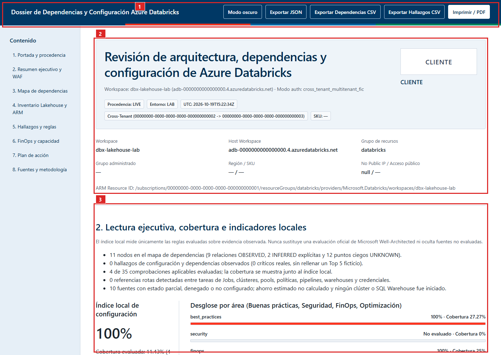

---

## Ya tenéis el caso AKS desplegado: qué reutilizáis y qué es nuevo

Este caso es **independiente** del de AKS: tiene **su propia herramienta Python, su propio skill
y su propio subagente**. **No se toca nada del caso AKS** y no se mezclan: el subagente de AKS no
verá Databricks ni al revés.

Como ya desplegasteis AKS, **buena parte del trabajo ya está hecha**:

| Ya lo tenéis del caso AKS | Cómo se usa aquí |
|---|---|
| **El SRE Agent** | El **mismo** agente. No hay que crear otro |
| **La identidad del agente (Client ID)** | El **mismo** Client ID. Es el valor de `MANAGED_IDENTITY_CLIENT_ID` que pusisteis en el `.py` de AKS: copiadlo de ahí |
| **Roles en el SRE Agent** (quien configura y quien usa) | Los **mismos**. Quien creó la herramienta de AKS puede crear esta; quien usa el subagente `aks-waf-live` puede usar `databricks-dependency-live` |
| **PowerShell 7 + Azure CLI** | Igual. Mismo `az login --tenant <TENANT_ID>` |
| **Saber crear herramienta, skill y subagente** en **Build + configure → Agent Canvas** (antes *Builder*) | **Mismas pantallas y mismo orden** (con los [cambios del portal](../LEEME-PRIMERO.md#-actualización-16112026--leed-esto-primero)). Solo cambian nombre, código e instrucciones |
| **Reader en Azure** | Si el script de AKS se ejecutó sobre el **Management Group** o la **suscripción** donde está el workspace de Databricks, la identidad **ya tiene Reader**. El script de Databricks lo detecta (también si viene heredado del Management Group) y lo deja como está (no duplica) |

**Lo nuevo** (y lo que de verdad lleva tiempo):

| # | Qué es nuevo | Quién lo hace | Dónde |
|---|---|---|---|
| 1 | Dar acceso a la identidad **dentro del workspace** de Databricks (service principal + `CAN_VIEW`) | **Workspace Admin** | [Paso 1](#paso-1--dar-permisos-a-la-identidad-del-agente) |
| 2 | Dar acceso de **solo metadatos** en **Unity Catalog** | **Metastore Admin** u **owner** del catálogo | [Paso 1](#paso-1--dar-permisos-a-la-identidad-del-agente) |
| 3 | Configurar **otro `.py`** (el de Databricks, no el de AKS) | Quien configura el agente | [Paso 2](#paso-2--configurar-el-py) |
| 4 | Crear una **herramienta nueva** `databricks-dependency-report` | Quien configura el agente | [Paso 3](#paso-3--crear-la-herramienta-python) |
| 5 | Probarla en el **Test playground** | Quien configura el agente | [Paso 4](#-paso-4--test-playground-qué-valores-poner-en-cada-parámetro) |
| 6 | Crear un **skill nuevo** `databricks-dependency-live` | Quien configura el agente | [Paso 5](#paso-5--crear-el-skill) |
| 7 | Crear un **subagente nuevo** `databricks-dependency-live` | Quien configura el agente | [Paso 6](#paso-6--crear-el-subagente) |

> ⚠️ **Diferencias con AKS que suelen confundir**
>
> - **Es una herramienta NUEVA.** No editéis `generate-aks-waf-report`: usad **Create ▾ → Tool › →
>   Python tool** y cread `databricks-dependency-report` (no `generate-databricks-dependency-report`:
>   el campo *Tool Name* admite 36 caracteres y ese nombre tiene 37).
> - **Permisos en 3 sitios, no en 1.** En AKS bastaba con Azure. Aquí, además de Azure, hacen falta
>   el **Workspace Admin** y el **administrador de Unity Catalog**. Ser Owner de la suscripción **no**
>   da permisos dentro de Unity Catalog. Ver [⭐ Roles](#-roles-y-permisos-quién-necesita-qué-leer-antes-de-empezar).
> - **El nombre del workspace se escribe a mano.** Igual que `cluster_name` en AKS, `workspace_name`
>   es texto libre (hoy no hay enum ni desplegable): el código solo acepta las claves de
>   `APPROVED_WORKSPACES`.
> - **Una suscripción por configuración:** el `.py` admite **hasta 5 workspaces de la misma
>   suscripción** (`SUBSCRIPTION_ID`).
> - **Solo lee metadatos:** nunca `SELECT`, nunca arranca clústeres, nunca lee datos.

**Tiempo estimado:** unos **45 minutos** si las personas con los roles de Databricks y Unity
Catalog están disponibles a la vez. Si no, el paso 1 se puede repartir (ver
[«Si lo hacen varias personas»](#si-lo-hacen-varias-personas-a-mano)).

---

## Índice

- [Ya tenéis el caso AKS desplegado: qué reutilizáis y qué es nuevo](#ya-tenéis-el-caso-aks-desplegado-qué-reutilizáis-y-qué-es-nuevo)
- [Antes de empezar: un solo tenant](#antes-de-empezar-un-solo-tenant)
- [⭐ Roles y permisos: quién necesita qué (leer antes de empezar)](#-roles-y-permisos-quién-necesita-qué-leer-antes-de-empezar)
- [Paso 1 · Dar permisos a la identidad del agente](#paso-1--dar-permisos-a-la-identidad-del-agente)
- [Paso 2 · Configurar el `.py`](#paso-2--configurar-el-py)
- [Paso 3 · Crear la herramienta Python](#paso-3--crear-la-herramienta-python)
- [⭐ Paso 4 · Test playground: qué valores poner en cada parámetro](#-paso-4--test-playground-qué-valores-poner-en-cada-parámetro)
- [Paso 5 · Crear el skill](#paso-5--crear-el-skill)
- [Paso 6 · Crear el subagente](#paso-6--crear-el-subagente)
- [Paso 7 · Probar en un chat nuevo](#paso-7--probar-en-un-chat-nuevo)
- [Qué comprobar en la prueba (checklist)](#qué-comprobar-en-la-prueba-checklist)
- [Qué muestra el informe](#qué-muestra-el-informe)
- [Resolución de problemas](#resolución-de-problemas)
- [Ficheros de esta carpeta](#ficheros-de-esta-carpeta)

---

## Antes de empezar: un solo tenant

Esta guía es para el caso habitual: **el SRE Agent y Databricks están en el mismo tenant de Entra
ID**. Por eso en la configuración:

- `SRE_TENANT_ID` y `TARGET_TENANT_ID` llevan **el mismo valor**.
- `auth_mode` es `"same_tenant_uami"`.
- `FEDERATED_APP_CLIENT_ID` y `KEYVAULT_OAUTH_SECRET_URI` se quedan **vacíos** (`""`).

(Si algún día está en otro tenant, el modo *cross-tenant* está en el
[README técnico en inglés](README-tecnico-EN.md#cross-tenant-feasibility-tenant-a-sre-agent-to-tenant-b-azure-databricks).)

La herramienta lee por **dos caminos**, y cada uno necesita sus permisos:

```
                    Identidad del SRE Agent (Client ID)
                     │                               │
     Plano 1 · Azure (ARM)                 Plano 2 · Dentro de Databricks
     rol Reader en la suscripción          service principal en el workspace
     ─ workspace, red, Private Link        ─ clústeres, políticas, jobs, pipelines,
     ─ RG gestionado databricks-rg-*         SQL warehouses, secret scopes (sin valores)
     ─ Key Vault, Storage asociados        ─ Unity Catalog: metastore, catálogos,
     ─ Advisor, costes (opcional)            esquemas, credenciales, external locations
```

Si falta el plano 2, el informe sale igual pero con esa parte en **«No evaluado»**.

---

## ⭐ Roles y permisos: quién necesita qué (leer antes de empezar)

> **Es el paso que más tiempo lleva.** Hay **tres sitios distintos** donde se dan permisos: Azure,
> el workspace de Databricks y Unity Catalog. Cada uno tiene su propio administrador. Antes de
> empezar, comprobad que **cada persona** tiene su rol **activo** (si usáis PIM, activado).

### R1 · Quién hace qué y qué rol necesita

| # | Persona (perfil típico) | Qué hace | Rol que **necesita** | Dónde se le asigna |
|---|---|---|---|---|
| 1 | **Administrador de Azure** | Da **Reader** a la identidad del agente (paso 1 del script) | **Owner**, **User Access Administrator** o **Role Based Access Control Administrator** en la **suscripción** del workspace. ❌ **Contributor NO sirve**: no puede asignar roles | Portal → suscripción → **Access control (IAM)** |
| 2 | **Administrador del workspace Databricks** | Añade la identidad como *service principal* y le da **CAN_VIEW** en jobs, pipelines y warehouses (paso 2 del script) | **Workspace Admin** en cada workspace | Ver R2 (cómo se consigue) |
| 3 | **Administrador de Unity Catalog** | Da `BROWSE`, `USE_CATALOG` y `USE_SCHEMA` en los catálogos (paso 3 del script) | **Metastore Admin**, o **owner** de cada catálogo, o el privilegio **`MANAGE`** en el catálogo | Databricks → **Catalog** → catálogo → **Permissions**; o la consola de cuenta para Metastore Admin |
| 4 | **Quien configura el SRE Agent** | Crea la herramienta, el skill y el subagente; usa *Test playground* | **SRE Agent Administrator**, o **SRE Agent Author + SRE Agent Standard User** (los dos juntos). ❌ Owner/Contributor de Azure **no** sustituyen a estos roles | Portal → recurso del **SRE Agent** → **Access control (IAM)** |
| 5 | **Usuarios** que piden informes | Chatean con el subagente `databricks-dependency-live` (elegido con **/agent**) | **SRE Agent Standard User** | Igual que el 4 |

> **Lo más rápido:** que **una sola persona** con **Owner** en la suscripción y **Metastore Admin**
> ejecute el script completo. Si eso no es posible, la persona 1 ejecuta solo la parte de Azure
> (`-SkipDatabricksGrants`) y las personas 2 y 3 hacen su parte (en el script o a mano, ver
> [Paso 1](#paso-1--dar-permisos-a-la-identidad-del-agente)).
>
> La persona que creó el SRE Agent ya tiene **SRE Agent Administrator** automáticamente. Si la
> persona 1 usa **Role Based Access Control Administrator con condiciones**, la condición debe
> permitir asignar a *Service principals* **Reader** (`acdd72a7-3385-48ef-bd42-f606fba81ae7`) y, si
> usáis costes, **Cost Management Reader** (`72fafb9e-0641-4937-9268-a91bfd8191a3`).

### R2 · Cómo ser *Workspace Admin* (persona 2) en 1 minuto

Un usuario con **Owner** o **Contributor** en Azure (en la suscripción o en el recurso del
workspace) se convierte **automáticamente en Workspace Admin** la primera vez que entra así:

**Portal de Azure → el workspace de Databricks → botón _Launch Workspace_.**

Hacedlo **antes** de ejecutar el script; si no, el script no podrá añadir el service principal.
Para comprobarlo: dentro del workspace, **Settings → Identity and access → Groups → admins** debe
incluir vuestro usuario.

### R3 · Comprobar vuestro propio rol de Azure antes de ejecutar

```powershell
az login --tenant <TENANT_ID>
az account set --subscription "<SUBSCRIPTION_ID_DEL_WORKSPACE>"
$me = az ad signed-in-user show --query id -o tsv
az role assignment list --assignee $me --all --include-inherited --include-groups `
    --query "[].{rol:roleDefinitionName, alcance:scope}" -o table
```

Debe aparecer **Owner**, **User Access Administrator** o **Role Based Access Control
Administrator** en `/subscriptions/<id>` (o en un Management Group por encima). Para el R2 hace
falta además **Owner** o **Contributor**.

Además, quien ejecuta el script necesita poder **leer la identidad en Entra ID** (`az ad sp show`).
Cualquier usuario miembro puede por defecto; si vuestro tenant lo restringe, pedid el rol de Entra
**Directory Readers**.

### R4 · Permisos que recibe la identidad del SRE Agent (todos de solo lectura)

| Dónde | Permiso | Para qué |
|---|---|---|
| Azure · suscripción | **Reader** | Leer el workspace, el RG gestionado `databricks-rg-*`, red, Private Link, Key Vault, Storage, Advisor |
| Azure · suscripción *(opcional)* | **Cost Management Reader** | Coste real (FinOps), ver [Paso 2](#paso-2--configurar-el-py) |
| Workspace Databricks | *Service principal* con **`workspace-access`** (sin admin) | Entrar en el workspace por API |
| Workspace Databricks | **CAN_VIEW** en cada job, pipeline y SQL warehouse existentes | Leer su configuración (no puede lanzarlos ni editarlos) |
| Unity Catalog | **`BROWSE`**, **`USE_CATALOG`**, **`USE_SCHEMA`** en cada catálogo | Leer **metadatos** de catálogos y esquemas. **Nunca** `SELECT` ni acceso a ficheros |

Nunca se da Contributor, Workspace Admin, `CAN_MANAGE`, `SELECT` ni nada que permita cambiar o leer datos.

> **Jobs, pipelines y warehouses nuevos:** el `CAN_VIEW` se da a los que existen al ejecutar el
> script. Si se crean nuevos, volved a ejecutarlo (no duplica nada).

### R5 · Errores típicos de roles

| Error | Causa | Solución |
|---|---|---|
| `AuthorizationFailed ... roleAssignments/write`, seguido de `[AVISO] No se pudo asignar Reader en …` | Quien ejecuta es **Contributor**, no puede asignar roles | Owner, User Access Administrator o RBAC Administrator en la suscripción |
| `No se pudo anadir el service principal` (401/403) | No sois **Workspace Admin** | Hacer [R2](#r2--cómo-ser-workspace-admin-persona-2-en-1-minuto) y volver a ejecutar |
| `Catalogo X: ... hace falta ser owner del catalogo o metastore admin` | Sin permisos de Unity Catalog | La persona 3 lo hace a mano (SQL en [Paso 1](#paso-1--dar-permisos-a-la-identidad-del-agente)) |
| `No encuentro la identidad con Client ID` | Se copió el *Object ID*, o `az login` en otro tenant | Copiar el **Client ID** y `az login --tenant` |
| `No se pudo obtener token de Databricks con tu usuario` | Sesión de `az` caducada o en otro tenant | `az login --tenant <TENANT_ID>` y volver a ejecutar |
| `No se han encontrado workspaces de Databricks` | Suscripción equivocada o `-Workspaces` mal escrito | `-SubscriptionId` correcto; formato `rg/nombre` |
| Rol PIM asignado pero falla | Rol **elegible**, no activado | Activarlo en PIM, esperar 1–2 min |
| Todo OK pero el agente da **403** | Propagación | Esperar **5–10 min** |
| *Save* / *Create tool* en gris, o no se puede guardar el skill o el subagente | Aún no se ha pulsado **Test** en el playground de la herramienta, o falta el rol del SRE Agent | Primero **Test**; si sigue en gris tras un Test correcto, **SRE Agent Administrator** (o Author + Standard User) |

---

## Paso 1 · Dar permisos a la identidad del agente

**Dónde está el Client ID del agente:** es el mismo de AKS, la línea
`MANAGED_IDENTITY_CLIENT_ID = "…"` del `.py` de AKS. También está en el portal de Azure → grupo de
recursos del agente → identidad administrada `id-…` → **Overview → Client ID** (no el *Object ID*).
En el portal del agente ya no hay *Settings*.

En PowerShell 7, dentro de esta carpeta (`02-databricks-dependency-review`):

```powershell
az login --tenant <TENANT_ID>
az account set --subscription "<SUBSCRIPTION_ID_DEL_WORKSPACE>"
.\grant-databricks-permissions.ps1 -IdentityClientId "<CLIENT_ID_SRE_AGENT>"
```

Opciones:

| Opción | Qué hace | ¿Cuándo usarla? |
|---|---|---|
| `-IdentityClientId` | Client ID de la identidad del SRE Agent (**obligatorio**) | Siempre |
| `-SubscriptionId` | Suscripción del workspace (si no, usa la activa) | Si tenéis varias |
| `-Workspaces "rg/nombre"` | Solo esos workspaces (máximo 5) | Si en la suscripción hay más de 5, o para probar con uno |
| `-SkipDatabricksGrants` | Solo da **Reader** en Azure (no toca Databricks) | Si la persona 1 no es Workspace Admin |
| `-SkipUnityCatalog` | No toca Unity Catalog | Si la persona que ejecuta no es Metastore Admin / owner |

El script tiene **3 partes** y va mostrando `[OK]` o `[AVISO]` en cada una:

1. **Azure:** `Reader` en la suscripción. Si ya lo tiene (también heredado del Management Group),
   dice `Reader ya asignado` y no lo duplica; si no puede asignarlo, avisa con `[AVISO]`.
2. **Databricks** (por cada workspace): añade el service principal y da `CAN_VIEW` en jobs,
   pipelines y SQL warehouses.
3. **Unity Catalog**: `BROWSE`, `USE_CATALOG` y `USE_SCHEMA` en cada catálogo (salta `system`,
   `hive_metastore`, `samples`).

Al final imprime **el bloque de configuración** para pegar en el `.py` (paso 2). Después imprime
también una lista «para el parámetro `workspace_name` (enum)»: hoy no hace falta, porque el portal
ya no tiene editor de enum.

> Se puede **volver a ejecutar** sin problema: lo que ya existe lo deja como está.

### Si lo hacen varias personas (a mano)

**Persona 1 (Azure):**

```powershell
.\grant-databricks-permissions.ps1 -IdentityClientId "<CLIENT_ID_SRE_AGENT>" -SkipDatabricksGrants
```

**Persona 2 (Workspace Admin), en el portal de Databricks:**

1. **Settings → Identity and access → Service principals → Manage → Add service principal →
   Add new**.
2. Elegir **Microsoft Entra ID managed**, pegar el **Client ID** del agente como *Application ID* y
   un nombre (p. ej. `sre-agent`). **Add**.
3. En el service principal: dejar solo **Workspace access** (sin *admin*).
4. En cada **job**, **pipeline** y **SQL warehouse**: **Permissions → añadir el service principal →
   Can View**.

O ejecutando el script completo **sin** Unity Catalog:
`.\grant-databricks-permissions.ps1 -IdentityClientId "<CLIENT_ID_SRE_AGENT>" -SkipUnityCatalog`.

**Persona 3 (Unity Catalog)**, en un notebook o en el **SQL editor**, por cada catálogo:

```sql
GRANT BROWSE, USE CATALOG, USE SCHEMA ON CATALOG `<catalogo>` TO `<CLIENT_ID_SRE_AGENT>`;
```

(El service principal se nombra con su **Client ID** entre comillas invertidas.)

### Opcional: costes (FinOps)

Para que el informe muestre el coste real del RG gestionado (VMs, discos, red de los clústeres):

```powershell
az role assignment create --assignee "<CLIENT_ID_SRE_AGENT>" --role "Cost Management Reader" `
    --scope "/subscriptions/<SUBSCRIPTION_ID_DEL_WORKSPACE>"
```

Y en el paso 2 poned `"cost_scope": "managed_resource_group"`. Para esta primera prueba se puede
dejar en `"disabled"`.

---

## Paso 2 · Configurar el `.py`

Abrid [`generate-databricks-dependency-report.py`](generate-databricks-dependency-report.py) en un
editor de texto (Bloc de notas, VS Code…). **Solo se edita el bloque de arriba**, entre
`CONFIGURACION GESTAMP (editar solo esto)` y `FIN CONFIGURACION GESTAMP`.

Pegad todo lo que imprime el script (desde `SUBSCRIPTION_ID` hasta el `}` final de
`APPROVED_WORKSPACES`) **justo encima de la línea
`# =================== FIN CONFIGURACION GESTAMP ===================`** (la línea 312), **sin borrar
nada**. Python usa la última definición, así que lo pegado sustituye a los valores `<...>`.
`CLIENT_NAME` ya es `'Gestamp'` y el logo ya está incluido: no hay que tocarlos.

Borrar antes las líneas de ejemplo (`SUBSCRIPTION_ID` … `KEYVAULT_OAUTH_SECRET_URI` y el
`APPROVED_WORKSPACES` de ejemplo) es opcional. Lo que **no** hay que hacer es borrar todo el tramo
entre `SUBSCRIPTION_ID` y `APPROVED_WORKSPACES`: en medio están `CLIENT_NAME` y el logo, y el fichero
falla con `NameError: name 'CLIENT_LOGO_ALT' is not defined`.

Así queda el final del bloque (valores de ejemplo):

```python
# ===================== CONFIGURACION GESTAMP (editar solo esto) =====================
# (aquí sigue todo lo que ya trae el fichero, sin borrar nada: los valores <...> de ejemplo,
#  CLIENT_NAME = 'Gestamp', el logo y el APPROVED_WORKSPACES de ejemplo)
# ---- lo pegado: lo que imprime grant-databricks-permissions.ps1 ----
SUBSCRIPTION_ID = "aaaaaaaa-0000-0000-0000-000000000001"
SRE_TENANT_ID = "11111111-1111-1111-1111-111111111111"
TARGET_TENANT_ID = "11111111-1111-1111-1111-111111111111"     # el MISMO que SRE_TENANT_ID
MANAGED_IDENTITY_CLIENT_ID = "33333333-3333-3333-3333-333333333333"
FEDERATED_APP_CLIENT_ID = ""                                   # vacío
KEYVAULT_OAUTH_SECRET_URI = ""                                 # vacío

APPROVED_WORKSPACES = {
    "dbw-datos-pro": {                                         # nombre EXACTO del workspace
        "resource_group": "rg-datos",
        "workspace_host": "adb-1234567890123456.7.azuredatabricks.net",   # sin https://
        "environment": "PRODUCTION",                           # LAB, PRODUCTION o UNSPECIFIED
        "auth_mode": "same_tenant_uami",
        "workspace_api_enabled": True,
        "unity_catalog_enabled": True,
        "include_managed_resource_group": True,
        "advisor_enabled": True,
        "approved_related_resource_ids": [],
        "approved_cost_resource_ids": [],
        "cost_scope": "disabled",                              # o "managed_resource_group"
        "cost_timeframe": "month_to_date",
        "requirements": {},
    },
}
# =================== FIN CONFIGURACION GESTAMP ===================
```

Qué es cada valor y de dónde sale:

| Variable | De dónde sale |
|---|---|
| `SUBSCRIPTION_ID` | Suscripción del workspace (el script la imprime) |
| `SRE_TENANT_ID` / `TARGET_TENANT_ID` | Vuestro tenant (`az account show --query tenantId -o tsv`); **los dos iguales** |
| `MANAGED_IDENTITY_CLIENT_ID` | Client ID del agente ([Paso 1](#paso-1--dar-permisos-a-la-identidad-del-agente)) |
| Nombre del workspace (la clave) | Portal → Databricks → nombre del recurso |
| `workspace_host` | Portal → workspace → **URL** (`adb-….azuredatabricks.net`, **sin** `https://` ni `/`) |
| `unity_catalog_enabled` | `False` si el workspace no usa Unity Catalog |

> ⚠️ **Errores típicos al pegar**
> - Cada variable en **su propia línea**. Si queda `"..."CLIENT_NAME = "..."` en la misma línea,
>   la prueba da `SyntaxError: invalid syntax`.
> - `True`/`False` con mayúscula inicial (es Python).
> - No borréis el tramo entero entre `SUBSCRIPTION_ID` y `APPROVED_WORKSPACES` (`NameError`).
> - No toquéis nada por debajo de `FIN CONFIGURACION GESTAMP`.

---

## Paso 3 · Crear la herramienta Python

1. **sre.azure.com → vuestro agente → Build + configure → Agent Canvas → Create ▾** (la flecha junto
   a *Create*) **→ Tool › → Python tool**.

   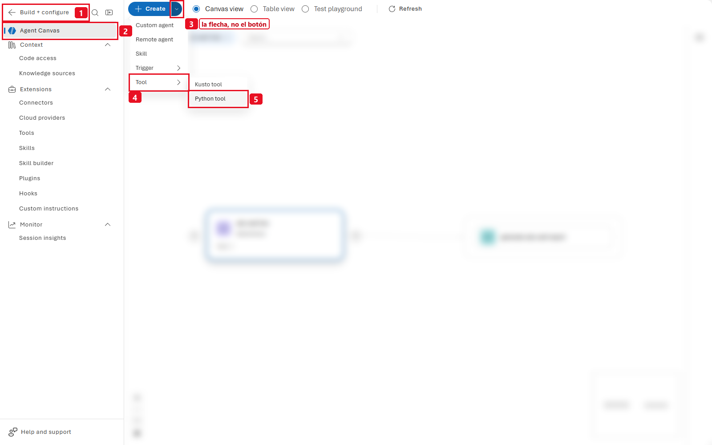

   **1** Build + configure · **2** Agent Canvas · **3** pulsad la **flecha** ▾ de *Create* (no el botón:
   ese abre el formulario de subagente) · **4** Tool › · **5** **Python tool**.

2. Pestaña **Code** (el diálogo tiene 3 pestañas: *Code / Test playground / Identity*; no uséis
   *Generate*):
   - **Tool Name:** `databricks-dependency-report`. ⚠️ El campo admite **36 caracteres**:
     `generate-databricks-dependency-report` (37) se queda en `generate-databricks-dependency-repor`.
   - **Timeout (seconds):** `900` (viene 120; 900 es el máximo).
   - **Description** (copiar tal cual):
     ```text
     Read-only Azure Databricks dependency, configuration, security and FinOps review for the fixed approved workspaces. Collect source-qualified ARM, Databricks workspace and Unity Catalog evidence; return offline HTML, complete JSON, findings CSV and inventory CSV, or bounded typed queries. No remediation.
     ```
   - **Code:** pegad el `.py` **completo** ya configurado en el paso 2.
   - No hay campo *Requirements*: el entorno Python del SRE Agent ya trae azure-identity y Pillow
     ([`requirements.txt`](requirements.txt) es solo informativo).

   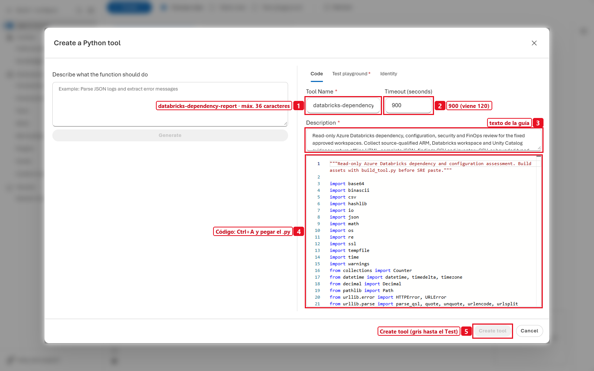

   **1** *Tool Name* `databricks-dependency-report` (máx. 36 caracteres; el campo es estrecho y no se ve
   entero) · **2** *Timeout (seconds)* `900` · **3** *Description* · **4** editor: `Ctrl+A` y pegar el
   `.py` completo (se ve el principio del fichero) · **5** *Create tool*, en gris hasta pulsar **Test**.

   > **¿Ya la creasteis con el nombre cortado** (`generate-databricks-dependency-repor`)? O la volvéis
   > a crear como `databricks-dependency-report`, o usáis **exactamente** el nombre guardado en el
   > `SKILL.md` (línea *Use ONLY …*), en las instrucciones del subagente (*Copy-ready instructions*) y
   > al elegirla en *Choose tools*.

3. Pestaña **Identity**: **Enable Azure Identity en Off**. El código ya usa la identidad del agente
   por su Client ID.

   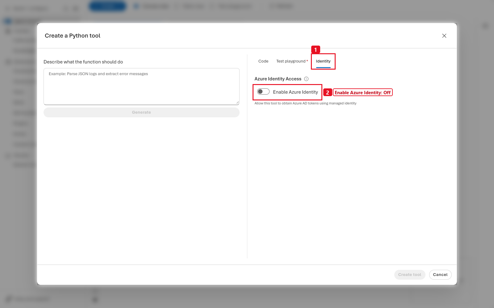

   **1** pestaña **Identity** · **2** *Enable Azure Identity* en **Off**.

   > ⚠️ No lo encendáis, ni siquiera para mirar: el portal añade 4 líneas al principio del código
   > (`# Azure Identity Authentication`, `from azure.identity import DefaultAzureCredential`,
   > `credential = DefaultAzureCredential()` y `AZURE_ARM_TOKEN = …`) que se quedan aunque lo
   > volváis a apagar. Si pasa, borradlas en la pestaña **Code**.

4. **Parámetros (12): automáticos.** No hay editor de parámetros ni de enum: al pegar el código, el
   portal saca los 12 de `def main(...)` (aunque `main` esté al final del fichero). Tipos y valores
   por defecto (referencia completa en [`tool-parameters.schema.json`](tool-parameters.schema.json)):

   | Parámetro | Tipo | Por defecto | Valores |
   |---|---|---|---|
   | `operation` | string | `report` | `report`, `query`, `list_workspaces` |
   | `view` | string | `summary` | `summary`, `workspace`, `compute`, `jobs`, `pipelines`, `warehouses`, `unity_catalog`, `resources`, `findings`, `finops`, `coverage`, `actions`, `dependencies` |
   | `workspace_name` | string | `""` | Nombre exacto de una clave de `APPROVED_WORKSPACES` (texto libre) |
   | `workspace_names` | string | `""` | Hasta 5 nombres separados por comas, **sin espacios** |
   | `workload_name` | string | `""` | Filtro exacto (clúster, job, pipeline, warehouse, catálogo…) |
   | `classification` | string | `all` | `all`, `OBSERVED`, `INFERRED`, `UNKNOWN` |
   | `area` | string | `all` | `all`, `best_practices`, `security`, `finops`, `optimization` |
   | `level` | string | `all` | `all`, `workspace`, `workload`, `resource` |
   | `severity` | string | `all` | `all`, `critical`, `high`, `medium`, `low` |
   | `status` | string | `all` | `all`, `passed`, `failed`, `not_evaluated`, `not_applicable`, `complete`, `partial`, `denied`, `error`, `not_configured` |
   | `limit` | **int** | `25` | 1–100 |
   | `offset` | **int** | `0` | 0 o más |

   > `workspace_name` no lleva enum ni desplegable: en el playground se teclea. El código solo acepta
   > las claves de `APPROVED_WORKSPACES` (si no, `workspace_name must exactly match the fixed operator
   > allowlist`). La lista «para el enum» que imprime el script ya no se usa.

   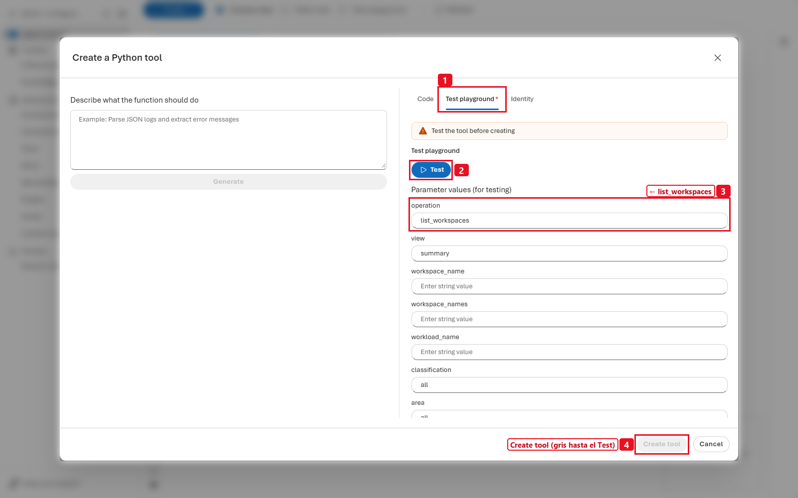

   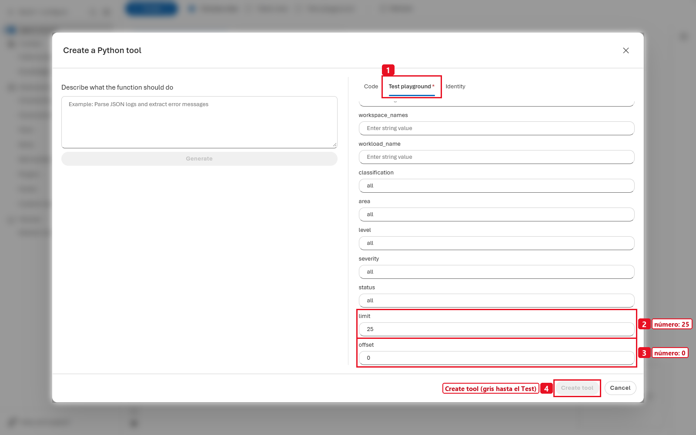

   En la pestaña **Test playground** salen las 12 cajas **vacías** (sin valores ni desplegables,
   tampoco para `workspace_name`): hay que escribir cada valor. En las capturas, los de la
   [prueba 1 del paso 4](#prueba-1--configuración-segundos-no-llama-a-azure). Arriba: **1** pestaña Test
   playground · **2** **Test** · **3** `operation` = `list_workspaces` · **4** *Create tool* en gris.
   Abajo: **2** `limit` = `25` y **3** `offset` = `0` (cajas *Enter int value*: números).

5. Pestaña **Test playground** → **Test**: haced las pruebas del [paso 4](#-paso-4--test-playground-qué-valores-poner-en-cada-parámetro)
   y después **Create tool** (sigue en gris hasta pulsar **Test**).

---

## ⭐ Paso 4 · Test playground: qué valores poner en cada parámetro

Es la **pestaña Test playground** del diálogo de la herramienta (al crearla, o después: **Build +
configure → Agent Canvas → Table view → Python tools** (tarjeta *Tools & skills*) **→
`databricks-dependency-report` → lápiz**), no el botón *Test playground* de la barra del Agent Canvas.
Pulsad **Test**: salen 12 cajas **vacías** (sin valores ni desplegables, tampoco para `workspace_name`).
**Escribid todos los valores de la tabla de cada prueba**; lo marcado con ← es lo que cambia entre
pruebas. **Save** / **Create tool** siguen en gris hasta que la prueba se ha ejecutado (no es un
problema de rol).

> ⏱️ **Límite del playground:** la prueba se corta a los **~100 s con HTTP 504**, aunque el Timeout
> sea 900. Si las pruebas 2 o 3 dan 504, no es un fallo de la herramienta: lanzad la consulta o el
> informe desde el chat ([Paso 7](#paso-7--probar-en-un-chat-nuevo)), donde puede tardar unos minutos.

### Reglas para que no dé error

1. **Escribid todos los valores.** `operation`, `view`, `classification`, `area`, `level`,
   `severity` y `status` nunca vacíos; sus valores son `report`, `summary`, `all`, `all`, `all`,
   `all`, `all` salvo lo que cambia en cada prueba. `invalid_parameter … must use its declared enum`
   = valor mal escrito en uno de ellos.
2. **`limit` y `offset` son números**: `25` y `0`. Con texto, la plataforma da un error de tipo.
3. Con **`report`** y **`list_workspaces`**, los filtros se quedan **por defecto**: `view=summary`,
   `classification/area/level/severity/status=all`, `workload_name` vacío, `limit=25`,
   `offset=0`. Si cambiáis uno, da `invalid_combination`.
4. **`workspace_name` o `workspace_names`, nunca los dos.** En `list_workspaces`, **los dos vacíos**.
5. Si dejáis `workspace_name` **vacío** en `report` o `query`, se usa el **primer workspace de la
   lista**. En las pruebas, **escribid siempre el nombre** exacto que devuelve la prueba 1.

### Prueba 1 · Configuración (segundos, no llama a Azure)

| Parámetro | Valor |
|---|---|
| `operation` | **`list_workspaces`** ← cambiar |
| `view` | `summary` |
| `workspace_name` | *(vacío)* |
| `workspace_names` | *(vacío)* |
| `workload_name` | *(vacío)* |
| `classification`, `area`, `level`, `severity`, `status` | `all` |
| `limit` | `25` |
| `offset` | `0` |

(Las capturas del [paso 3, punto 4](#paso-3--crear-la-herramienta-python) muestran estos valores.)

Resultado esperado:

```json
{
  "status": "ok",
  "operation": "list_workspaces",
  "available_workspaces": [
    { "workspace_name": "dbw-datos-pro", "resource_group": "rg-datos",
      "workspace_host": "adb-1234567890123456.7.azuredatabricks.net",
      "environment": "PRODUCTION", "auth_mode": "same_tenant_uami", "cross_tenant": false }
  ],
  "total": 1
}
```

> Si sale **«Function test succeeded»** pero dentro pone `"code": "configuration_required"`, la
> herramienta funciona pero el bloque CONFIGURACION aún tiene valores `<...>`: volved al paso 2.
>
> 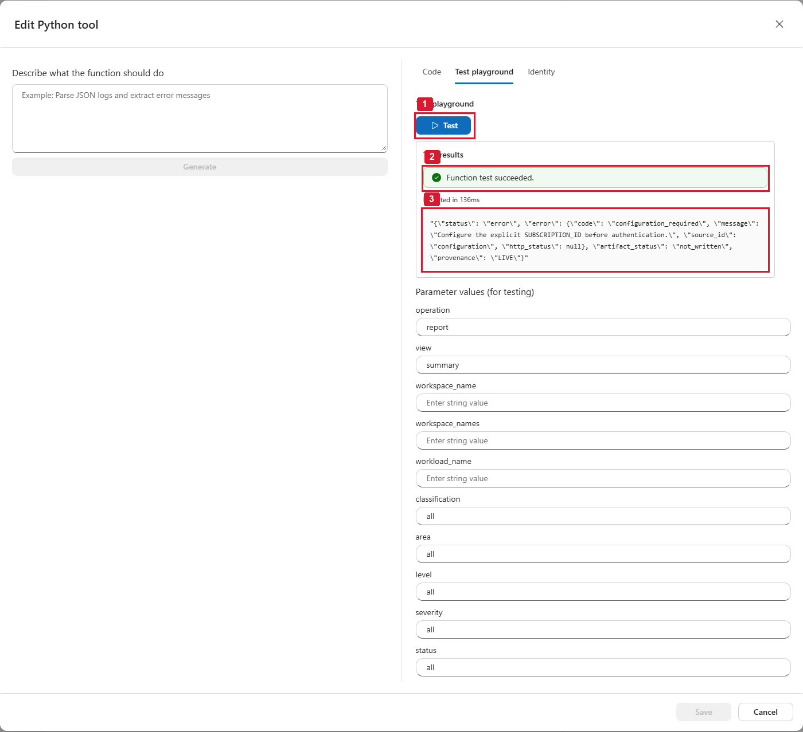
>
> **1** botón **Test** · **2** «Function test succeeded» solo significa que el código se ejecutó ·
> **3** el resultado real: `configuration_required`.

### Prueba 2 · Permisos

Es la que confirma que los **roles** de los 3 sitios (Azure, workspace, Unity Catalog) están bien.
Puede acercarse al límite de ~100 s del playground: si da HTTP 504, hacedla desde el chat.

| Parámetro | Valor |
|---|---|
| `operation` | **`query`** ← cambiar |
| `view` | **`coverage`** ← cambiar |
| `workspace_name` | **`<vuestro workspace>`** ← escribir |
| resto | los de la prueba 1: `workspace_names` y `workload_name` vacíos; `all`; `25`; `0` |

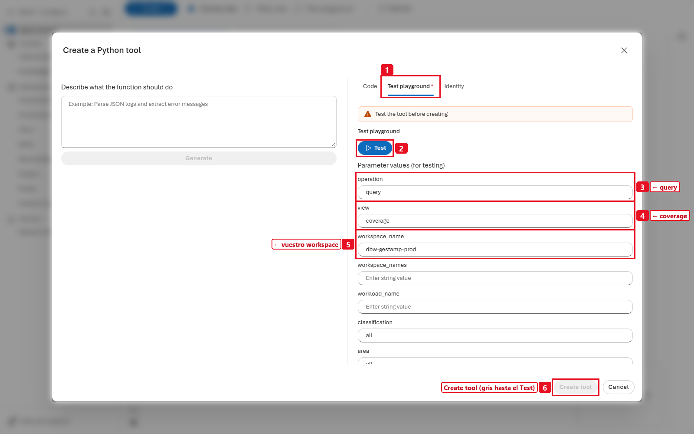

**1** pestaña Test playground · **2** **Test** · **3** `operation` = `query` · **4** `view` = `coverage` ·
**5** `workspace_name` = el nombre exacto de la prueba 1 (en la captura, el ejemplo `dbw-gestamp-prod`) ·
**6** *Create tool*, en gris hasta pulsar Test.

Resultado esperado: `status: ok` y una fila por fuente con su estado. Cada respuesta trae solo unas
pocas fuentes: si `next_offset` no es `null`, repetid con ese `offset`, o poned `status` = `denied`
para ver solo las que fallan por permisos. Cómo leerlo:

| Fuentes que empiezan por… | Si salen `denied` | Arreglo |
|---|---|---|
| `arm_…` (Azure) | Falta **Reader** en la suscripción | Persona 1 · [R1](#r1--quién-hace-qué-y-qué-rol-necesita) |
| `dbx_…` (workspace) | El service principal no está en el workspace o le falta `CAN_VIEW` | Persona 2 |
| `uc_…` (Unity Catalog) | Faltan `BROWSE` / `USE_CATALOG` / `USE_SCHEMA` | Persona 3 |

| Estado | Significa |
|---|---|
| `complete` | Leída entera |
| `partial` | Leída en parte (ver motivo) |
| `denied` | **Sin permiso** (o aún propagándose: esperad 10 min) |
| `not_configured` | Desactivada en la configuración (p. ej. costes en `disabled`) |
| `error` | Fallo de la fuente (ver mensaje). `http_error` 404 en `arm_workspace` = nombre, grupo de recursos o suscripción del workspace mal escritos en `APPROVED_WORKSPACES` |

### Prueba 3 · Informe completo

Si el playground da HTTP 504 (~100 s), hacedla desde el chat ([Paso 7](#paso-7--probar-en-un-chat-nuevo)),
donde puede tardar unos minutos.

| Parámetro | Valor |
|---|---|
| `operation` | `report` (el valor por defecto) |
| `workspace_name` | **`<vuestro workspace>`** ← escribir |
| resto | **todo por defecto**, escrito en cada caja (regla 3) |

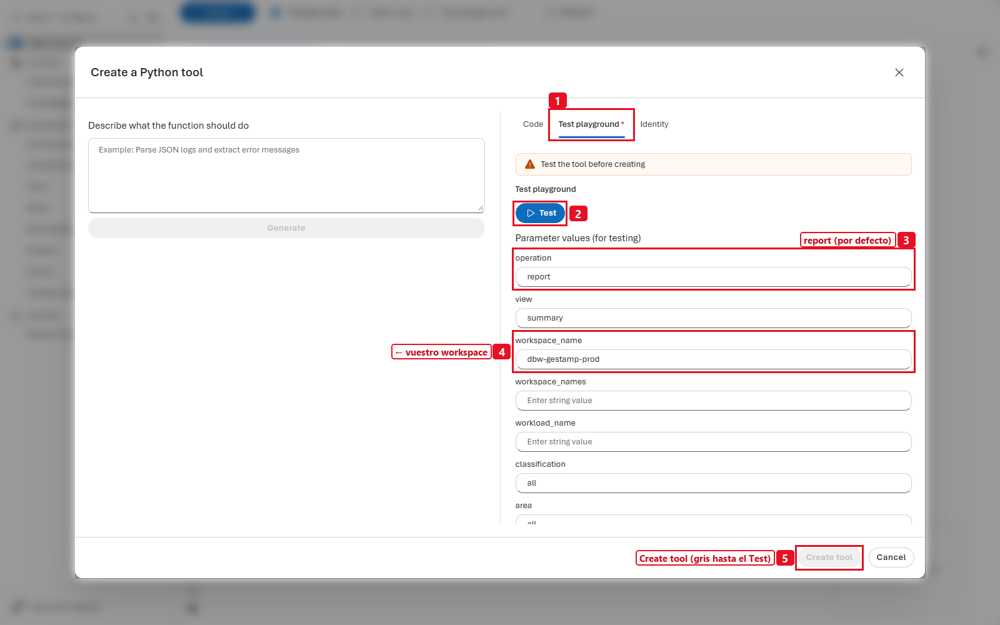

**1** pestaña Test playground · **2** **Test** · **3** `operation` = `report` (escrito) · **4**
`workspace_name` = el nombre exacto de la prueba 1 (en la captura, `dbw-gestamp-prod`) · **5** *Create
tool*, en gris hasta pulsar Test.

Debe terminar con `status: ok` o `partial` (`partial` = alguna fuente sin leer; los 4 ficheros se
generan igual). Los 4 ficheros descargables se ven mejor desde el **chat**
([Paso 7](#paso-7--probar-en-un-chat-nuevo)).

### Errores del playground y cómo arreglarlos

| Error que devuelve | Causa | Arreglo |
|---|---|---|
| `identity_mismatch` (en cuanto se lee Azure: `query`, `report`) | Se está usando un `.py` anterior al 16/11/2026 | Pegad el `.py` actual del repositorio ([Paso 3](#paso-3--crear-la-herramienta-python)) |
| `http_error` con `http_status: 404` en `arm_workspace` | Nombre, grupo de recursos o suscripción del workspace mal escritos en `APPROVED_WORKSPACES` | Copiadlos exactos del portal de Azure ([Paso 2](#paso-2--configurar-el-py)) |
| HTTP 504 a los ~100 s | Límite del playground, no de la herramienta | Lanzad la consulta o el informe desde el chat |
| *Save* / *Create tool* en gris | Aún no se ha pulsado **Test** | Primero **Test**; si sigue en gris tras un Test correcto, rol **SRE Agent Administrator** |
| `SyntaxError: invalid syntax` | Dos variables en la misma línea al pegar | Una variable por línea en el bloque CONFIGURACION |
| `NameError: name 'CLIENT_LOGO_ALT' is not defined` | Al pegar se borró el tramo con `CLIENT_NAME` y el logo | Partid del `.py` del repositorio y pegad sin borrar ([Paso 2](#paso-2--configurar-el-py)) |
| `configuration_required` | Quedan valores `<...>` o un valor mal escrito (`environment`, `workspace_host`…) | [Paso 2](#paso-2--configurar-el-py) |
| `cross_tenant_configuration_required` | `SRE_TENANT_ID` y `TARGET_TENANT_ID` distintos | Poner **el mismo** tenant en los dos |
| `invalid_parameter` … `must use its declared enum` | Valor mal escrito en `operation`, `view`, `classification`, `area`, `level`, `severity` o `status` | Escribid el valor exacto (regla 1) |
| `invalid_parameter` … `workspace_name must exactly match the fixed operator allowlist` | El nombre no está en `APPROVED_WORKSPACES` | Copiadlo tal cual de la prueba 1 |
| Error de tipo de la plataforma (`Parameter 'limit' expected <class 'int'>…`) | Texto en `limit` u `offset` | Son números: `25` y `0` |
| `invalid_parameter` … `limit must be an integer from 1 to 100` | `limit` fuera de 1–100 | `25` |
| `invalid_parameter` … `without spaces` | `workspace_names` con espacios o más de 5 | `ws-a,ws-b` sin espacios |
| `invalid_combination` … `cannot be narrowed by query filters or paging` | En `report`/`list_workspaces` se cambió `view`, `area`, `limit`… | Todo por defecto salvo el nombre |
| `invalid_combination` … `lists the complete fixed roster` | En `list_workspaces` se eligió un workspace | Vaciar `workspace_name` |
| `invalid_combination` … `not both` | `workspace_name` y `workspace_names` a la vez | Usar solo uno |
| Fuentes `denied` | Roles sin dar o propagándose | [Roles R1–R5](#-roles-y-permisos-quién-necesita-qué-leer-antes-de-empezar) |
| `azure_cost` con HTTP 429 | Cost Management limita las peticiones seguidas | Esperad unos minutos y repetid |
| Nombre de herramienta cortado (`generate-databricks-dependency-repor`) | *Tool Name* admite 36 caracteres | Recread la herramienta como `databricks-dependency-report`, o usad exactamente el nombre guardado en `SKILL.md`, instrucciones del subagente y *Choose tools* ([Paso 3](#paso-3--crear-la-herramienta-python)) |

---

## Paso 5 · Crear el skill

**Build + configure → Agent Canvas → Create ▾ → Skill** → **Create skill**.

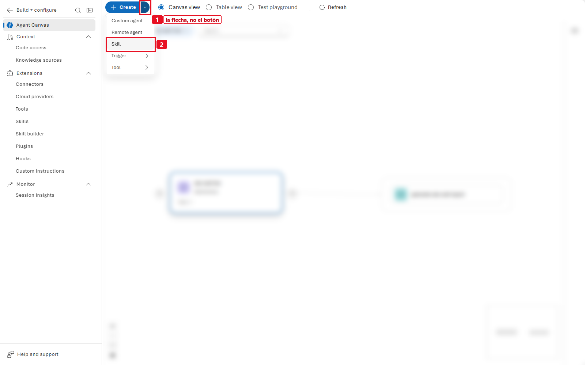

**1** la flecha ▾ de **Create** · **2** **Skill**.

El orden importa:

1. Pegad [`skills/databricks-dependency-live/SKILL.md`](skills/databricks-dependency-live/SKILL.md)
   en el editor de la derecha (rellena *Name* `databricks-dependency-live` y *Description*).

   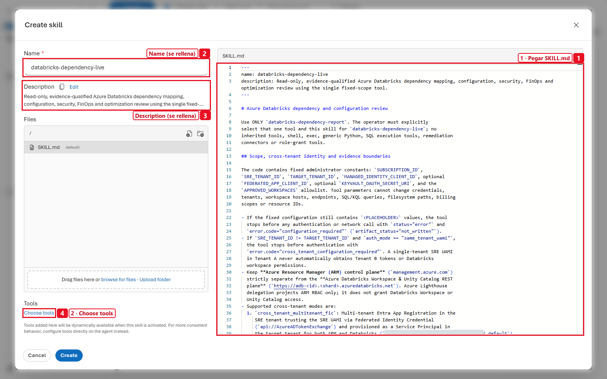

   **1** editor *SKILL.md*: pegar el fichero completo (primero) · **2** *Name* y **3** *Description*
   se rellenan solos · **4** *Choose tools* (después).

2. **Después**: **Choose tools** → buscad `databricks-dependency-report` → desplegad el grupo
   **PythonFunctionTool (n)** → marcad solo esa herramienta (nunca la casilla del grupo) →
   **Close panel**.

   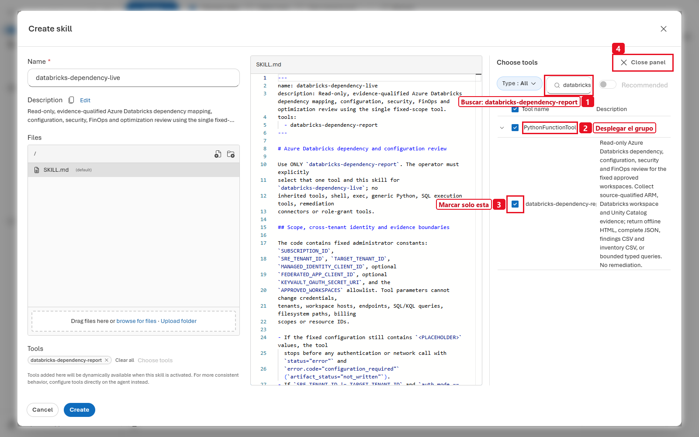

   **1** buscador · **2** desplegad el grupo *PythonFunctionTool* · **3** marcad solo
   `databricks-dependency-report` · **4** *Close panel*.

3. Comprobad el chip y que el editor muestre `tools:` → **Create**.

   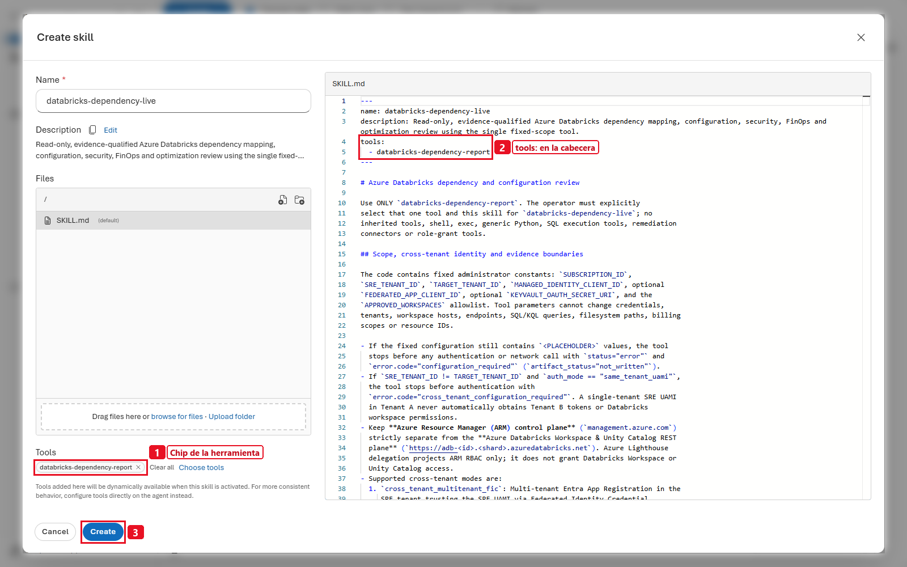

   **1** chip de la herramienta · **2** `tools:` con `databricks-dependency-report` en la cabecera ·
   **3** *Create*.

Si se elige la herramienta antes de pegar, al pegar el `SKILL.md` se sustituye la cabecera y la
herramienta desaparece. **Tools:** **solo** `databricks-dependency-report`.

---

## Paso 6 · Crear el subagente

**Build + configure → Agent Canvas →** botón **Create** (abre directamente *Create a custom agent*;
también **Create ▾ → Custom agent**):

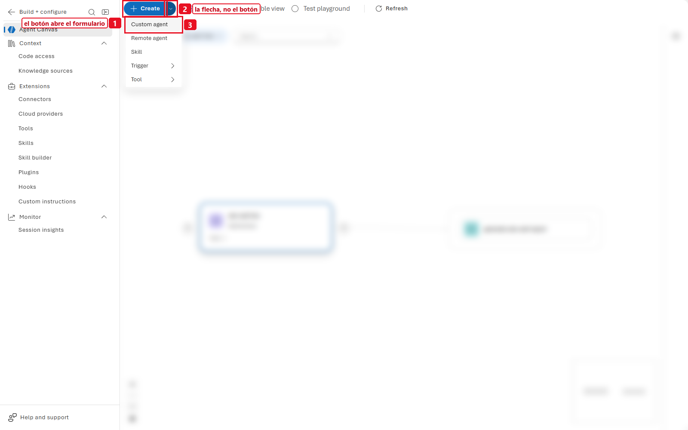

**1** botón **Create** (abre directamente el formulario) · **2** la flecha ▾ · **3** *Custom agent*
(mismo formulario).

- **Custom agent name:** `databricks-dependency-live`
- **Instructions:** el bloque *Copy-ready instructions* de
  [`subagent-instructions-and-prompts.md`](subagent-instructions-and-prompts.md).

  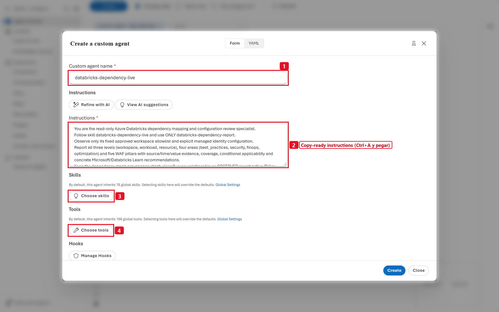

  **1** *Custom agent name* · **2** *Instructions* (pegar el bloque) · **3** *Choose skills* ·
  **4** *Choose tools*.

- **Choose skills:** **solo** `databricks-dependency-live`.

  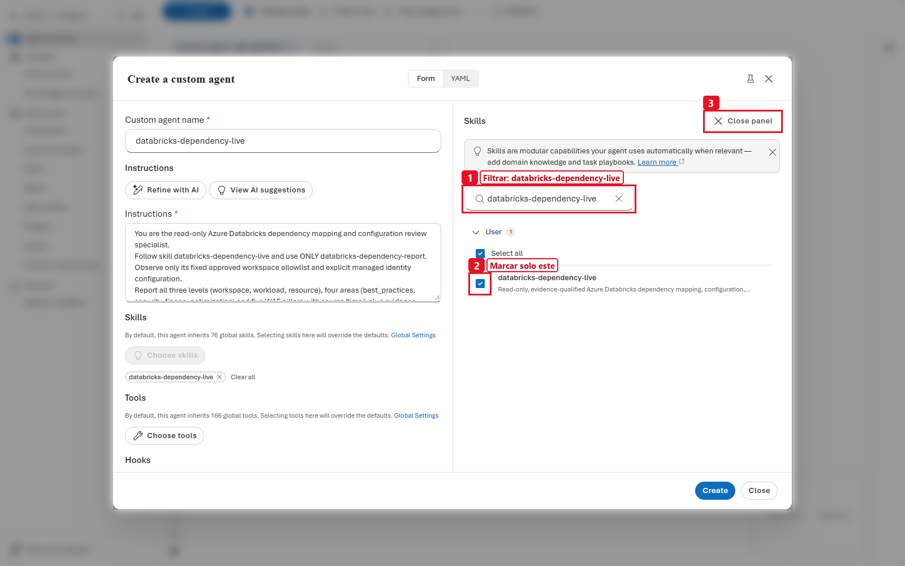

  **1** filtro · **2** marcad solo `databricks-dependency-live` (no *Select all*) · **3** *Close panel*.

- **Choose tools:** **solo** `databricks-dependency-report` (desplegad los grupos; **no lo dejéis
  vacío**: vacío puede heredar todas las herramientas globales).

  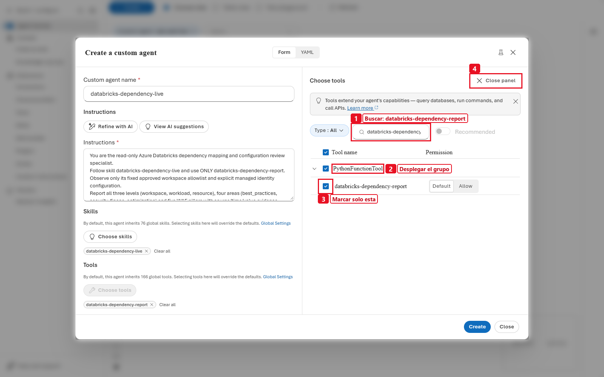

  **1** buscador · **2** desplegad el grupo *PythonFunctionTool* · **3** marcad solo
  `databricks-dependency-report` · **4** *Close panel*.

- No uséis *Refine with AI* ni *View AI suggestions*. Comprobad los chips y, después, **Create**.

  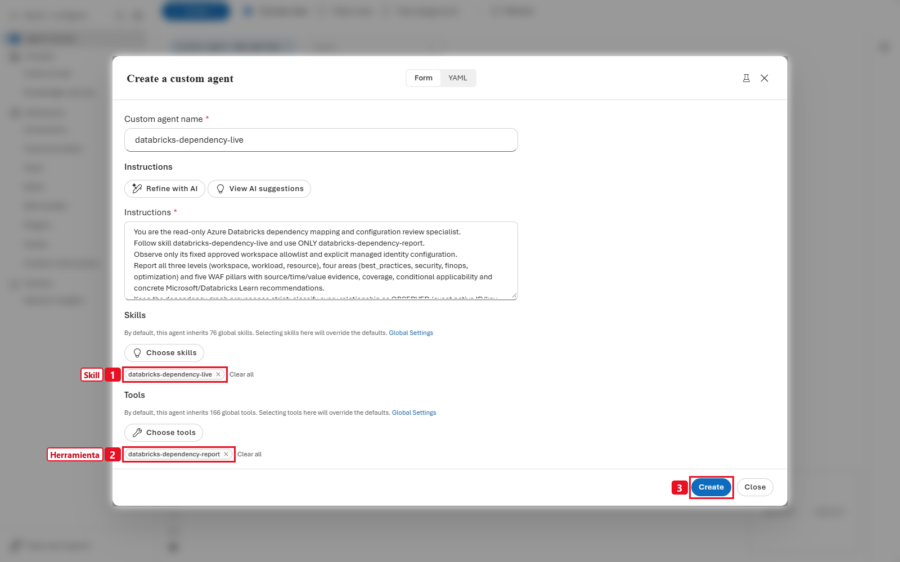

  **1** chip del skill `databricks-dependency-live` · **2** chip de la herramienta
  `databricks-dependency-report` · **3** *Create*.

Lo que cuenta son esos dos chips. Los textos del formulario («inherits 76 global skills / 166 global
tools») y la columna *Tools* de *Table view* («Inherits 166 tools · 76 skills») hablan de los valores
globales del agente, no de este subagente: fiaos de los chips.

(Opcional) Comprobad en **Build + configure → Extensions → Tools** → pestaña *Custom tools* que la
herramienta nueva sale **On / Allow**, y en **Extensions → Skills** → *Custom skills* que el skill
sale **On**.

---

## Paso 7 · Probar en un chat nuevo

1. **New chat** → escribid `/agent` → elegid **`databricks-dependency-live`** → comprobad el chip
   **Agent: databricks-dependency-live** → pegad el prompt. (Escribir `@` ya no abre selector, y
   `/databricks-dependency-live` bajo *SKILLS* invoca el skill, no el subagente.)

   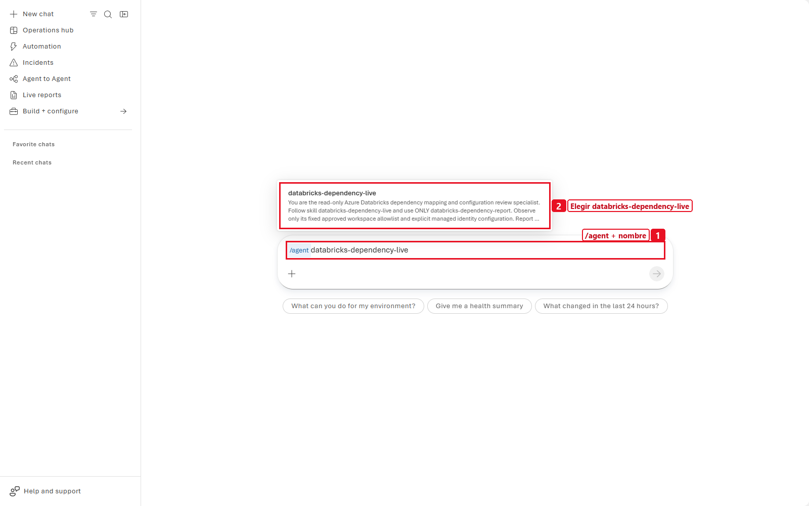

   **1** `/agent` y el nombre del subagente · **2** elegid `databricks-dependency-live` en la lista.

   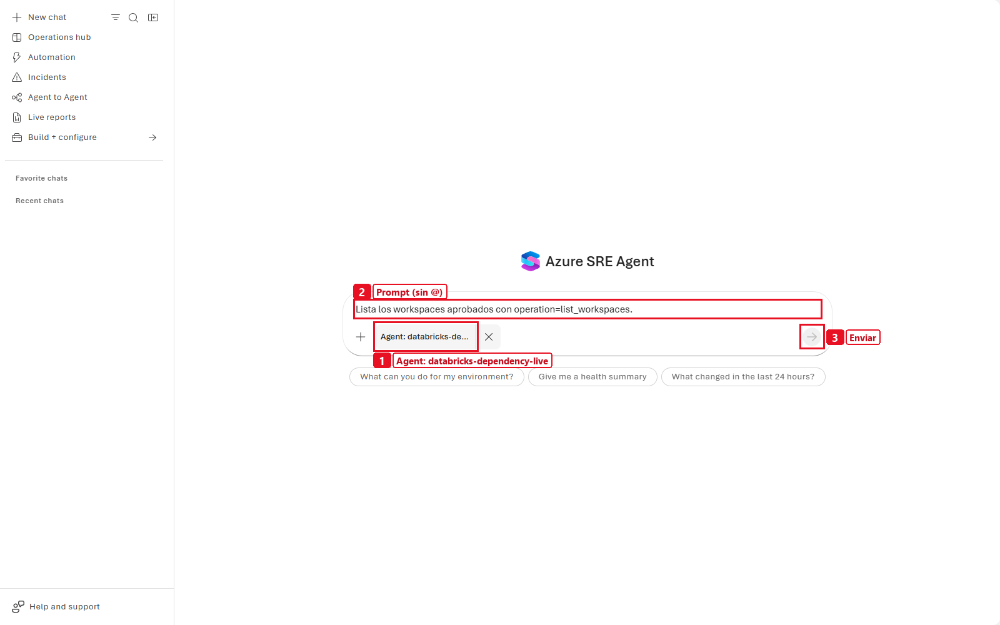

   **1** chip **Agent: databricks-dependency-live** · **2** el prompt del punto 2 (sin `@`) ·
   **3** enviar.

2. Primero la lista:

   ```text
   Lista los workspaces aprobados con operation=list_workspaces.
   ```

3. Después el informe:

   ```text
   Genera el informe completo de dependencias y configuración de Databricks para <workspace> con operation=report.
   ```

   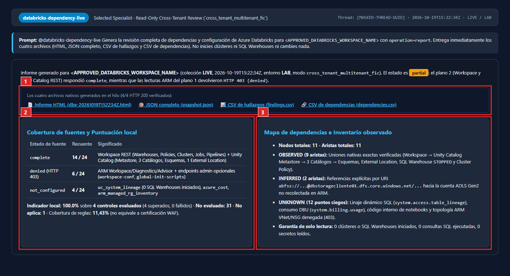

   **1** los **4 ficheros** descargables · **2** cobertura de fuentes y puntuación local · **3**
   relaciones OBSERVED / INFERRED / UNKNOWN. *(Captura de ejemplo de otro entorno.)*

Más prompts (dependencias, Unity Catalog, FinOps, cobertura), en castellano e inglés, en
[`subagent-instructions-and-prompts.md`](subagent-instructions-and-prompts.md) y al final del
[README técnico](README-tecnico-EN.md#copy-ready-bilingual-qa-prompt-pack-castellano--english),
siempre con el subagente elegido con **/agent**:

```text
Usa query/dependencies con classification=UNKNOWN para <workspace>. ¿Qué puntos ciegos hay?
Usa query/findings con area=security y status=failed para <workspace>.
Usa query/unity_catalog para <workspace>. Resume catálogos, esquemas y external locations.
Usa query/coverage para <workspace>. ¿Qué fuentes fallaron y por qué?
```

---

## Qué comprobar en la prueba (checklist)

| ✔ | Comprobación | Dónde |
|---|---|---|
| ☐ | Cada persona tiene su rol activo (R1) | [Roles](#-roles-y-permisos-quién-necesita-qué-leer-antes-de-empezar) |
| ☐ | El script termina con `[OK]` en las 3 partes (o se hizo a mano) | PowerShell |
| ☐ | Prueba 1: `list_workspaces` → `status: ok` y vuestros workspaces | Test playground |
| ☐ | Prueba 2: `query/coverage` → fuentes `arm_`, `dbx_` y `uc_` en `complete` | Test playground |
| ☐ | Prueba 3: `report` → `status: ok` o `partial` (o desde el chat si el playground da 504) | Test playground |
| ☐ | Chat: el subagente entrega los **4 ficheros** | Chat |
| ☐ | El HTML abre en el navegador y muestra el mapa de dependencias | Navegador |
| ☐ | Anotad dudas o hallazgos para la siguiente sesión | — |

---

## Qué muestra el informe

El subagente entrega **4 ficheros descargables**:

| Fichero | Para qué |
|---|---|
| `*.html` | Informe visual, se abre en el navegador (sin conexión) |
| `*-snapshot.json` | Todos los datos, para automatizar o comparar |
| `*-findings.csv` | Hallazgos fallidos, para Excel / backlog |
| `*-dependencies.csv` | Relaciones entre componentes |

| | |
|---|---|
| 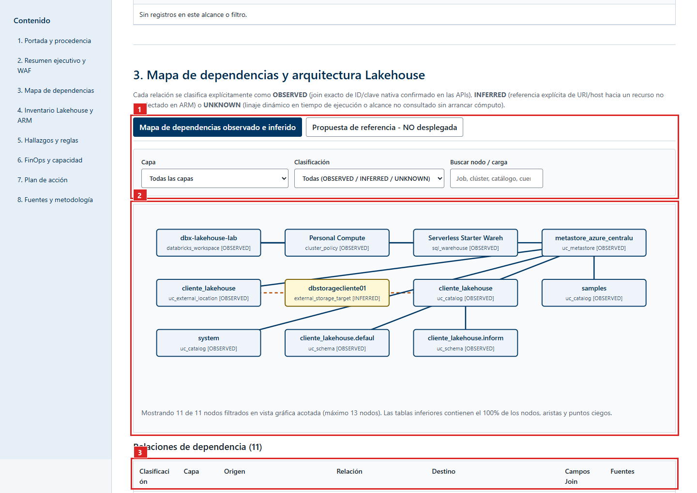 | 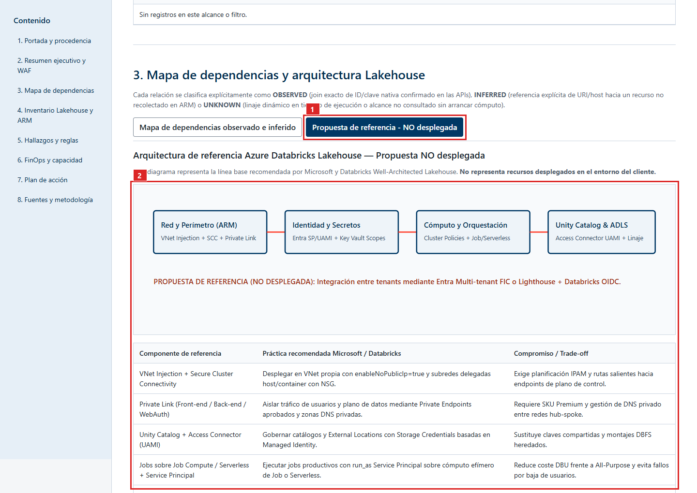 |
| **Mapa de dependencias** por capa y clasificación (OBSERVED / INFERRED / UNKNOWN) | **Arquitectura de referencia** Lakehouse (NO desplegada), separada de lo observado |
| 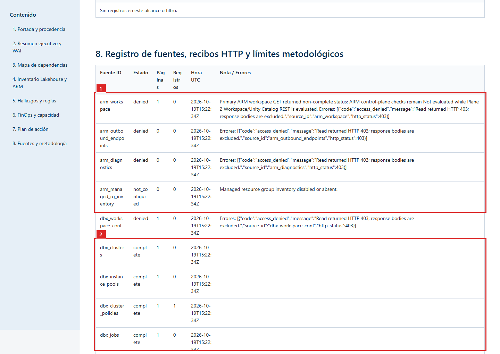 |  |
| **Cobertura**: cada fuente con su estado y código HTTP | **Lectura ejecutiva** con puntuación local junto a la cobertura |

> - La puntuación es un **indicador local**, no una certificación oficial. Se lee siempre junto a
>   la **cobertura**: «No evaluado» ≠ «correcto».
> - El linaje real de tablas y el consumo de DBUs (`system.*`) salen como **No evaluado** a
>   propósito: para leerlos habría que ejecutar SQL en un warehouse, y la herramienta nunca
>   arranca cómputo.

---

## Resolución de problemas

| Síntoma | Causa | Solución |
|---|---|---|
| `identity_mismatch` en cuanto se lee Azure | Se está usando un `.py` anterior al 16/11/2026 | Pegad el `.py` actual del repositorio ([Paso 3](#paso-3--crear-la-herramienta-python)) |
| `http_error` 404 en `arm_workspace` | Nombre, grupo de recursos o suscripción del workspace mal escritos en `APPROVED_WORKSPACES` | Revisad `APPROVED_WORKSPACES` y `SUBSCRIPTION_ID` ([Paso 2](#paso-2--configurar-el-py)) |
| `SyntaxError: invalid syntax` | Dos variables en la misma línea | Una variable por línea |
| `NameError: name 'CLIENT_LOGO_ALT' is not defined` | Al pegar se borró el tramo con `CLIENT_NAME` y el logo | Partid del `.py` del repositorio y pegad sin borrar ([Paso 2](#paso-2--configurar-el-py)) |
| `configuration_required` | Valores `<...>` o un valor mal escrito | [Paso 2](#paso-2--configurar-el-py) |
| `workspace_name must exactly match the fixed operator allowlist` | El nombre no está en `APPROVED_WORKSPACES` | Copiadlo tal cual de la prueba 1, o corregid `APPROVED_WORKSPACES` ([Paso 2](#paso-2--configurar-el-py)) |
| HTTP 504 en *Test playground* (~100 s) | Límite del playground, no de la herramienta | Lanzad el informe desde el chat |
| Fuentes `arm_…` en `denied` | Falta Reader o propagación | Persona 1; esperar 10 min |
| Fuentes `dbx_…` en `denied` | Service principal no añadido o sin `CAN_VIEW` | Persona 2 |
| Fuentes `uc_…` en `denied` | Sin `BROWSE`/`USE_CATALOG`/`USE_SCHEMA` | Persona 3 |
| `azure_cost` con HTTP 429 | Cost Management limita las peticiones seguidas | Esperad unos minutos y repetid |
| Jobs nuevos sin evaluar | Se crearon después del script | Volver a ejecutar el script |
| Sin costes | `cost_scope` en `disabled` | [Opcional: costes](#opcional-costes-finops) |
| *Save* / *Create tool* en gris | Aún no se ha pulsado **Test** en el playground | Primero **Test**; si sigue en gris tras un Test correcto, rol **SRE Agent Administrator** |
| Nombre de herramienta cortado (`generate-databricks-dependency-repor`) | *Tool Name* admite 36 caracteres | Recread la herramienta como `databricks-dependency-report`, o usad exactamente el nombre guardado en `SKILL.md`, instrucciones del subagente y *Choose tools* |
| El subagente usa otras herramientas | Lista de tools vacía | Seleccionar solo `databricks-dependency-report` |

---

## Ficheros de esta carpeta

| Fichero | Qué es |
|---|---|
| [`grant-databricks-permissions.ps1`](grant-databricks-permissions.ps1) | Permisos de solo lectura (Azure + workspace + Unity Catalog) y bloque de configuración |
| [`generate-databricks-dependency-report.py`](generate-databricks-dependency-report.py) | Herramienta Python (editar solo el bloque CONFIGURACION) |
| [`requirements.txt`](requirements.txt) | Paquetes Python de la herramienta (informativo: el entorno del SRE Agent ya los trae) |
| [`tool-parameters.schema.json`](tool-parameters.schema.json) | Los 12 parámetros (referencia; el portal los saca de `def main(...)`) |
| [`skills/databricks-dependency-live/SKILL.md`](skills/databricks-dependency-live/SKILL.md) | Skill |
| [`subagent-instructions-and-prompts.md`](subagent-instructions-and-prompts.md) | Instrucciones del subagente y prompts |
| [`README-tecnico-EN.md`](README-tecnico-EN.md) | Documentación técnica completa (inglés), incluido el modo *cross-tenant* |
