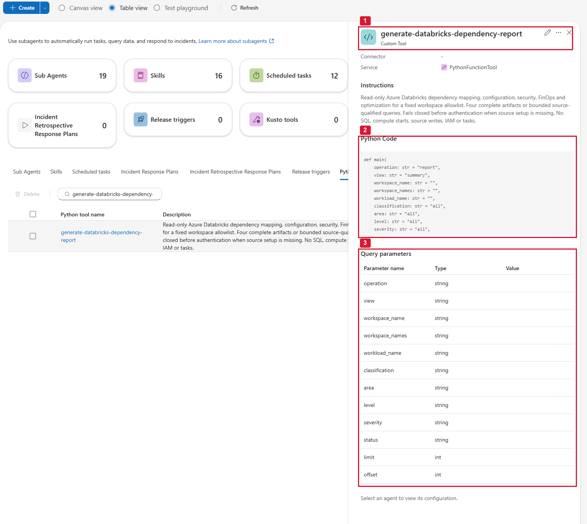
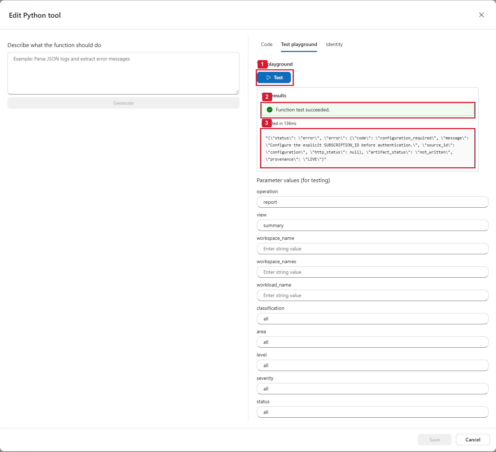
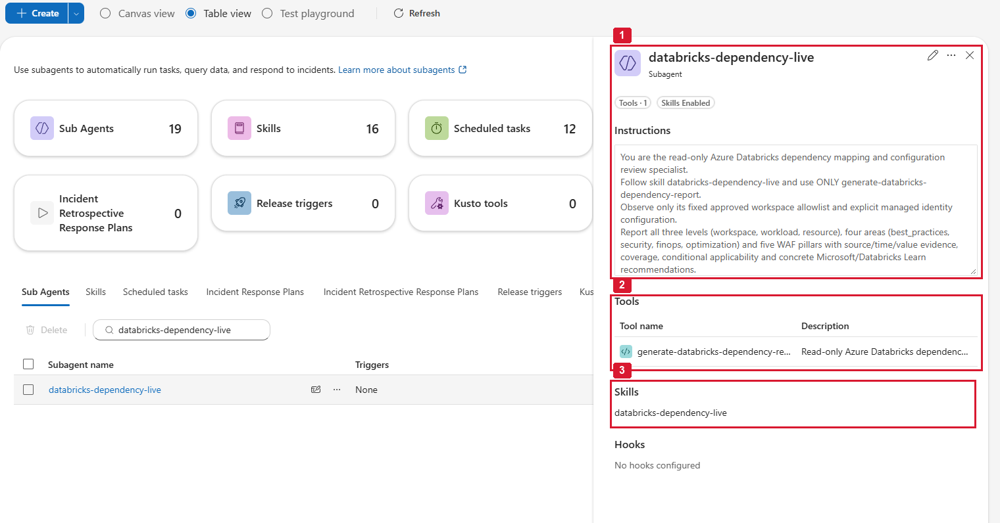
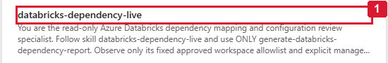
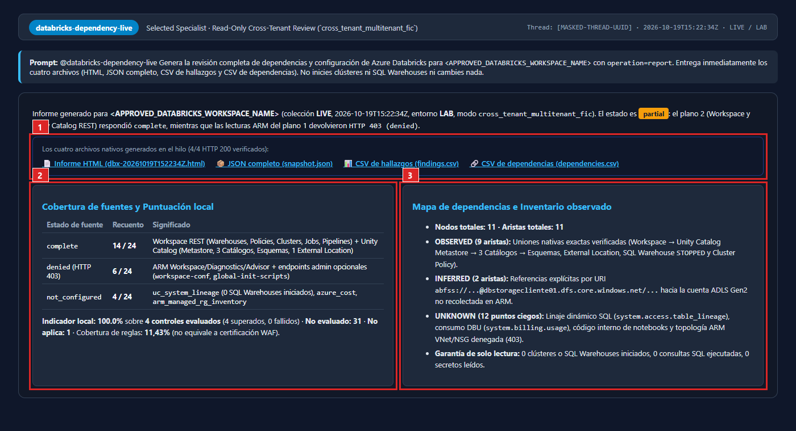

# Caso Databricks · Mapa de dependencias, configuración y FinOps

> **Azure SRE Agent** · Herramienta Python de solo lectura · Skill · Subagente restringido ·
> Informe HTML + JSON completo + CSV de hallazgos + CSV de dependencias

El subagente `databricks-dependency-live` revisa **hasta 5 workspaces de Azure Databricks** y genera
un informe con:

- **Mapa de dependencias**: qué jobs usan qué clústeres, qué pipelines, SQL warehouses, catálogos
  de Unity Catalog, almacenamiento, Key Vault, red… Cada relación se clasifica como **OBSERVED**
  (vista en la API), **INFERRED** (deducida de una URL/ruta) o **UNKNOWN** (punto ciego).
- **Configuración y seguridad**: workspace, red (VNet injection, Private Link, NPIP), clústeres,
  políticas, jobs, pipelines, warehouses, secretos, init scripts, Unity Catalog.
- **4 áreas** (buenas prácticas, seguridad, FinOps, optimización) y **5 pilares** Well-Architected.
- **Cobertura**: qué fuentes se pudieron leer y cuáles no (y por qué).
- **Arquitectura de referencia** Lakehouse de Microsoft, separada de lo observado.

No cambia nada: **solo lee metadatos**. Nunca arranca clústeres, nunca ejecuta SQL, nunca lee datos
de tablas ni ficheros.


---

## Ya tenéis el caso AKS desplegado: qué reutilizáis y qué es nuevo

Este caso es **independiente** del de AKS: tiene **su propia herramienta Python, su propio skill
y su propio subagente**. **No se toca nada del caso AKS** y no se mezclan: el subagente de AKS no
verá Databricks ni al revés.

Como ya desplegasteis AKS, **buena parte del trabajo ya está hecha**:

| Ya lo tenéis del caso AKS | Cómo se usa aquí |
|---|---|
| **El SRE Agent** | El **mismo** agente. No hay que crear otro |
| **La identidad del agente (Client ID)** | El **mismo** Client ID. Es el valor de `MANAGED_IDENTITY_CLIENT_ID` que pusisteis en el `.py` de AKS: copiadlo de ahí |
| **Roles en el SRE Agent** (quien configura y quien usa) | Los **mismos**. Quien creó la herramienta de AKS puede crear esta; quien usa `@aks-waf-live` puede usar `@databricks-dependency-live` |
| **PowerShell 7 + Azure CLI** | Igual. Mismo `az login --tenant <TENANT_ID>` |
| **Saber crear herramienta, skill y subagente** en el Builder | **Mismas pantallas y mismo orden**. Solo cambian nombre, código, parámetros e instrucciones |
| **Reader en Azure** | Si el script de AKS se ejecutó sobre el **Management Group** o la **suscripción** donde está el workspace de Databricks, la identidad **ya tiene Reader**. El script de Databricks lo detecta y lo deja como está (no duplica) |

**Lo nuevo** (y lo que de verdad lleva tiempo):

| # | Qué es nuevo | Quién lo hace | Dónde |
|---|---|---|---|
| 1 | Dar acceso a la identidad **dentro del workspace** de Databricks (service principal + `CAN_VIEW`) | **Workspace Admin** | [Paso 1](#paso-1--dar-permisos-a-la-identidad-del-agente) |
| 2 | Dar acceso de **solo metadatos** en **Unity Catalog** | **Metastore Admin** u **owner** del catálogo | [Paso 1](#paso-1--dar-permisos-a-la-identidad-del-agente) |
| 3 | Configurar **otro `.py`** (el de Databricks, no el de AKS) | Quien configura el agente | [Paso 2](#paso-2--configurar-el-py) |
| 4 | Crear una **herramienta nueva** `generate-databricks-dependency-report` | Quien configura el agente | [Paso 3](#paso-3--crear-la-herramienta-python) |
| 5 | Probarla en el **Test playground** | Quien configura el agente | [Paso 4](#-paso-4--test-playground-qué-valores-poner-en-cada-parámetro) |
| 6 | Crear un **skill nuevo** `databricks-dependency-live` | Quien configura el agente | [Paso 5](#paso-5--crear-el-skill) |
| 7 | Crear un **subagente nuevo** `databricks-dependency-live` | Quien configura el agente | [Paso 6](#paso-6--crear-el-subagente) |

> ⚠️ **Diferencias con AKS que suelen confundir**
>
> - **Es una herramienta NUEVA.** No editéis `generate-aks-waf-report`: usad **Create → Tool →
>   Python tool** y cread `generate-databricks-dependency-report`.
> - **Permisos en 3 sitios, no en 1.** En AKS bastaba con Azure. Aquí, además de Azure, hacen falta
>   el **Workspace Admin** y el **administrador de Unity Catalog**. Ser Owner de la suscripción **no**
>   da permisos dentro de Unity Catalog. Ver [⭐ Roles](#-roles-y-permisos-quién-necesita-qué-leer-antes-de-empezar).
> - **El parámetro del nombre SÍ lleva lista de valores.** En AKS quitasteis el enum de
>   `cluster_name`; aquí `workspace_name` **mantiene** el enum con los nombres de vuestros
>   workspaces (más `""`).
> - **Una suscripción por configuración:** el `.py` admite **hasta 5 workspaces de la misma
>   suscripción** (`SUBSCRIPTION_ID`).
> - **Solo lee metadatos:** nunca `SELECT`, nunca arranca clústeres, nunca lee datos.

**Tiempo estimado:** unos **45 minutos** si las personas con los roles de Databricks y Unity
Catalog están disponibles a la vez. Si no, el paso 1 se puede repartir (ver
[«Si lo hacen varias personas»](#si-lo-hacen-varias-personas-a-mano)).

---

## Índice

- [Ya tenéis el caso AKS desplegado: qué reutilizáis y qué es nuevo](#ya-tenéis-el-caso-aks-desplegado-qué-reutilizáis-y-qué-es-nuevo)
- [Antes de empezar: un solo tenant](#antes-de-empezar-un-solo-tenant)
- [⭐ Roles y permisos: quién necesita qué (leer antes de empezar)](#-roles-y-permisos-quién-necesita-qué-leer-antes-de-empezar)
- [Paso 1 · Dar permisos a la identidad del agente](#paso-1--dar-permisos-a-la-identidad-del-agente)
- [Paso 2 · Configurar el `.py`](#paso-2--configurar-el-py)
- [Paso 3 · Crear la herramienta Python](#paso-3--crear-la-herramienta-python)
- [⭐ Paso 4 · Test playground: qué valores poner en cada parámetro](#-paso-4--test-playground-qué-valores-poner-en-cada-parámetro)
- [Paso 5 · Crear el skill](#paso-5--crear-el-skill)
- [Paso 6 · Crear el subagente](#paso-6--crear-el-subagente)
- [Paso 7 · Probar en un chat nuevo](#paso-7--probar-en-un-chat-nuevo)
- [Qué comprobar en la prueba (checklist)](#qué-comprobar-en-la-prueba-checklist)
- [Qué muestra el informe](#qué-muestra-el-informe)
- [Resolución de problemas](#resolución-de-problemas)
- [Ficheros de esta carpeta](#ficheros-de-esta-carpeta)

---

## Antes de empezar: un solo tenant

Esta guía es para el caso habitual: **el SRE Agent y Databricks están en el mismo tenant de Entra
ID**. Por eso en la configuración:

- `SRE_TENANT_ID` y `TARGET_TENANT_ID` llevan **el mismo valor**.
- `auth_mode` es `"same_tenant_uami"`.
- `FEDERATED_APP_CLIENT_ID` y `KEYVAULT_OAUTH_SECRET_URI` se quedan **vacíos** (`""`).

(Si algún día está en otro tenant, el modo *cross-tenant* está en el
[README técnico en inglés](README-tecnico-EN.md#cross-tenant-feasibility-tenant-a-sre-agent-to-tenant-b-azure-databricks).)

La herramienta lee por **dos caminos**, y cada uno necesita sus permisos:

```
                    Identidad del SRE Agent (Client ID)
                     │                               │
     Plano 1 · Azure (ARM)                 Plano 2 · Dentro de Databricks
     rol Reader en la suscripción          service principal en el workspace
     ─ workspace, red, Private Link        ─ clústeres, políticas, jobs, pipelines,
     ─ RG gestionado databricks-rg-*         SQL warehouses, secret scopes (sin valores)
     ─ Key Vault, Storage asociados        ─ Unity Catalog: metastore, catálogos,
     ─ Advisor, costes (opcional)            esquemas, credenciales, external locations
```

Si falta el plano 2, el informe sale igual pero con esa parte en **«No evaluado»**.

---

## ⭐ Roles y permisos: quién necesita qué (leer antes de empezar)

> **Es el paso que más tiempo lleva.** Hay **tres sitios distintos** donde se dan permisos: Azure,
> el workspace de Databricks y Unity Catalog. Cada uno tiene su propio administrador. Antes de
> empezar, comprobad que **cada persona** tiene su rol **activo** (si usáis PIM, activado).

### R1 · Quién hace qué y qué rol necesita

| # | Persona (perfil típico) | Qué hace | Rol que **necesita** | Dónde se le asigna |
|---|---|---|---|---|
| 1 | **Administrador de Azure** | Da **Reader** a la identidad del agente (paso 1 del script) | **Owner**, **User Access Administrator** o **Role Based Access Control Administrator** en la **suscripción** del workspace. ❌ **Contributor NO sirve**: no puede asignar roles | Portal → suscripción → **Access control (IAM)** |
| 2 | **Administrador del workspace Databricks** | Añade la identidad como *service principal* y le da **CAN_VIEW** en jobs, pipelines y warehouses (paso 2 del script) | **Workspace Admin** en cada workspace | Ver R2 (cómo se consigue) |
| 3 | **Administrador de Unity Catalog** | Da `BROWSE`, `USE_CATALOG` y `USE_SCHEMA` en los catálogos (paso 3 del script) | **Metastore Admin**, o **owner** de cada catálogo, o el privilegio **`MANAGE`** en el catálogo | Databricks → **Catalog** → catálogo → **Permissions**; o la consola de cuenta para Metastore Admin |
| 4 | **Quien configura el SRE Agent** | Crea la herramienta, el skill y el subagente; usa *Test playground* | **SRE Agent Administrator**, o **SRE Agent Author + SRE Agent Standard User** (los dos juntos). ❌ Owner/Contributor de Azure **no** sustituyen a estos roles | Portal → recurso del **SRE Agent** → **Access control (IAM)** |
| 5 | **Usuarios** que piden informes | Chatean con `@databricks-dependency-live` | **SRE Agent Standard User** | Igual que el 4 |

> **Lo más rápido:** que **una sola persona** con **Owner** en la suscripción y **Metastore Admin**
> ejecute el script completo. Si eso no es posible, la persona 1 ejecuta solo la parte de Azure
> (`-SkipDatabricksGrants`) y las personas 2 y 3 hacen su parte (en el script o a mano, ver
> [Paso 1](#paso-1--dar-permisos-a-la-identidad-del-agente)).
>
> La persona que creó el SRE Agent ya tiene **SRE Agent Administrator** automáticamente. Si la
> persona 1 usa **Role Based Access Control Administrator con condiciones**, la condición debe
> permitir asignar a *Service principals* **Reader** (`acdd72a7-3385-48ef-bd42-f606fba81ae7`) y, si
> usáis costes, **Cost Management Reader** (`72fafb9e-0641-4937-9268-a91bfd8191a3`).

### R2 · Cómo ser *Workspace Admin* (persona 2) en 1 minuto

Un usuario con **Owner** o **Contributor** en Azure (en la suscripción o en el recurso del
workspace) se convierte **automáticamente en Workspace Admin** la primera vez que entra así:

**Portal de Azure → el workspace de Databricks → botón _Launch Workspace_.**

Hacedlo **antes** de ejecutar el script; si no, el script no podrá añadir el service principal.
Para comprobarlo: dentro del workspace, **Settings → Identity and access → Groups → admins** debe
incluir vuestro usuario.

### R3 · Comprobar vuestro propio rol de Azure antes de ejecutar

```powershell
az login --tenant <TENANT_ID>
az account set --subscription "<SUBSCRIPTION_ID_DEL_WORKSPACE>"
$me = az ad signed-in-user show --query id -o tsv
az role assignment list --assignee $me --all --include-inherited --include-groups `
    --query "[].{rol:roleDefinitionName, alcance:scope}" -o table
```

Debe aparecer **Owner**, **User Access Administrator** o **Role Based Access Control
Administrator** en `/subscriptions/<id>` (o en un Management Group por encima). Para el R2 hace
falta además **Owner** o **Contributor**.

Además, quien ejecuta el script necesita poder **leer la identidad en Entra ID** (`az ad sp show`).
Cualquier usuario miembro puede por defecto; si vuestro tenant lo restringe, pedid el rol de Entra
**Directory Readers**.

### R4 · Permisos que recibe la identidad del SRE Agent (todos de solo lectura)

| Dónde | Permiso | Para qué |
|---|---|---|
| Azure · suscripción | **Reader** | Leer el workspace, el RG gestionado `databricks-rg-*`, red, Private Link, Key Vault, Storage, Advisor |
| Azure · suscripción *(opcional)* | **Cost Management Reader** | Coste real (FinOps), ver [Paso 2](#paso-2--configurar-el-py) |
| Workspace Databricks | *Service principal* con **`workspace-access`** (sin admin) | Entrar en el workspace por API |
| Workspace Databricks | **CAN_VIEW** en cada job, pipeline y SQL warehouse existentes | Leer su configuración (no puede lanzarlos ni editarlos) |
| Unity Catalog | **`BROWSE`**, **`USE_CATALOG`**, **`USE_SCHEMA`** en cada catálogo | Leer **metadatos** de catálogos y esquemas. **Nunca** `SELECT` ni acceso a ficheros |

Nunca se da Contributor, Workspace Admin, `CAN_MANAGE`, `SELECT` ni nada que permita cambiar o leer datos.

> **Jobs, pipelines y warehouses nuevos:** el `CAN_VIEW` se da a los que existen al ejecutar el
> script. Si se crean nuevos, volved a ejecutarlo (no duplica nada).

### R5 · Errores típicos de roles

| Error | Causa | Solución |
|---|---|---|
| `AuthorizationFailed ... roleAssignments/write` | Quien ejecuta es **Contributor**, no puede asignar roles | Owner, User Access Administrator o RBAC Administrator en la suscripción |
| `No se pudo anadir el service principal` (401/403) | No sois **Workspace Admin** | Hacer [R2](#r2--cómo-ser-workspace-admin-persona-2-en-1-minuto) y volver a ejecutar |
| `Catalogo X: ... hace falta ser owner del catalogo o metastore admin` | Sin permisos de Unity Catalog | La persona 3 lo hace a mano (SQL en [Paso 1](#paso-1--dar-permisos-a-la-identidad-del-agente)) |
| `No encuentro la identidad con Client ID` | Se copió el *Object ID*, o `az login` en otro tenant | Copiar el **Client ID** y `az login --tenant` |
| `No se pudo obtener token de Databricks con tu usuario` | Sesión de `az` caducada o en otro tenant | `az login --tenant <TENANT_ID>` y volver a ejecutar |
| `No se han encontrado workspaces de Databricks` | Suscripción equivocada o `-Workspaces` mal escrito | `-SubscriptionId` correcto; formato `rg/nombre` |
| Rol PIM asignado pero falla | Rol **elegible**, no activado | Activarlo en PIM, esperar 1–2 min |
| Todo OK pero el agente da **403** | Propagación | Esperar **5–10 min** |
| No se puede guardar en el Builder | Falta el rol del SRE Agent | **SRE Agent Administrator** (o Author + Standard User) |

---

## Paso 1 · Dar permisos a la identidad del agente

**Dónde está el Client ID del agente:** sre.azure.com → vuestro agente → **Settings → Azure
settings → Managed Identity → Go to Identity → Overview → Client ID** (no el *Object ID*).

En PowerShell 7, dentro de esta carpeta (`02-databricks-dependency-review`):

```powershell
az login --tenant <TENANT_ID>
az account set --subscription "<SUBSCRIPTION_ID_DEL_WORKSPACE>"
.\grant-databricks-permissions.ps1 -IdentityClientId "<CLIENT_ID_SRE_AGENT>"
```

Opciones:

| Opción | Qué hace | ¿Cuándo usarla? |
|---|---|---|
| `-IdentityClientId` | Client ID de la identidad del SRE Agent (**obligatorio**) | Siempre |
| `-SubscriptionId` | Suscripción del workspace (si no, usa la activa) | Si tenéis varias |
| `-Workspaces "rg/nombre"` | Solo esos workspaces (máximo 5) | Si en la suscripción hay más de 5, o para probar con uno |
| `-SkipDatabricksGrants` | Solo da **Reader** en Azure (no toca Databricks) | Si la persona 1 no es Workspace Admin |
| `-SkipUnityCatalog` | No toca Unity Catalog | Si la persona que ejecuta no es Metastore Admin / owner |

El script tiene **3 partes** y va mostrando `[OK]` o `[AVISO]` en cada una:

1. **Azure:** `Reader` en la suscripción.
2. **Databricks** (por cada workspace): añade el service principal y da `CAN_VIEW` en jobs,
   pipelines y SQL warehouses.
3. **Unity Catalog**: `BROWSE`, `USE_CATALOG` y `USE_SCHEMA` en cada catálogo (salta `system`,
   `hive_metastore`, `samples`).

Al final imprime **el bloque de configuración** para pegar en el `.py` (paso 2) y **la lista para
el parámetro `workspace_name`** (paso 3).

> Se puede **volver a ejecutar** sin problema: lo que ya existe lo deja como está.

### Si lo hacen varias personas (a mano)

**Persona 1 (Azure):**

```powershell
.\grant-databricks-permissions.ps1 -IdentityClientId "<CLIENT_ID_SRE_AGENT>" -SkipDatabricksGrants
```

**Persona 2 (Workspace Admin), en el portal de Databricks:**

1. **Settings → Identity and access → Service principals → Manage → Add service principal →
   Add new**.
2. Elegir **Microsoft Entra ID managed**, pegar el **Client ID** del agente como *Application ID* y
   un nombre (p. ej. `sre-agent`). **Add**.
3. En el service principal: dejar solo **Workspace access** (sin *admin*).
4. En cada **job**, **pipeline** y **SQL warehouse**: **Permissions → añadir el service principal →
   Can View**.

O ejecutando el script completo **sin** Unity Catalog:
`.\grant-databricks-permissions.ps1 -IdentityClientId "<CLIENT_ID_SRE_AGENT>" -SkipUnityCatalog`.

**Persona 3 (Unity Catalog)**, en un notebook o en el **SQL editor**, por cada catálogo:

```sql
GRANT BROWSE, USE CATALOG, USE SCHEMA ON CATALOG `<catalogo>` TO `<CLIENT_ID_SRE_AGENT>`;
```

(El service principal se nombra con su **Client ID** entre comillas invertidas.)

### Opcional: costes (FinOps)

Para que el informe muestre el coste real del RG gestionado (VMs, discos, red de los clústeres):

```powershell
az role assignment create --assignee "<CLIENT_ID_SRE_AGENT>" --role "Cost Management Reader" `
    --scope "/subscriptions/<SUBSCRIPTION_ID_DEL_WORKSPACE>"
```

Y en el paso 2 poned `"cost_scope": "managed_resource_group"`. Para esta primera prueba se puede
dejar en `"disabled"`.

---

## Paso 2 · Configurar el `.py`

Abrid [`generate-databricks-dependency-report.py`](generate-databricks-dependency-report.py) en un
editor de texto (Bloc de notas, VS Code…). **Solo se edita el bloque de arriba**, entre
`CONFIGURACION (editar solo esto)` y `FIN CONFIGURACION`.

El script imprime las líneas `SUBSCRIPTION_ID` … `KEYVAULT_OAUTH_SECRET_URI` y el
`APPROVED_WORKSPACES` completo: **sustituid esas líneas** por las impresas y **dejad las de
`CLIENT_NAME`, `CLIENT_LOGO_DATA_URI` y `CLIENT_LOGO_ALT`** (podéis cambiar el nombre que sale en
el informe). Queda así (valores de ejemplo):

```python
# ===================== CONFIGURACION (editar solo esto) =====================
SUBSCRIPTION_ID = "aaaaaaaa-0000-0000-0000-000000000001"
SRE_TENANT_ID = "11111111-1111-1111-1111-111111111111"
TARGET_TENANT_ID = "11111111-1111-1111-1111-111111111111"     # el MISMO que SRE_TENANT_ID
MANAGED_IDENTITY_CLIENT_ID = "33333333-3333-3333-3333-333333333333"
FEDERATED_APP_CLIENT_ID = ""                                   # vacío
KEYVAULT_OAUTH_SECRET_URI = ""                                 # vacío
CLIENT_NAME = 'Mi empresa'                                     # nombre que sale en el informe
CLIENT_LOGO_DATA_URI = ""                                      # opcional
CLIENT_LOGO_ALT = 'Logotipo del cliente'
APPROVED_WORKSPACES = {
    "dbw-datos-pro": {                                         # nombre EXACTO del workspace
        "resource_group": "rg-datos",
        "workspace_host": "adb-1234567890123456.7.azuredatabricks.net",   # sin https://
        "environment": "PRODUCTION",                           # LAB, PRODUCTION o UNSPECIFIED
        "auth_mode": "same_tenant_uami",
        "workspace_api_enabled": True,
        "unity_catalog_enabled": True,
        "include_managed_resource_group": True,
        "advisor_enabled": True,
        "approved_related_resource_ids": [],
        "approved_cost_resource_ids": [],
        "cost_scope": "disabled",                              # o "managed_resource_group"
        "cost_timeframe": "month_to_date",
        "requirements": {},
    }
}
# =================== FIN CONFIGURACION ===================
```

Qué es cada valor y de dónde sale:

| Variable | De dónde sale |
|---|---|
| `SUBSCRIPTION_ID` | Suscripción del workspace (el script la imprime) |
| `SRE_TENANT_ID` / `TARGET_TENANT_ID` | Vuestro tenant (`az account show --query tenantId -o tsv`); **los dos iguales** |
| `MANAGED_IDENTITY_CLIENT_ID` | Client ID del agente ([Paso 1](#paso-1--dar-permisos-a-la-identidad-del-agente)) |
| Nombre del workspace (la clave) | Portal → Databricks → nombre del recurso |
| `workspace_host` | Portal → workspace → **URL** (`adb-….azuredatabricks.net`, **sin** `https://` ni `/`) |
| `unity_catalog_enabled` | `False` si el workspace no usa Unity Catalog |

> ⚠️ **Errores típicos al pegar**
> - Cada variable en **su propia línea**. Si queda `"..."CLIENT_NAME = "..."` en la misma línea,
>   la prueba da `SyntaxError: invalid syntax`.
> - `True`/`False` con mayúscula inicial (es Python).
> - No toquéis nada por debajo de `FIN CONFIGURACION`.

---

## Paso 3 · Crear la herramienta Python

1. **sre.azure.com → vuestro agente → Builder → Agent Canvas → flecha junto a _Create_ → Tool →
   Python tool**.

   

   **1** pulsad la **flecha** de *Create* (no el botón: ese abre el formulario de subagente) ·
   **2** **Tool → Python tool**.

2. Pestaña **Code** (no uséis *Generate*):
   - **Name:** `generate-databricks-dependency-report`
   - **Description** (copiar tal cual):
     ```text
     Read-only Azure Databricks dependency, configuration, security and FinOps review for the fixed approved workspaces. Collect source-qualified ARM, Databricks workspace and Unity Catalog evidence; return offline HTML, complete JSON, findings CSV and inventory CSV, or bounded typed queries. No remediation.
     ```
   - **Code:** pegad el `.py` **completo** ya configurado en el paso 2.
   - **Requirements:** el contenido de [`requirements.txt`](requirements.txt).
   - **Timeout:** `900` segundos.

   

   **1** nombre `generate-databricks-dependency-report` y timeout `900` · **2** editor donde se
   pega el fichero completo (en la captura está tapado a propósito).

3. Pestaña **Identity**: **Enable Azure Identity en Off**. El código ya usa la identidad del agente
   por su Client ID.

   

   **1** pestaña **Identity** · **2** interruptor en **Off**.

4. **Parámetros (12).** Tipos y valores por defecto (referencia completa en
   [`tool-parameters.schema.json`](tool-parameters.schema.json)):

   | Parámetro | Tipo | Por defecto | Valores |
   |---|---|---|---|
   | `operation` | string | `report` | `report`, `query`, `list_workspaces` |
   | `view` | string | `summary` | `summary`, `workspace`, `compute`, `jobs`, `pipelines`, `warehouses`, `unity_catalog`, `resources`, `findings`, `finops`, `coverage`, `actions`, `dependencies` |
   | `workspace_name` | string | `""` | ⚠️ **Enum: cambiadlo** (ver abajo) |
   | `workspace_names` | string | `""` | Hasta 5 nombres separados por comas, **sin espacios** |
   | `workload_name` | string | `""` | Filtro exacto (clúster, job, pipeline, warehouse, catálogo…) |
   | `classification` | string | `all` | `all`, `OBSERVED`, `INFERRED`, `UNKNOWN` |
   | `area` | string | `all` | `all`, `best_practices`, `security`, `finops`, `optimization` |
   | `level` | string | `all` | `all`, `workspace`, `workload`, `resource` |
   | `severity` | string | `all` | `all`, `critical`, `high`, `medium`, `low` |
   | `status` | string | `all` | `all`, `passed`, `failed`, `not_evaluated`, `not_applicable`, `complete`, `partial`, `denied`, `error`, `not_configured` |
   | `limit` | **int** | `25` | 1–100 |
   | `offset` | **int** | `0` | 0 o más |

   > ⚠️ **`workspace_name` — el único valor que hay que cambiar en los parámetros.** En el esquema
   > viene con los valores permitidos `""` y `<NOMBRE_WORKSPACE_DATABRICKS>`. **Sustituid
   > `<NOMBRE_WORKSPACE_DATABRICKS>` por el nombre exacto de vuestro(s) workspace(s)**, dejando
   > también `""`. Es la lista que imprime el script al final, por ejemplo:
   > `["", "dbw-datos-pro", "dbw-datos-lab"]`. Los nombres tienen que ser **idénticos** a las
   > claves de `APPROVED_WORKSPACES`.

   

   **1** nombre de la herramienta · **2** firma de `main` · **3** los 12 parámetros
   (`limit` y `offset` como **int**).

5. **Create tool** / **Save**, y pasad al paso 4 (pruebas).

---

## ⭐ Paso 4 · Test playground: qué valores poner en cada parámetro

En la herramienta (**Builder → Agent Canvas → `generate-databricks-dependency-report` → Test
playground**) se ven los 12 parámetros con un valor ya escrito. **Ese valor es el correcto para
casi todos.** Solo hay que cambiar 1–3 campos según la prueba.

### Reglas para que no dé error

1. **Nunca dejéis vacíos** `operation`, `view`, `classification`, `area`, `level`, `severity` ni
   `status`. Vacío da `invalid_parameter … must use its declared enum`. Sus valores son `report`,
   `summary`, `all`, `all`, `all`, `all`, `all`.
2. **`limit` y `offset` son números**: `25` y `0`.
3. Con **`report`** y **`list_workspaces`**, los filtros se quedan **por defecto**: `view=summary`,
   `classification/area/level/severity/status=all`, `workload_name` vacío, `limit=25`,
   `offset=0`. Si cambiáis uno, da `invalid_combination`.
4. **`workspace_name` o `workspace_names`, nunca los dos.** En `list_workspaces`, **los dos vacíos**.
5. Si dejáis `workspace_name` **vacío** en `report` o `query`, se usa el **primer workspace de la
   lista**. En las pruebas, **elegid siempre el nombre** en el desplegable.

### Prueba 1 · Configuración (segundos, no llama a Azure)

| Parámetro | Valor |
|---|---|
| `operation` | **`list_workspaces`** ← cambiar |
| `view` | `summary` |
| `workspace_name` | *(vacío)* |
| `workspace_names` | *(vacío)* |
| `workload_name` | *(vacío)* |
| `classification`, `area`, `level`, `severity`, `status` | `all` |
| `limit` | `25` |
| `offset` | `0` |

Resultado esperado:

```json
{
  "status": "ok",
  "operation": "list_workspaces",
  "available_workspaces": [
    { "workspace_name": "dbw-datos-pro", "resource_group": "rg-datos",
      "workspace_host": "adb-1234567890123456.7.azuredatabricks.net",
      "environment": "PRODUCTION", "auth_mode": "same_tenant_uami", "cross_tenant": false }
  ],
  "total": 1
}
```

> Si sale **«Function test succeeded»** pero dentro pone `"code": "configuration_required"`, la
> herramienta funciona pero el bloque CONFIGURACION aún tiene valores `<...>`: volved al paso 2.
>
> 
>
> **1** botón **Test** · **2** «Function test succeeded» solo significa que el código se ejecutó ·
> **3** el resultado real: `configuration_required`.

### Prueba 2 · Permisos (1–3 min)

Es la que confirma que los **roles** de los 3 sitios (Azure, workspace, Unity Catalog) están bien.

| Parámetro | Valor |
|---|---|
| `operation` | **`query`** ← cambiar |
| `view` | **`coverage`** ← cambiar |
| `workspace_name` | **`<vuestro workspace>`** ← elegir |
| resto | por defecto (`workspace_names` y `workload_name` vacíos; `all`; `25`; `0`) |

Resultado esperado: `status: ok` y una fila por fuente con su estado. Cómo leerlo:

| Fuentes que empiezan por… | Si salen `denied` | Arreglo |
|---|---|---|
| `arm_…` (Azure) | Falta **Reader** en la suscripción | Persona 1 · [R1](#r1--quién-hace-qué-y-qué-rol-necesita) |
| `dbx_…` (workspace) | El service principal no está en el workspace o le falta `CAN_VIEW` | Persona 2 |
| `uc_…` (Unity Catalog) | Faltan `BROWSE` / `USE_CATALOG` / `USE_SCHEMA` | Persona 3 |

| Estado | Significa |
|---|---|
| `complete` | Leída entera |
| `partial` | Leída en parte (ver motivo) |
| `denied` | **Sin permiso** (o aún propagándose: esperad 10 min) |
| `not_configured` | Desactivada en la configuración (p. ej. costes en `disabled`) |
| `error` | Fallo de la fuente (ver mensaje) |

### Prueba 3 · Informe completo (2–10 min)

| Parámetro | Valor |
|---|---|
| `operation` | `report` (el valor por defecto) |
| `workspace_name` | **`<vuestro workspace>`** ← elegir |
| resto | **todo por defecto** (regla 3) |

Debe terminar con `status: ok`. Los 4 ficheros descargables se ven mejor desde el **chat**
([Paso 7](#paso-7--probar-en-un-chat-nuevo)).

### Errores del playground y cómo arreglarlos

| Error que devuelve | Causa | Arreglo |
|---|---|---|
| `SyntaxError: invalid syntax` | Dos variables en la misma línea al pegar | Una variable por línea en el bloque CONFIGURACION |
| `configuration_required` | Quedan valores `<...>` o un valor mal escrito (`environment`, `workspace_host`…) | [Paso 2](#paso-2--configurar-el-py) |
| `cross_tenant_configuration_required` | `SRE_TENANT_ID` y `TARGET_TENANT_ID` distintos | Poner **el mismo** tenant en los dos |
| `invalid_parameter` … `must use its declared enum` | Un campo vacío o con valor no permitido; o `workspace_name` no está en el enum | Valor por defecto (regla 1); añadir el nombre al enum ([Paso 3](#paso-3--crear-la-herramienta-python)) |
| `invalid_parameter` … `limit must be an integer` | `limit` vacío o con texto | `25` |
| `invalid_parameter` … `without spaces` | `workspace_names` con espacios o más de 5 | `ws-a,ws-b` sin espacios |
| `invalid_combination` … `cannot be narrowed by query filters or paging` | En `report`/`list_workspaces` se cambió `view`, `area`, `limit`… | Todo por defecto salvo el nombre |
| `invalid_combination` … `lists the complete fixed roster` | En `list_workspaces` se eligió un workspace | Vaciar `workspace_name` |
| `invalid_combination` … `not both` | `workspace_name` y `workspace_names` a la vez | Usar solo uno |
| Fuentes `denied` | Roles sin dar o propagándose | [Roles R1–R5](#-roles-y-permisos-quién-necesita-qué-leer-antes-de-empezar) |

---

## Paso 5 · Crear el skill

**Builder → Agent Canvas → flecha de _Create_ → Skill**:

- **Name:** `databricks-dependency-live`
- **Contenido:** pegad [`skills/databricks-dependency-live/SKILL.md`](skills/databricks-dependency-live/SKILL.md).
- **Tools:** **solo** `generate-databricks-dependency-report`.


**1** nombre del skill · **2** única herramienta adjunta · **3** `SKILL.md` completo.

---

## Paso 6 · Crear el subagente

**Builder → Agent Canvas → _Create_ (botón) → Custom Agent**:

- **Name:** `databricks-dependency-live`
- **Instructions:** el bloque *Copy-ready instructions* de
  [`subagent-instructions-and-prompts.md`](subagent-instructions-and-prompts.md).
- **Tools:** **solo** `generate-databricks-dependency-report` (**no lo dejéis vacío**: vacío puede
  heredar todas las herramientas globales).
- **Skills:** **solo** `databricks-dependency-live`.



**1** nombre e instrucciones · **2** solo la herramienta de Databricks · **3** solo el skill
`databricks-dependency-live`.


**1** skill seleccionado · **2** herramienta seleccionada · **3** *Save* deshabilitado = ya está
guardado. (Los contadores globales de herramientas/skills que se ven arriba son del agente, no del
subagente: lo que cuenta son los chips seleccionados.)

---

## Paso 7 · Probar en un chat nuevo

1. **New chat** → escribid `/agent` → elegid **`databricks-dependency-live`**.

   

   

2. Primero la lista:

   ```text
   @databricks-dependency-live Lista los workspaces aprobados con operation=list_workspaces.
   ```

3. Después el informe:

   ```text
   @databricks-dependency-live Genera el informe completo de dependencias y configuración de Databricks para <workspace> con operation=report.
   ```

   

   **1** los **4 ficheros** descargables · **2** cobertura de fuentes y puntuación local · **3**
   relaciones OBSERVED / INFERRED / UNKNOWN. *(Captura de ejemplo de otro entorno.)*

Más prompts (dependencias, Unity Catalog, FinOps, cobertura), en castellano e inglés, en
[`subagent-instructions-and-prompts.md`](subagent-instructions-and-prompts.md) y al final del
[README técnico](README-tecnico-EN.md#copy-ready-bilingual-qa-prompt-pack-castellano--english):

```text
@databricks-dependency-live Usa query/dependencies con classification=UNKNOWN para <workspace>. ¿Qué puntos ciegos hay?
@databricks-dependency-live Usa query/findings con area=security y status=failed para <workspace>.
@databricks-dependency-live Usa query/unity_catalog para <workspace>. Resume catálogos, esquemas y external locations.
@databricks-dependency-live Usa query/coverage para <workspace>. ¿Qué fuentes fallaron y por qué?
```

---

## Qué comprobar en la prueba (checklist)

| ✔ | Comprobación | Dónde |
|---|---|---|
| ☐ | Cada persona tiene su rol activo (R1) | [Roles](#-roles-y-permisos-quién-necesita-qué-leer-antes-de-empezar) |
| ☐ | El script termina con `[OK]` en las 3 partes (o se hizo a mano) | PowerShell |
| ☐ | Prueba 1: `list_workspaces` → `status: ok` y vuestros workspaces | Test playground |
| ☐ | Prueba 2: `query/coverage` → fuentes `arm_`, `dbx_` y `uc_` en `complete` | Test playground |
| ☐ | Prueba 3: `report` → `status: ok` | Test playground |
| ☐ | Chat: el subagente entrega los **4 ficheros** | Chat |
| ☐ | El HTML abre en el navegador y muestra el mapa de dependencias | Navegador |
| ☐ | Anotad dudas o hallazgos para la siguiente sesión | — |

---

## Qué muestra el informe

El subagente entrega **4 ficheros descargables**:

| Fichero | Para qué |
|---|---|
| `*.html` | Informe visual, se abre en el navegador (sin conexión) |
| `*-snapshot.json` | Todos los datos, para automatizar o comparar |
| `*-findings.csv` | Hallazgos fallidos, para Excel / backlog |
| `*-dependencies.csv` | Relaciones entre componentes |

| | |
|---|---|
|  |  |
| **Mapa de dependencias** por capa y clasificación (OBSERVED / INFERRED / UNKNOWN) | **Arquitectura de referencia** Lakehouse (NO desplegada), separada de lo observado |
|  |  |
| **Cobertura**: cada fuente con su estado y código HTTP | **Lectura ejecutiva** con puntuación local junto a la cobertura |

> - La puntuación es un **indicador local**, no una certificación oficial. Se lee siempre junto a
>   la **cobertura**: «No evaluado» ≠ «correcto».
> - El linaje real de tablas y el consumo de DBUs (`system.*`) salen como **No evaluado** a
>   propósito: para leerlos habría que ejecutar SQL en un warehouse, y la herramienta nunca
>   arranca cómputo.

---

## Resolución de problemas

| Síntoma | Causa | Solución |
|---|---|---|
| `SyntaxError: invalid syntax` | Dos variables en la misma línea | Una variable por línea |
| `configuration_required` | Valores `<...>` o un valor mal escrito | [Paso 2](#paso-2--configurar-el-py) |
| `invalid_parameter` con el nombre del workspace | No está en el enum de `workspace_name` o no coincide con `APPROVED_WORKSPACES` | [Paso 3](#paso-3--crear-la-herramienta-python), punto 4 |
| Fuentes `arm_…` en `denied` | Falta Reader o propagación | Persona 1; esperar 10 min |
| Fuentes `dbx_…` en `denied` | Service principal no añadido o sin `CAN_VIEW` | Persona 2 |
| Fuentes `uc_…` en `denied` | Sin `BROWSE`/`USE_CATALOG`/`USE_SCHEMA` | Persona 3 |
| Jobs nuevos sin evaluar | Se crearon después del script | Volver a ejecutar el script |
| Sin costes | `cost_scope` en `disabled` | [Opcional: costes](#opcional-costes-finops) |
| El subagente usa otras herramientas | Lista de tools vacía | Seleccionar solo `generate-databricks-dependency-report` |

---

## Ficheros de esta carpeta

| Fichero | Qué es |
|---|---|
| [`grant-databricks-permissions.ps1`](grant-databricks-permissions.ps1) | Permisos de solo lectura (Azure + workspace + Unity Catalog) y bloque de configuración |
| [`generate-databricks-dependency-report.py`](generate-databricks-dependency-report.py) | Herramienta Python (editar solo el bloque CONFIGURACION) |
| [`requirements.txt`](requirements.txt) | Paquetes Python de la herramienta |
| [`tool-parameters.schema.json`](tool-parameters.schema.json) | Los 12 parámetros |
| [`skills/databricks-dependency-live/SKILL.md`](skills/databricks-dependency-live/SKILL.md) | Skill |
| [`subagent-instructions-and-prompts.md`](subagent-instructions-and-prompts.md) | Instrucciones del subagente y prompts |
| [`README-tecnico-EN.md`](README-tecnico-EN.md) | Documentación técnica completa (inglés), incluido el modo *cross-tenant* |
