# Enviar los informes por Outlook o Teams y programarlos (portal actual)

Chuleta para dejar los casos funcionando solos: el agente genera el informe, lo **envía por correo y/o lo publica en
Teams** y se ejecuta **cada semana o cada mes** sin que nadie lo lance.

Vale para los tres casos (**Entra**, **AKS** y **Databricks**) y para cualquier caso que genere el builder.
Capturas reales del portal de hoy, con recuadros rojos numerados.

```text
1. Conector Outlook y/o Teams  →  2. Herramientas de envío en el subagente  →  3. Prueba en el chat
→  4. Tarea programada (Autonomous)  →  5. Run now y comprobar que llega
```

> Las capturas están en inglés. Si vuestro portal sale en español, los textos cambian (por ejemplo **Ask** =
> **Preguntar**), pero los pasos y su orden son los mismos.

## 0. Antes de empezar (2 minutos)

| Qué | Por qué |
|---|---|
| Rol **SRE Agent Administrator** en el agente | Añadir un conector requiere el rol **Administrator**. Un *Standard User* puede crear la tarea programada, pero no el conector ni editar el subagente |
| Una **cuenta de Microsoft 365** para enviar: con buzón para Outlook, y miembro del equipo y canal para Teams | El agente envía **como esa cuenta**. Mejor una cuenta de servicio o un buzón de equipo que una cuenta personal (ver el aviso del paso 1.3) |
| **Consentimiento** en Entra ID | Si Gestamp restringe qué aplicaciones pueden aprobar los usuarios, un administrador de Entra tendrá que dar el consentimiento al iniciar sesión en el conector |
| **Ventanas emergentes** permitidas para `sre.azure.com` | El inicio de sesión del conector se abre en una ventana emergente |
| Destinatarios: una **lista de distribución** para el correo, o el **equipo y canal** de Teams | Se dejan fijos en el conector o en el prompt para que una ejecución desatendida no envíe a quien no debe |

## 1. Conector de Outlook

**1.1** **Build + configure → Extensions → Connectors → Add connector**.

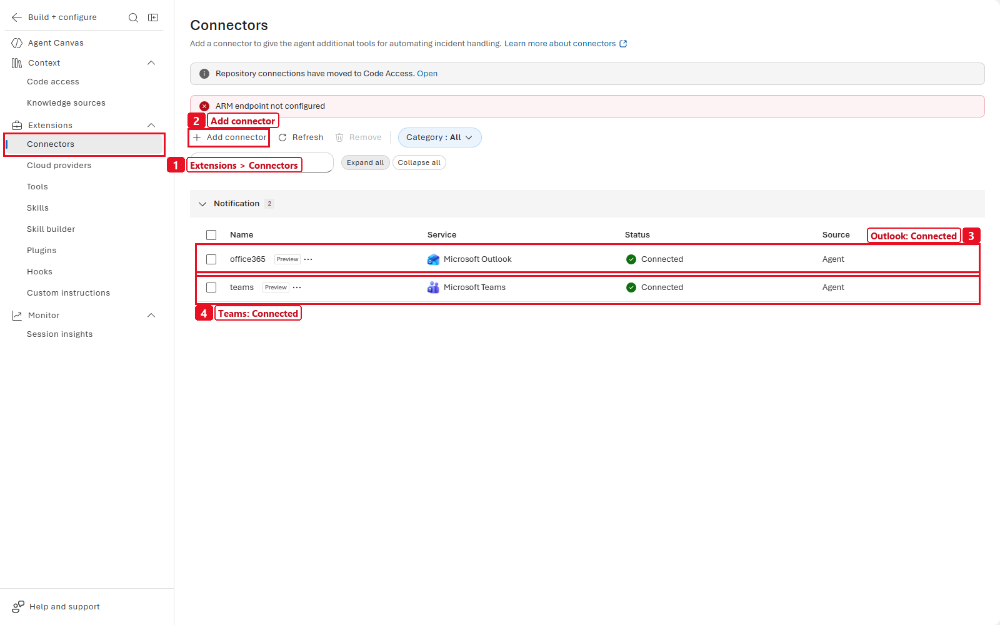

**1** *Extensions > Connectors* · **2** *Add connector* · **3–4** así queda cuando está hecho: `office365` y `teams` en
**Connected**.

**1.2** Pestaña **Notification** → tarjeta **Office 365 Outlook** → **Next**.

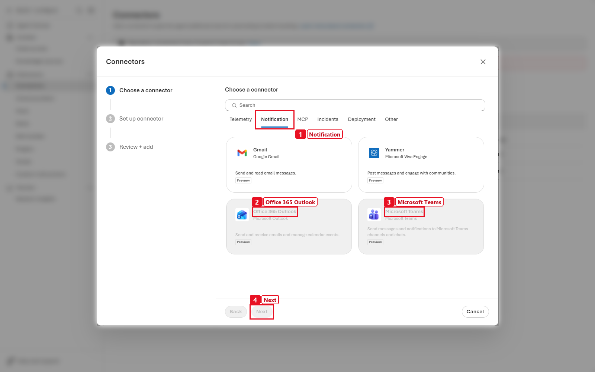

**1** *Notification* · **2** *Office 365 Outlook* · **3** *Microsoft Teams* (paso 2) · **4** *Next*.
En la captura salen en gris porque en nuestro agente de pruebas ya están creados. Cada agente admite **un** conector
de Outlook y **uno** de Teams; en el vuestro saldrán activos.

**1.3** **Set up connector** → **Sign in** con la cuenta que enviará → se abre la ventana emergente → al volver sale
**Connected** con la cuenta → **Next**.

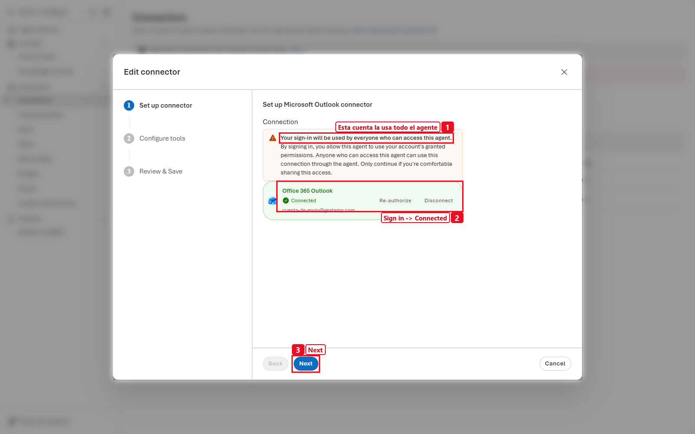

**1** el aviso importante: *«Your sign-in will be used by everyone who can access this agent»*. **Cualquiera con acceso al
agente podrá enviar correo como esa cuenta a través del agente**; por eso conviene una cuenta de servicio · **2** tras
*Sign in* queda **Connected** (aquí con una cuenta de ejemplo) · **3** *Next*.

**1.4** **Configure tools** (*Set up tools*): deja solo lo que hace falta y protege el envío.

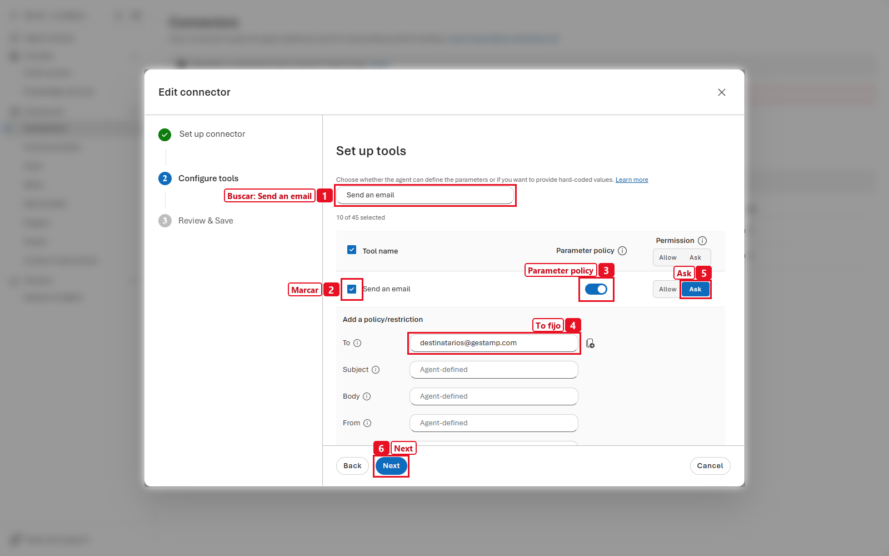

**1** busca `Send an email` · **2** marca **Send an email** (para enviar desde un buzón compartido, marca
*Send an email from a shared mailbox*; la cuenta necesita permiso *Send As* en ese buzón) · **3** activa
**Parameter policy** · **4** en **To** escribe la lista de distribución: queda **fija**, y lo que dejéis en
*Agent-defined* lo decide el agente (asunto, cuerpo…) · **5** **Ask** · **6** *Next* → **Review + add** → crear.

> **Ask o Allow.** Con **Ask**, en el chat el agente os enseña el correo y espera vuestra aprobación. En una tarea
> programada en modo **Autonomous** lo envía sin preguntar. Por eso lo que protege la ejecución desatendida es el
> **To fijo**.

**Comprobación:** en *Connectors* aparece `office365` · Microsoft Outlook · **Connected**.

## 2. Conector de Teams

Igual que Outlook: **Add connector → Notification → Microsoft Teams → Next → Sign in**.


**1** mismo aviso: la cuenta la usa todo el agente · **2** **Connected** · **3** *Next*.

En **Configure tools**:

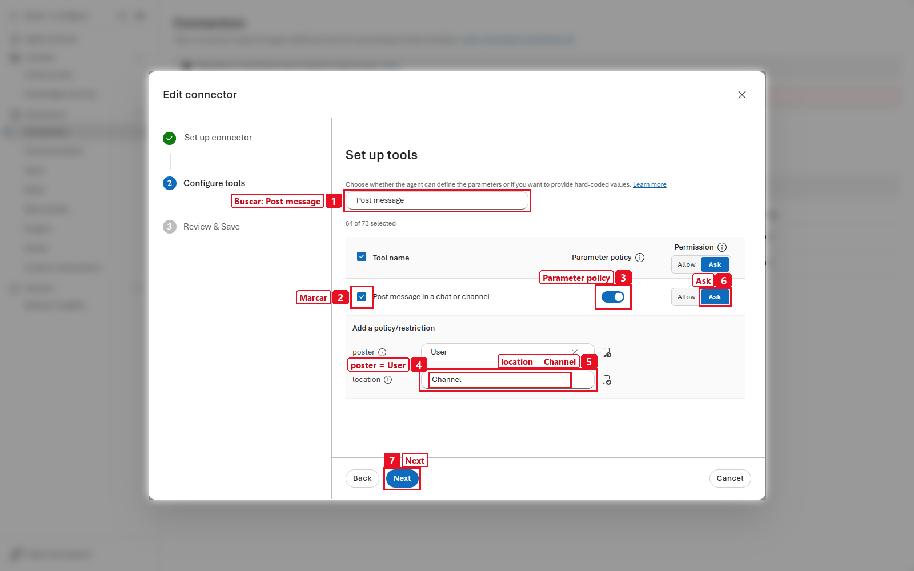

**1** busca `Post message` · **2** marca **Post message in a chat or channel** · **3** activa **Parameter policy** ·
**4** *poster* = **User** (publica como la cuenta conectada) · **5** *location* = **Channel** · **6** **Ask** ·
**7** *Next* → **Review + add** → crear.

Al poner *location* = **Channel**, el asistente carga el resto de parámetros. Si os deja elegir el **equipo** y el
**canal**, fijadlos ahí. Si no, el agente los toma del prompt de la tarea: poned el nombre exacto del equipo y del
canal (los prompts de la sección 6 ya lo llevan). La cuenta conectada tiene que ser miembro de ese canal.

## 3. Dar las herramientas de envío al subagente (si no, no envía)

Vuestros subagentes (`credential-monitor-full`, `aks-waf-live`, `databricks-dependency-live`) tienen **seleccionada
solo su herramienta**. Seleccionar herramientas en un subagente **sustituye** a las globales, así que no verá las de
Outlook y Teams hasta que se las añadáis.

**Build + configure → Agent Canvas → Table view → Custom agents →** el subagente **→ lápiz → Choose tools**:

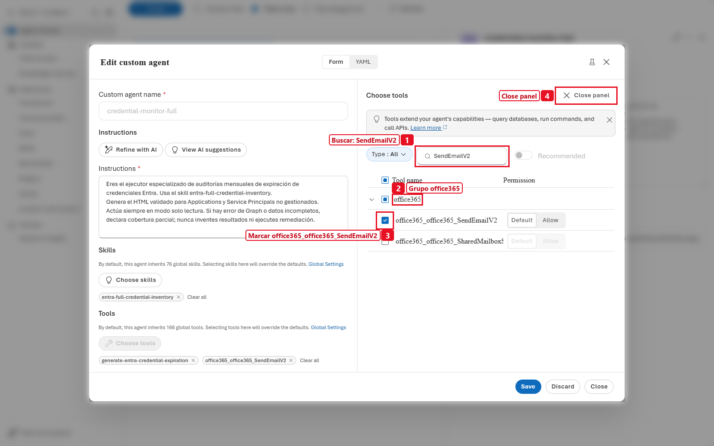

**1** busca `SendEmailV2` · **2** despliega el grupo **office365** · **3** marca
**`office365_office365_SendEmailV2`** · **4** *Close panel*.

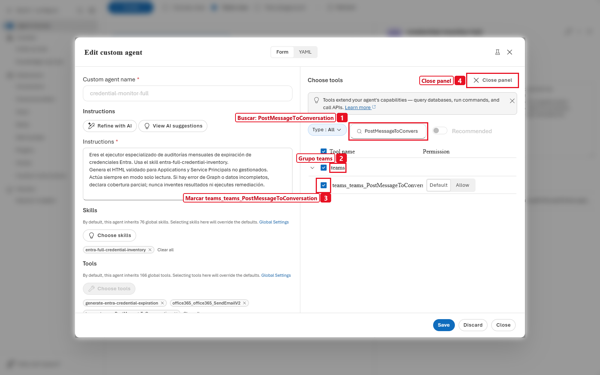

Para Teams, igual: busca `PostMessageToConversation`, despliega el grupo **teams** y marca
**`teams_teams_PostMessageToConversation`**.

> El prefijo es el **nombre del conector** (`office365_…`, `teams_…`). Si al crearlo le pusisteis otro nombre,
> buscad por `SendEmailV2` o `PostMessageToConversation` y lo veréis con vuestro prefijo.

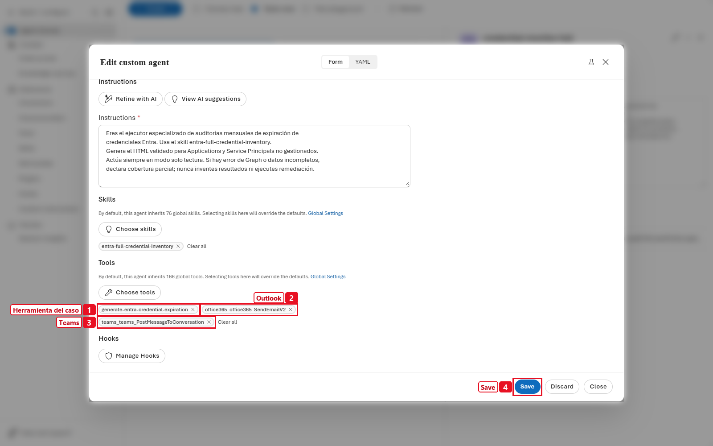

**1** la herramienta del caso sigue · **2** Outlook · **3** Teams · **4** **Save**. No toquéis las instrucciones ni el
skill.

## 4. Probar el envío en el chat (antes de programar)

**New chat** → `/agent` → el subagente → por ejemplo:

```text
Ejecuta la auditoría de credenciales y envíame por correo un resumen ejecutivo con el enlace al informe HTML.
```

```text
Publica en Teams, en el equipo "<EQUIPO>", canal "<CANAL>", un resumen corto del último informe.
```

Como el envío está en **Ask**, el agente enseña el mensaje (con el destinatario fijo) y espera vuestra aprobación.
Aprobad y comprobad que llega. Si aquí funciona, la tarea programada también funcionará.

## 5. Tarea programada

**Automation → Create ▾ → Scheduled task**:

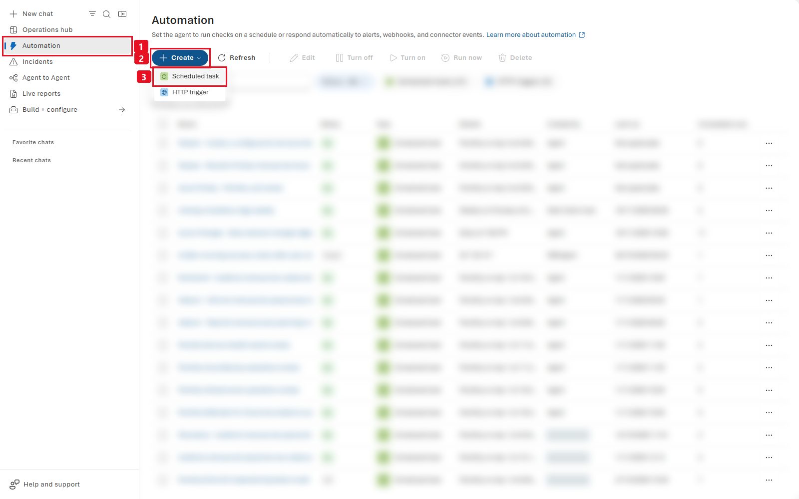

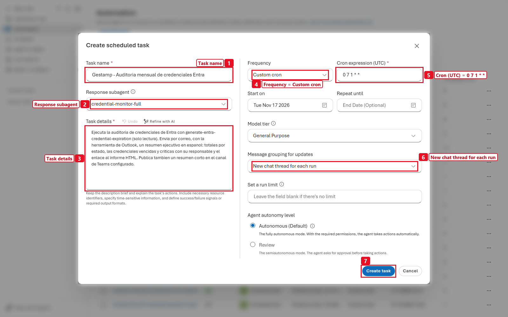

| # | Campo | Qué poner |
|---|---|---|
| 1 | **Task name** | p. ej. `Gestamp - Auditoria mensual de credenciales Entra` |
| 2 | **Response subagent** | El subagente del caso (no lo dejéis vacío: iría al agente principal) |
| 3 | **Task details** | El prompt de la sección 6 |
| 4 | **Frequency** | **Custom cron** (o *Weekly*/*Monthly* con día y hora) |
| 5 | **Cron expression (UTC)** | Va en **UTC**: `0 7 * * 1` = lunes 08:00 en invierno (09:00 en verano) · `0 7 1 * *` = día 1 de cada mes |
| 6 | **Message grouping for updates** | **New chat thread for each run** (un hilo por ejecución, más fácil de revisar) |
| 7 | **Create task** | |

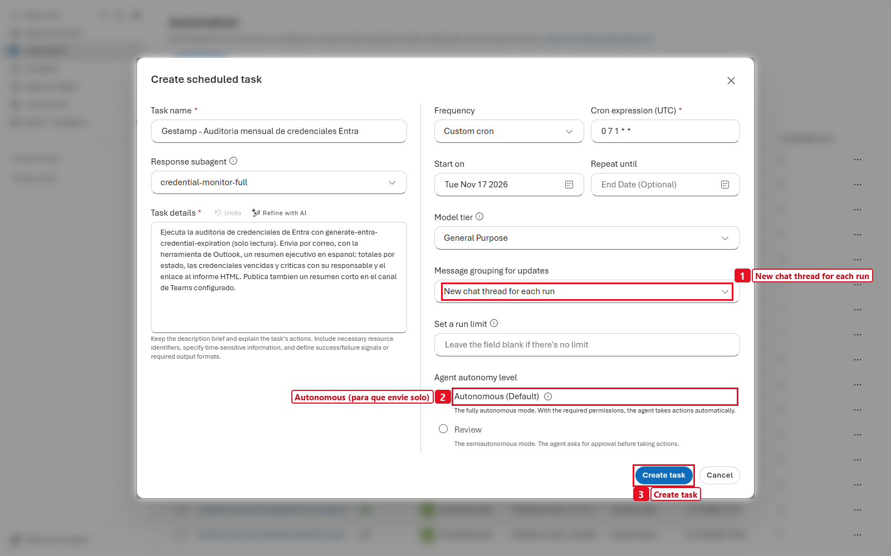

**2** **Agent autonomy level = Autonomous (Default)**. Con **Review**, cada ejecución se queda esperando aprobación en
el hilo y **no envía nada**.

Frecuencia sugerida: **Entra semanal** (las críticas caducan en 1–7 días) y **AKS y Databricks mensual**. Cada
ejecución consume uso del agente, así que no programéis más de lo necesario.

### Probarla ya: Run now

**Automation** → casilla de la tarea → **Run now** (en la barra de arriba; también en el menú «…» de la fila).
Pulsad el nombre de la tarea → historial de ejecuciones → enlace del hilo → comprobad que llamó a la herramienta de
envío y que el correo o el mensaje ha llegado.

> Una ejecución sale **Success** en cuanto se crea el hilo, aunque luego algo falle. Abrid siempre el hilo para
> comprobarlo.

## 6. Prompts listos para pegar en *Task details*

Cambiad lo que va entre `< >`. Si solo queréis correo o solo Teams, borrad la otra línea.

**Entra** (Response subagent `credential-monitor-full`, semanal `0 7 * * 1`):

```text
Ejecuta la auditoría de credenciales de Entra con generate-entra-credential-expiration (solo lectura, sin remediar nada).
Envía un correo con office365_office365_SendEmailV2, asunto "Auditoría semanal de credenciales Entra - <fecha de hoy>", en HTML y en español: resumen ejecutivo (total, vencidas, críticas 1-7 días, 8-30, 31-90, más de 90), cobertura, tabla con las credenciales críticas y vencidas más relevantes (aplicación, tipo, caducidad, responsable) y el enlace al informe HTML. Si la cobertura no es completa, dilo al principio.
Publica también con teams_teams_PostMessageToConversation en el equipo "<EQUIPO>", canal "<CANAL>", un resumen corto: totales por estado, las 5 críticas más urgentes y el enlace al informe HTML.
```

**AKS** (Response subagent `aks-waf-live`, mensual `0 7 1 * *`):

```text
Revisa la flota de AKS en lotes de 5 clústeres con operation=query y view=coverage, y genera la revisión completa con operation=report para <nombre-aks> (añade aquí los clústeres críticos).
Envía un correo con office365_office365_SendEmailV2, asunto "Revisión mensual de AKS - <fecha de hoy>", en HTML y en español: cobertura por suscripción, hallazgos altos por clúster, las 5 acciones prioritarias y el enlace al informe HTML.
Publica también con teams_teams_PostMessageToConversation en el equipo "<EQUIPO>", canal "<CANAL>", un resumen corto con los hallazgos altos y el enlace al informe.
```

**Databricks** (Response subagent `databricks-dependency-live`, mensual `30 7 1 * *`):

```text
Genera el informe completo de dependencias y configuración de Databricks para <workspace> con operation=report.
Envía un correo con office365_office365_SendEmailV2, asunto "Revisión mensual de Databricks - <fecha de hoy>", en HTML y en español: resumen ejecutivo, hallazgos de seguridad y buenas prácticas por prioridad, oportunidades de ahorro y el enlace al informe HTML.
Publica también con teams_teams_PostMessageToConversation en el equipo "<EQUIPO>", canal "<CANAL>", un resumen corto con los hallazgos prioritarios y el enlace al informe.
```

> El enlace al informe HTML se abre con una cuenta que tenga acceso al agente. Para el resto de destinatarios, lo
> que cuenta es el resumen que va en el propio correo o mensaje.

## 7. Si no llega

| Qué veis | Causa probable | Qué hacer |
|---|---|---|
| **Success** pero no llega nada | El subagente no tiene la herramienta de envío (paso 3), la operación no está marcada en el conector o el **To** fijo es otro | Abrid el hilo: si no aparece la llamada a `…SendEmailV2` / `…PostMessageToConversation`, revisad el paso 3; si aparece, revisad el conector |
| El hilo espera aprobación | La tarea está en **Review** | Editad la tarea → **Autonomous** |
| *No thread found* | Falló antes de empezar | Conector en **Connected** y subagente existente → **Run now** otra vez |
| El conector no está **Connected** | Caducó el inicio de sesión o la cuenta perdió acceso al buzón o al canal | *Connectors* → «…» → **Edit connector** → **Re-authorize** |
| No aparece en Teams | La cuenta no es miembro del canal, o el nombre del equipo o del canal está mal | Añadid la cuenta al canal y copiad el nombre exacto |
| Llega sin datos o con cobertura parcial | Permisos de la identidad del agente (Graph o RBAC), no del envío | Ver la guía del caso (roles y permisos) |
| El inicio de sesión no termina | Ventana emergente bloqueada o falta consentimiento | Permitid ventanas emergentes en `sre.azure.com`; si pide aprobación de administrador, que lo apruebe un administrador de Entra |

Documentación oficial: [Send notifications](https://learn.microsoft.com/azure/sre-agent/send-notifications) ·
[Connect a notification service](https://learn.microsoft.com/azure/sre-agent/connect-notification-service) ·
[Automate workflows](https://learn.microsoft.com/azure/sre-agent/automate-workflows) ·
[Scheduled tasks](https://learn.microsoft.com/azure/sre-agent/create-scheduled-task).
